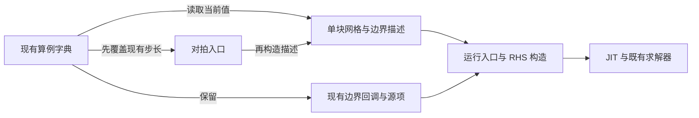

## Goal Capsule

在现有单块计算中引入统一的网格与边界描述，并实际接入运行链，为后续边界迁移和多块计算提供入口。保持现有算例、命令行和数值行为，以 Step 0 JAX 基准验证。

## Product Contract

### Summary

Step 1 是从当前算例字典过渡到网格及边界描述的第一步。它必须在现有运行链中有实际用途，同时沿用已有 `Grid`、边界执行逻辑和求解器；后续网格格式为 CGNS，本步不实现解析或多块交换。

### Requirements

- R1. 现有 Sod、TG、Poiseuille、channel、plate 均能构造与实际单块网格、方向及边界行为相符的描述；当前参数和入口继续可用。
- R2. 描述在真实运行链中被读取和使用，不能只创建一个没有消费者的对象。具体切入点见 Planning Contract 和 U3。
- R3. 兼容现有 `Grid` 和算例接口，明确过渡期间新旧信息的来源及同步责任；不能让两份可独立修改的配置悄悄分歧。
- R4. 保留六个方向侧的表达能力，准确反映槽道双壁、平板入口与出口及上下侧不同边界；对当前轴级复合标志不能虚构成已独立实现的边界处理。
- R5. 保留当前计算轴、数组轴和原码边界标志的关系，尤其是平板 `dif_axis_map`；计算步长、度量及边界带参数的口径保持不变。
- R6. 普通边界的执行仍由现有代码负责；边界描述不应声称替代当前的壁面状态更新、鬼胞填充或粘性通量处理。
- R7. 已提供的真实坐标、度量应能按现有口径关联到单块；对没有显式坐标或度量的内置算例，不伪造数据，也不迫使其新增网格文件。
- R8. 为后续多块接口留出可扩展位置，但第 1 步只要求单块：不推断接口的连接、索引映射或方向变换，不把占位字段当作已支持的能力。
- R9. 重构后保留命令行、算例构造及已使用的对拍入口；与 Step 0 的七个 JAX 用例比较，在记录的相同环境下通过既定检查。不同环境或预期数值变化应说明差异，不覆盖原基准。

### Scope Boundaries

不在本步迁移普通边界实现，不实现 `input.json`、CGNS 文件解析、多块拓扑匹配、halo 交换、多 GPU 或新输出格式。这些分别属于后续步骤；现有求解算法、时间推进、物性和输出行为应保持原状。

### Relationship to Later Steps

| 后续工作 | Step 1 应提供的基础 | 现在不提前决定 |
|---|---|---|
| Step 2：普通边界迁移 | 每侧边界的可识别描述及现有行为的兼容关系 | 新边界执行接口与所有物理公式 |
| Step 3：运行配置 | 可由其他来源构造的单块描述 | JSON 字段和边界覆盖规则 |
| Step 4：CGNS 读取 | 网格和边界描述的接收位置 | 未核实的文件版本、边界分区、参数与连接约定 |
| Step 5：case 插件 | 描述与算例特有初值、源项职责的区分 | 插件具体接口和迁移方式 |
| Step 6～7：多块与粘性 | 可扩展的块、边界和接口概念 | 匹配、旋转、交换与粘性同步细节 |
| Step 8～9：输出与多 GPU | 保留网格身份和块的概念 | 存储布局、并行划分与设备通信 |

### Acceptance Examples

- A1. 对槽道真网格，现有命令行得到相同网格维数、方向、度量和边界带设置；Step 0 单步结果通过基准检查。
- A2. 对平板，入口/出口和壁面/远场保持不对称，原码方向映射不变；Step 0 平板单步结果通过检查。
- A3. Sod、TG、Poiseuille 和小网格槽道仍可运行，固定步长与 CFL 用例的结果和元数据通过 Step 0 检查。
- A4. 现有对拍入口仍可取得原有网格、步长与边界信息；其覆盖情况由执行计划列出并验证。

### Planning Context

- 现有 `compare.py` 会在构造后覆盖 `case["dxs"]`；接入新描述时应确定唯一更新路径，避免运行链与对拍使用不同步长。
- 当前 channel 构造度量时坐标是局部变量，其他内置算例没有同一种坐标表示；计划需先确认现有消费者和内存成本，再确定是否保存坐标引用。
- `MeshData`、`BlockMesh`、`BoundarySpec`、`FaceBoundary`、`InterfaceMap` 是原方案提出的候选名称，不要求预先全部实现。第 1 步只固定当前需要的职责与能验证的接口。

### Evidence

`src/fields.py` 定义 `Grid`、轴级边界标志和鬼胞填充；`src/cases.py` 构造各算例的网格、边界、度量和方向映射；`src/run.py` 在 RHS 构造时读取这些值；`src/compare.py` 还会覆盖步长。Step 0 说明和检查方式见 `experiment/README.md`。

---

## Planning Contract

**需求变更记录：** Summary、Scope Boundaries 和后续步骤表中的 Gridgen 已按 jisen 的新决定改为 CGNS；R1～R9 与 A1～A4 的范围保持不变。

### Key Technical Decisions

- KTD1. 过渡期保留现有算例字典为唯一可变来源；在消费者入口从该字典生成只读单块描述。描述不与旧键并列保存为可独立修改的第二份状态。修改在创建 JIT 闭包前完成；闭包建立后不承诺动态更新。
- KTD2. 正式运行的 `run()` 与 `build_rhs()` 通过描述取得网格、步长、轴、边界及度量信息；原 `Grid`、旧键和原始边界回调继续可用。对拍入口在覆盖 `case["dxs"]` 后生成描述，保持其既有计算参数，不顺手改变对拍算法。
- KTD3. 区分轴级执行标志与面侧描述。槽道双壁和平板各侧信息用于描述，不直接驱动新的边界填充；保留平板回调、零状态鬼层、`dif_axis_map=(0,2,1)`、槽道每子步回调及 source。
- KTD4. 复用已存在的 `Grid` 和度量引用；channel 读取真网格时，把已有内区原始坐标保存在 case 中并按引用关联到描述，不保留补鬼层坐标。这样会增加三份内区坐标数组的常驻内存；无显式坐标或度量时保持 `None`，不构造虚拟坐标。
- KTD5. 首版表示一个块及可描述的六侧；不创建未使用的多块映射、CGNS 节点模型或自动推断规则。后续 CGNS 文件及参数来源须结合样例再设计。

### Data Flow

图表示数据依赖；对拍使用独立的描述实例，不要求复用运行入口对象。

### Assumptions and Deferred Items

- CGNS 作为后续输入格式已确定；文件样例、库、边界数值参数来源、索引变换和连接覆盖范围留待第 4 步及多块计划核实，本步不依赖外部 CGNS API。
- `tests/` 被仓库 `.gitignore` 排除，新增可长期保留的测试须放在可追踪位置，或以明确的仓库约定保管；不得悄悄依赖本机忽略文件。
- `compare.py` 目前直接调用 RHS 时未传 `dif_bound` 和 `dif_axis_map`。本步以现有行为为基准，是否改变对拍口径另行处理。

---

## Implementation Units

### U1. 固定现有算例和消费者行为

**目标：** 在改动数据流前记录现有五类算例的网格、边界、轴和可选字段行为。对应 R1、R3～R7、R9，依赖 Step 0 现有基准。

**文件：** `src/cases.py`、`src/fields.py`、`src/run.py`、`src/compare.py`；新增 `experiment/test_step1_mesh.py`；参考 `tests/test_channel_case.py`、`tests/test_plate_boundaries.py`、`tests/test_boundary_bands.py`、`tests/test_compare_chain.py`。

**方法：** 先对现有入口补行为刻画；确认旧键的有无、步长覆盖先后、度量有无、平板的轴级复合标志与 callback。测试依据运行可见行为，不把数据类内部结构当成行为。

**测试场景：** 五类算例尺寸、步长和轴一致；槽道 `metrics=None` 与真网格度量两种路径；平板 `dif_axis_map` 和左右侧真实语义；对拍步长覆盖后其后续消费者可见新值；构造前后旧入口不受影响。无 CGNS 样例时不加入虚构解析测试。

**验收：** 改动前记录测试及 Step 0 的结果，测试在相同环境可复跑，缺数据和环境不兼容单独记录。

### U2. 建立可适配的单块描述

**目标：** 将现有数据转换为单块及六侧描述，保留轴级执行行为。对应 R1、R3～R8，依赖 U1。

**文件：** 新增 `src/mesh_data.py`；按需要修改 `src/cases.py`；扩展 `experiment/test_step1_mesh.py`。

**方法：** 描述引用既有 `Grid`、步长、求解轴、轴级边界标志、已有度量和边界带映射；读取真网格时由 case 保留内区原始坐标，描述引用它。六侧提供可辨识的描述，复合边界注明仍由原回调执行。定义可从现有 case 即时构造的适配入口；不要重复存储可变状态、猜测坐标或新增未使用接口类。无度量保持 `None`；不改变 JAX 数组及计算表达式。

**测试场景：** 槽道六侧和壁面执行来源正确；平板四个非对称侧和周期侧正确且 `INFLOW`/`PLATE` 保持执行标志；不同算例缺省度量保留 `None`；真网格内区坐标与输入一致且描述引用 case 的原始坐标，补鬼层坐标不被保留；无坐标时不伪造；读取更新后的 case 步长得到更新结果；非法或不能准确表示的边界信息明确报错，不回退出流。

**验收：** 适配器既能表达现状，也能保持旧入口，且测试覆盖二维和三维算例。

### U3. 接入正式运行链与对拍消费者

**目标：** 真实运行链消费单块描述，同时保持现有入口和数值。对应 R2、R3、R5～R7、R9 与 A1～A4，依赖 U2。

**文件：** `src/run.py`、`src/compare.py`；按需调整 `src/cases.py`；扩展 `experiment/test_step1_mesh.py`；核查 `experiment/compare_ocfd_jax.py`。

**方法：** 在 `run()` 和 `build_rhs()` 各自的入口按当前 case 适配，并从描述读取已覆盖的网格信息；不改 callback、source、RHS 次序、滤波或时间推进。`compare.py` 沿用旧步长覆盖后再获取描述；保持其原有 RHS 参数，确保与 `experiment/compare_ocfd_jax.py` 的旧访问兼容。确认外部可能在构造 `build_rhs` 前调整 case 的入口仍可见调整。

**测试场景：** 用替换的步长构造描述和 RHS 前捕获相同值；平板回调、槽道 callback/source 仍在原阶段运行；现有 CLI、`build_case`、`build_rhs` 和对拍读取旧字段均可调用；一处有意识的边界或步长调整不会被旧快照遮蔽。测试 JIT 捕获发生在配置完成之后。

**验收：** 描述确由运行入口使用；无额外边界执行；已有接口不出现两套状态分叉。

### U4. 基准与交付说明

**目标：** 验证重构未改变现有 JAX 计算，并让后续步骤能够复用结果。对应 R9 与 A1～A4，依赖 U3。

**文件：** `experiment/README.md`、`src/README.md`；必要时在可追踪目录保存测试与本次回归结果；不修改 `experiment/baseline/`。

**测试场景：** Step 0 七例、80 个场与相同 Windows CPU 环境的基准逐字段对照，包括 CFL 元数据；执行网格、槽道、平板、轴映射与对拍相关测试；说明已有跳过、缺网格或平台路径问题。若 CLI 或对拍测试因环境受阻，报告准确限制。

**验收：** 记录环境、命令入口、测试结果和差异；默认零容差通过。若存在数值差异，定位并解释，不覆盖基准、不静默放宽阈值；必要时停止并交由用户决定。

---

## Verification Contract

执行 AI 先运行相关现有测试并记录基线，再添加针对描述与消费者的行为测试。实现后运行 U1～U3 场景及现有单块测试，使用 `experiment/run_step0.py` 生成独立候选，再由 `experiment/check_step0.py` 对照七个 JAX 基准；不要覆盖 `experiment/baseline/`。原版 OCFD 对拍不属于此步骤的门槛。输出报告须区分通过、已知失败、跳过与无法运行。

## Definition of Done

- 五类算例通过适配进入真实运行链，旧命令行与对拍入口可用，步长覆盖没有状态分叉。
- 槽道、平板两侧语义和轴映射保持原样；边界回调、求解和输出路径未迁移。
- 持久测试可追踪，Step 0 七例在可比环境下通过；若不通过则提供差异并停止交付为完成。
- 文档说明过渡期数据来源与 CGNS 后续边界；未声称本步支持 CGNS 读取或多块交换。
