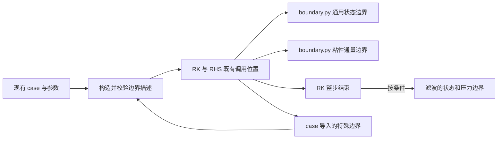

## Goal Capsule

把 JAX 已有的单块边界行为整理到统一边界模块，并保留后续添加边界的入口。以现有 JAX 算例和 Step 0 基准保证迁移不改变数值；OCFD 中尚未迁移的边界作为后续候选，逐项确定物理定义和验证方式。

## Product Contract

### Summary

Step 2 将已有的周期、出流、槽道壁面及平板入口、壁面和远场中的通用边界行为迁到 `boundary.py`。特殊边界由 case 侧导入和选择，并按约定接入运行流程；本步保留后续扩展的途径，沿用单块网格与已有 case 包装接口，不要求先实现 CGNS 读取或多块通信。

### Requirements

- R1. 迁移现有周期和出流的填充行为，并保持各算例现有轴向、鬼胞层数及角点处理次序。
- R2. 保留槽道上、下壁的无滑移、等温及绝热分支，壁温可分别指定；保留其壁面压力、温度处理与镜像规则。
- R3. 保留平板入口、出口、下壁和上方来流的现有不对称行为，保持物理边界点、鬼胞及角点处理顺序；不将平板和槽道不同的壁面外推公式混为一谈。
- R4. 守恒量状态、派生量、粘性通量及滤波等其他需要边界处理的场，分别按现有处理对象和阶段迁移；不把 Ev 镜像当成普通状态镜像。
- R5. 保留每个 RK 子步及整步中的边界调用时机、无粘和粘性路径、`DIF_BOUND` 和平板轴映射；普通边界迁移不改变源项、时间推进或差分格式。
- R6. 通用边界在 `boundary.py` 实现；特殊边界由 case 侧导入、选择并按约定接入。当前 `channel.py`、`plate.py` 可保留兼容包装，算例体积力及特殊物理能力不被普通边界迁移吞并；完整 case 插件化仍属后续步骤。
- R7. 提供添加通用边界和 case 特殊边界的明确扩展位置，使后续新增类型及参数不需要把普通边界逻辑散回求解器和算例；未知或缺少必要信息的边界明确报错，不静默改为出流。
- R8. Step 2 完成时，正式运行链中本步迁移的现有边界应由一致的边界描述选择和执行，保持与旧入口的兼容；处理 Step 1 中轴级 `bcs` 与六侧描述可能分歧的问题，禁止两套配置各自决定行为。
- R9. 维持现有入口及七个 Step 0 JAX 用例的可比行为，核对边界点、鬼胞、角点及槽道和平板 RHS；不覆盖现有基准。

### Step 1 Review Prerequisites

- `src/mesh_data.py::from_case` 在识别 `plate` 或 `channel_bc` 后使用固定的六侧表，不核对实际 `bcs`。例如改动槽道 x 轴为出流后，描述仍报告周期；Step 2 不能让这种描述直接控制执行。
- `_channel_faces` 的说明将两侧都写为等温，但 `src/channel.py::_wall_layer` 在 `Tw <= 0` 时执行绝热分支，且上下壁温可以不同。至少要让边界处理或描述准确携带各侧的热条件和所需参数。
- 现有 Step 0 候选报告记录 7 个用例、80 个场 PASS；该候选是在提交前的脏工作区生成，且基准和运行检查脚本当前未被版本控制跟踪。后续执行前应确认基准及脚本可取得，并在修改前记录当前工作区的验证状态。

### OCFD Boundary Inventory

工作区兄弟目录中的 OCFD 目前通过 `../OpenCFD-SCU-v3.0/src/OCFD_boundary.cu::OCFD_bc` 按 `IBC_USER` 选择算例边界；下表是阅读当前源码得到的候选能力，不代表已形成通用注册表或已在 JAX 中对齐。

| 原码位置 | 可供迁移的行为 | Step 2 范围 |
|---|---|---|
| `channel_flow.cu`，IBC=200 | 上下无滑移壁；各侧 `Tw > 0` 等温、`Tw <= 0` 绝热；三点压力外推和镜像；另有体积力 | 迁移 JAX 已有对应行为；体积力仍属算例物理 |
| `OCFD_boundary_Liftbody3D.cu`，IBC=124 | 指定入口剖面、上方均匀来流或文件给定状态、两点外推的等温/绝热壁；可选壁面扰动；y 向对称鬼胞 | 本步保留 JAX 平板已有入口、远场和等温壁；其他分支作为后续候选 |
| `OCFD_boundary_compression_conner.cu`，IBC=108 | 入口剖面、局部顶边给定状态、带扰动壁面及等温/绝热处理 | 留待单独设计和验证；原码提示非壁面法向网格尚不支持 |
| `OCFD_Stream.cu` 及通信路径 | 周期方向的状态和粘性通量交换 | 本步迁移 JAX 已有单块周期填充；跨块通信留待多块步骤 |
| `OCFD_NS_Jacobian3d.cu` | 对称/极点条件下 y 向粘性通量镜像 | 留作后续对称面实现的参考，不能单独视为完整的物理对称边界 |

物理壁面种类、差分格式的 `DIF_BOUND` 边界带，以及 MPI/周期 halo 交换是不同层次；统一入口应保留它们的区别。OCFD 的 IBC=124 运行分支在 `IF_WITHLEADING=1` 时会退出，不能据初始化阶段读取文件的代码就宣称该入口已支持。JAX 平板是简化算例，不能仅凭名称认定完整复现 IBC=124 的所有分支。

### Scope Boundaries

不在本步新增 OCFD 的对称面、压缩拐角、壁面吹吸扰动、激波边界或新的参数化通用入口等物理能力；现有平板的具体入口行为仍须迁移。为后续边界保留扩展入口。CGNS 读取、边界参数从文件的获取、多块拓扑与 halo 交换及完整 case 插件化仍属于后续步骤。

### Acceptance Examples

- A1. 槽道上下壁使用不同壁温，含一侧绝热时，壁面物理点、各层鬼胞与现有 JAX 路径一致。
- A2. 平板入口、出口、下壁、上方来流和角点的守恒量状态及粘性通量鬼胞，与现有处理顺序一致。
- A3. 七个 Step 0 JAX 基准用例在可比环境下通过既有检查；槽道和平板单步 RHS 与迁移前一致。另行验证滤波启用时边界填充行为，因为 Step 0 的滤波关闭。
- A4. 构造互相矛盾的轴级边界与面侧描述时不会静默执行错误边界；添加新边界所需的注册、参数和验证位置在接口文档中可找到。
- A5. 已有通用边界由 `boundary.py` 提供；用不引入新物理行为的测试边界验证 case 侧可导入并选择特殊边界，且按既定阶段与通用边界衔接。

### Open Questions for Planning

- 迁移顺序如何同时保持状态填充、粘性通量填充与角点覆盖顺序；现有不同算例可能需要不同的壁面外推策略。
- `src/filtering.py` 也调用现有鬼胞填充；规划时需覆盖滤波路径，并为不同壁温和绝热槽道提供独立验证，不能只依赖七个关闭滤波的基准用例。
- 如何表达未来 CGNS 分区与边界参数尚未给定的情况；接口只需允许后续接入，不预设未经实际文件核实的映射。
- Step 0 基准数据和运行脚本当前未跟踪；执行环境应先确认其可用和来源，再作为回归门槛。

---

## Planning Contract

**Product Contract 保持不变。** 以下方案覆盖 R1～R9，保留 A1～A5；CGNS 解析和新物理边界仍留在后续步骤。

### Key Technical Decisions

- KTD1. 构造 RHS 和时间推进前，由现有 case 唯一来源构造静态边界执行配置。它统一校验轴级标志、六侧描述、回调和各侧参数；当现有组合不受支持或互相矛盾时在 JIT 前报错。不要让轴标志和六侧描述分别作相互矛盾的执行决策。
- KTD2. 把当前周期、出流、状态壁面、已有平板条件和粘性通量填充的实现迁至 `src/boundary.py`；`fields.py` 保留必要兼容入口，`channel.py` 和 `plate.py` 可以包装调用。公共底层不得反向依赖算例模块，避免循环导入；特殊边界由 case 侧显式导入和提供，不要求本步实现插件发现机制。
- KTD3. 分别表达守恒量状态、派生温度、Ev、滤波场的边界阶段及各自的规则；保持不同方向及角点的现有覆盖次序。现有 WALL 只在 y 方向支持，平板复合轴标志的 no-op 与原回调语义必须保留，不借迁移宣称支持任意方向。
- KTD4. 上下壁分别保留参数、等温/绝热及其执行策略。槽道三点和平板两点外推是不同的现有行为；不得以统一接口消除其差异。
- KTD5. 现有 `run.build_rhs` 内与 `rk3_step_stages` 内均会调用边界回调；冻结现有调用位置和次数，不假定重复调用幂等。静态配置在 JIT 之前解析，计算路径只执行 JAX 可追踪的数组操作。
- KTD6. 先为旧行为建立可追踪的测试，再按依赖迁移；允许旧 API 在过渡期包装新实现，但实现仅有一处。边界带 `DIF_BOUND`、通量重构和体积力不在本步改写。

### Data Flow

描述在构造 JIT 前解析；图中的调用关系不改变现有具体先后顺序。特殊边界的测试替身仅用于证明 case 可注入，不引入新的物理模型。

### Deferred and Risks

- CGNS 如何提供分区、边界参数和连接仍需后续样例确认；这里不定义文件格式映射或跨块通信。
- Step 0 基准和生成/检查脚本当前未跟踪，执行前核实文件和哈希可用；若缺失或不可比，记录阻塞，不重写基准冒充通过。
- `shock_filter` 当前把方向移到末轴后调用 `fill_halos_x`，只支持该函数已有的边界类型；保持周期/出流路径及不支持组合的现状，不把槽道和平板滤波伪装成已支持。
- `tests/` 被忽略；新增持久测试放在可追踪的 `experiment/`，并以真实包路径运行。Step 0 关闭滤波且不覆盖不同壁温及绝热分支，需要另行比较。

---

## Implementation Units

### U1. 固定旧边界行为和执行环境

**目标：** 在迁移前保存可重复的行为证据。对应 R1～R5、R9 和 A1～A3，无前置单元。

**文件：** 新增 `experiment/test_step2_boundary.py`；参考 `src/fields.py`、`src/channel.py`、`src/plate.py`、`src/solver.py`、`src/viscous.py`、`src/filtering.py`、`experiment/test_step1_mesh.py` 和 `experiment/README.md`。

**方法：** 先在当前可比环境确认七个基准的输入和输出，再为旧路径构造确定性状态及参考结果；在保留原始测试基准的前提下记录壁面、鬼胞、角点、RK 各阶段与滤波结果。为误报问题先添加失败场景，再调整实现。

**测试场景：** 非常数状态下 x/y/z 周期与出流四层鬼胞、角点顺序；槽道不同壁温及单侧绝热；平板入口物理点、四个边界交角及上/下端；分裂和粘性前状态、派生温度、各方向 Ev；启用周期/出流滤波前后值及现有不支持的边界报错；正式路径初态、三个 RHS 和末态的回调次序及结果。记录每个阶段用到的数组与参数，而非只记录最终解。

**验收：** 旧路径的行为有可复跑对照；七个 Step 0 结果可核查，缺失或不可比较的输入被明确记录。

### U2. 对齐描述与配置来源

**目标：** 使描述和实际执行配置一致。对应 R2、R7、R8 与 A4，依赖 U1。

**文件：** `src/mesh_data.py`、`src/cases.py`、`src/channel.py`；扩展 `experiment/test_step2_boundary.py` 和 `experiment/test_step1_mesh.py`。

**方法：** 从当前 case 生成唯一边界执行配置，保留旧键作为兼容输入；对 `plate` 和 `channel` 的固定六侧与 `bcs` 校验，支持的旧组合按实际行为描述，尚不支持的矛盾组合明确拒绝。记录槽道每侧实际热条件、壁温与执行来源；平板入口、远场及轴映射沿用现有来源。在构造 JIT 前完成校验。

**测试场景：** 单侧 `Tw <= 0` 和另一侧不同正壁温准确反映热条件；把槽道 x 轴改成与固定描述不符的边界得到明确错误；平板复合标志与回调缺失或矛盾时失败；未知类型或缺必要参数失败；五个已有算例仍能通过旧入口构造；步长和 `dif_axis_map` 按当前值读取。

**验收：** 不存在允许执行而描述与实际边界分歧的受支持组合；已支持算例不改变数值配置。

### U3. 迁移通用填充与壁面行为

**目标：** 把已存在的通用边界运算归入 `boundary.py`，保留兼容入口。对应 R1～R4、R6 和 A1、A2，依赖 U1、U2。

**文件：** `src/boundary.py`、`src/fields.py`、`src/channel.py`、`src/plate.py`、`src/viscous.py`；扩展 `experiment/test_step2_boundary.py`。

**方法：** 按现有表达式与切片迁移周期/出流、状态镜像、槽道和平板的物理壁面及 Ev 规则；按字段类别和壁面策略分开选择。通用实现位于 `boundary.py`，旧 API 可调用新实现；保持原有算例参数和槽道源项位置。消除循环导入，按依赖方向复用而不复制两份计算公式。

**测试场景：** U1 的鬼胞、壁点和角点前后逐项一致；槽道等温与绝热各侧、平板两点外推与槽道三点外推分别一致；Ev 壁面与平板顶部四分量符号/填法一致；旧 `fields`、`channel`、`plate` 导入入口正常；未知边界及未支持方向不静默接受。

**验收：** 现有边界实现只有一个实际来源，数值与 U1 对照一致；没有新增通用边界物理分支。

### U4. 接入阶段执行与特殊边界扩展

**目标：** 使正式运行路径根据一致配置调用边界，并保留 case 导入特殊边界的入口。对应 R3～R8 和 A2、A4、A5，依赖 U2、U3。

**文件：** `src/run.py`、`src/solver.py`、`src/viscous.py`、`src/filtering.py`、`src/cases.py`、`src/boundary.py`；扩展 `experiment/test_step2_boundary.py`。

**方法：** 在 JIT 前选择静态执行配置和必要 callback；保留 RK、RHS、通量和滤波路径的既有阶段与输入输出。case 显式导入或提供特殊边界回调，通过已有或清晰的组合点接入；用测试回调验证，无需开发新物理模型。滤波沿每个轴从原始输入取场及当前方向执行次序保持现状。

**测试场景：** 测试回调在 case 中注入后按原阶段调用，并与通用边界保持顺序；空回调与旧入口可运行；RK 初态、各阶段 RHS 和末态与 U1 一致；平板 `zero_state_ghosts`、`DIF_BOUND` 和 `dif_axis_map` 不变；对拍入口、JIT CPU 路径及现有不支持的滤波边界行为一致。

**验收：** 正式运行链确实使用统一配置和通用实现；特殊边界由 case 侧选择；不存在新的动态注册或 I/O 进入 JIT。

### U5. 回归与交付

**目标：** 证明迁移保持现有 JAX 数值并说明如何扩展。对应 R7、R9 和 A1～A5，依赖 U3、U4。

**文件：** `experiment/README.md`、`src/README.md`、`experiment/test_step2_boundary.py`；保留 `experiment/baseline/`。

**测试场景：** 运行 U1～U4 的测试和 Step 1 相关测试；独立候选复跑七个 Step 0 JAX 算例，按现有检查器比较 80 个场、元数据和基准哈希；另比槽道和平板各阶段 RHS、滤波周期/出流及用户自定义特殊边界替身。

**验收：** 记录环境、通过/失败/跳过和逐场差异；零容差不通过时定位并说明，不覆盖基准或静默放宽。文档给出添加普通边界、case 特殊边界及其参数/测试的入口。

---

## Verification Contract

执行 AI 先核查基准文件和输入的来源、哈希、环境并运行旧路径相关测试，记录基线；以持久测试覆盖物理点、鬼胞、角点、各 RK 阶段、状态/派生量/Ev/滤波以及特殊回调，再进行迁移。完成后运行同一套测试与独立候选七例 JAX 回归。基准不覆盖；结果与现有 JAX 基准不同或环境不可比时，报告原因及影响，不称完成。此步骤不要求新的 OCFD 对拍，也不以 Step 0 证明未覆盖分支正确。

## Definition of Done

- 已有通用边界由 `boundary.py` 提供；case 可导入、选择和接入特殊边界，旧入口兼容。
- 轴级与六侧配置不分叉；槽道热条件、平板非对称边界、字段类别和调用顺序符合现有行为。
- 持久测试及七例 JAX 基准在可比环境通过；滤波、不同壁温和绝热分支有独立验证。
- 未引入新物理边界、CGNS 解析或多块能力，扩展方式及当前限制已记录。
