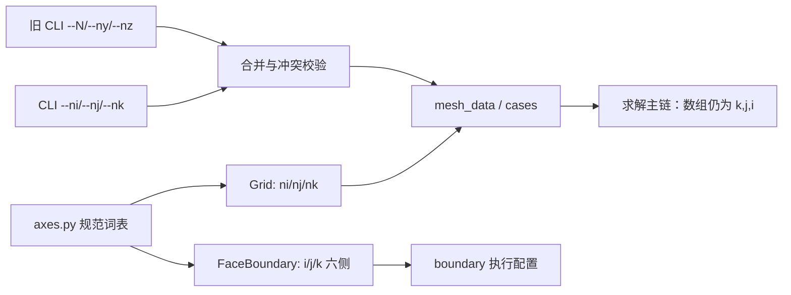

## Goal Capsule

将程序中的计算方向名称逐步统一为 `i/j/k`，在接入 CGNS 前消除与物理坐标 `x/y/z` 的混淆。保留旧名称作为过渡入口，确保现有单块算例和 JAX 基准结果不变。

- **Authority.** Product Contract 的 R1–R7、A1–A5 与 Scope Boundaries 是产品约束；本计划的 KTD 只决定实现方式，不扩大或缩小产品范围。
- **Execution profile.** 只改命名、接口与兼容层，不改数组布局、网格、度量、边界公式、时间推进或输出步号格式。
- **Stop conditions.** 七例基准出现任何非零差异、旧入口无法等价运行、`dif_axis_map` 语义改变，或需要引入 CGNS/多块/新边界能力时停止执行并报告。
- **Tail ownership.** 由执行流水线在本地完成测试、简化、审查与提交；用户当前要求是本地 Git 提交，不推送远端。

## Product Contract

### 已确认的决定

- 计算坐标 `(i,j,k)` 对应 `(ξ,η,ζ)`；网格尺寸命名采用 `ni/nj/nk`，六侧面采用 `i-/i+/j-/j+/k-/k+`。
- 数组空间轴顺序仍为 `(k,j,i)`。方向编号 `0/1/2`、实际数据布局和数值计算不随命名改变。
- 初期保留 `nx/ny/nz`、`x-/x+/y-/y+/z-/z+`、现有函数名和命令行参数作为兼容入口；何时移除旧入口另行决定。
- 同一参数同时提供新旧名称且值不同时，明确报冲突，不按出现顺序悄悄覆盖。
- 物理坐标 `x/y/z`、速度 `u/v/w` 和物理分量仍保留原意。原码度量键 `Ak/Ai/As` 暂时保留，并标明其对应的计算方向。
- 方向命名是 JSON 配置之后、CGNS 接入之前的独立步骤；不把命名迁移与网格格式或边界公式调整混在一起。

### Requirements

- R1. 网格尺寸、面侧描述和计算方向相关的填充入口均提供 `i/j/k` 命名，并在新接口中使用这一口径。
- R2. 旧名称在兼容期继续可用，新旧名称访问同一配置；冲突值报错，不产生两份各自可变的状态。
- R3. 配置解析、命令行、边界描述、算例特殊边界和历史调用方使用同一套明确映射；数组轴顺序和鬼胞层保持原样。
- R4. 保留 `dif_axis_map` 对原码计算方向的映射，尤其是平板算例中当前 JAX 计算 j 方向对应原码 k 方向的情况；不能将其误当作名称替换而删除。
- R5. JSON 仍不设置网格维数或边界开关；内置算例分辨率沿用命令行及默认值，槽道过渡期 `.in` 保持现有行为。
- R6. `x/y/z` 若表示物理位置、物理速度分量或原码字段，不作为计算轴标签盲目重命名。CGNS 文件内容与原码兼容键的映射留待对应步骤确定。
- R7. 七个 Step 0 JAX 基准及现有 Step 1、Step 2、Step 3 的入口测试在可比环境下保持通过；新旧名称分别验证同一行为，不覆盖原基准。

### Scope Boundaries

本步不实现 CGNS 读取、多块通信、JSON 新网格维数字段或新的物理边界，不调整网格、度量计算、边界公式或时间推进。输出文件的八位步号命名属于 Step 3 待处理事项，不与方向名称混为同一验证结论。

### Acceptance Examples

- A1. 同一网格通过 `ni/nj/nk` 与兼容的 `nx/ny/nz` 得到一致尺寸和 `(k,j,i)` 数组形状；同名新旧参数取不同值时报错。
- A2. `i-/i+`、`j-/j+`、`k-/k+` 分别对应现有的第一、第二、第三计算轴两侧；旧面标签在兼容期指向相同边界和参数。
- A3. 槽道的两个壁面仍是计算 j 两侧；平板入口/出口与壁面/远场保持不对称，原码边界带映射与迁移前一致。
- A4. 用旧入口和新入口分别运行等价算例，七例基准的状态、步数和时间步按现有检查口径一致。
- A5. OCFD 网格文件、物理坐标场和 `Ak/Ai/As` 度量键保持原有语义；日志和文档能区分计算轴标签与物理分量。

### Planning Questions

- 兼容别名覆盖对象属性、构造参数、面描述和 CLI；具体适配位置及错误信息在执行计划中确定，避免每层都维护独立的映射。
- Step 3 的 JSON/CLI 合并已完成（本地提交 `e70d68f`）；八位步号输出仍待完成，但不属于本步。开始此步前先固定可复跑的七例基准及实际工作区状态。

### Evidence

`src/fields.py::Grid` 仍保存 `nx/ny/nz`；`src/mesh_data.py` 和 `src/boundary.py` 使用 `x-/x+/y-/y+/z-/z+` 面标志；`src/run.py` 仍提供 `--N/--ny/--nz`。`src/cases.py` 的平板算例使用 `dif_axis_map=(0,2,1)`，相关基准与测试位于 `experiment/`。总体路线见 `11-16 我建议先对齐的.md`。

## Planning Contract

### Technical Design

命名迁移分四层落地，所有层共享 `src/axes.py` 中的同一套词汇：

1. **轴与面标签**：`axes.py` 定义计算轴 `i/j/k`、六侧 `i±/j±/k±`、旧标签 `x/y/z` 的规范化函数。旧标签只在边界入口被规范化，内部不保存第二份可变状态。
2. **尺寸对象**：`Grid` 以 `ni/nj/nk` 为规范字段，提供只读 `nx/ny/nz` 兼容属性；构造器接受新旧关键字及旧位置参数。
3. **描述与执行**：`FaceBoundary.side` 保存规范 `i±...`；`BlockMesh` 以规范顺序保存六侧，查找入口同时接受旧标签；`boundary.py` 的六侧校验和执行配置使用规范标签。
4. **入口**：命令行提供 `--ni/--nj/--nk`，旧 `--N/--ny/--nz` 继续可用；合并后同时写入新旧参数键，使现有 `cases.py`/`run.py` 消费者无需两套逻辑。OCFD 网格/场读取函数和 `.in` 维数读取函数提供 `i/j/k` 关键字与返回值别名。JSON 不增加维数字段。

### Key Technical Decisions

- KTD1. **单一词表模块。** 新增 `src/axes.py`，集中定义 `AXIS_NAMES=("i","j","k")`、`SIDES=("i-","i+","j-","j+","k-","k+")`、`LEGACY_AXIS_NAMES`、`LEGACY_SIDES`、`normalize_axis`、`normalize_side`、`legacy_side`、`array_axis`。`fields.py`、`mesh_data.py`、`boundary.py`、`run.py` 只从这里取词表，避免四份映射漂移。旧名称是输入别名和只读视图，不是第二份配置。
- KTD2. **Grid 双入口、单状态。** `Grid(ni, nj, nk)` 的规范字段为 `ni/nj/nk`；旧位置参数 `Grid(nx, ny, nz)` 按计算轴顺序继续有效；关键字同时支持 `ni/nj/nk` 与 `nx/ny/nz`。同一轴新旧值不同直接 `ValueError`，相同值允许。`nx/ny/nz` 是只读属性，返回同一整数；`shape`、`inner()`、`n_inner` 仍按 `(k,j,i)` 生成，数值数组形状不变。`infile.grid_dims` 保留旧返回顺序；新增 `grid_dims_ijk` 返回同一组 `(ni,nj,nk,p)` 值，`cases.py` 改用它。`mesh.read_ocfd_mesh`/`read_ocfd_field` 增加 `ni/nj/nk` 关键字别名，旧位置参数和旧关键字继续有效。
- KTD3. **面标签规范存储、旧名查找。** `FaceBoundary.side` 统一保存为 `i-/i+/j-/j+/k-/k+`，构造时接受旧 `x/y/z` 标签并规范化；新增只读 `legacy_side` 供日志/历史调用方显示。`BlockMesh.faces` 按 `i-/i+/j-/j+/k-/k+` 顺序校验；`BlockMesh.face("x-")` 与 `face("i-")` 返回同一对象。`boundary._face_map`、`validate_special_sides`、`_check_faces`、channel/plate 的六侧循环使用规范标签。重复或混用到同一规范侧时按“六侧不完整/顺序错误”报错，不静默去重。
- KTD4. **填充入口别名为同一实现。** `boundary.py` 新增 `fill_halos_i/j/k`、`fill_wall_j`、`fill_ev_wall_j`、`fill_ev_plate_j` 作为规范实现；旧 `fill_halos_x/y/z`、`fill_wall_y`、`fill_ev_wall_y`、`fill_ev_plate_y` 仅赋值为同一函数对象，不写包装器。`fields.py` 继续导出旧名，保证 `fields.fill_halos_x is boundary.fill_halos_x` 等历史身份断言。生产调用（`solver.py`、`viscous.py`、`filtering.py`、`boundary.py`）改用 `i/j/k` 名称；旧调用方可继续使用旧名。
- KTD5. **CLI 双入口、显式冲突。** `run.py` 新增 `--ni`（缺省 256）、`--nj`（缺省 64）、`--nk`（缺省 4）；旧 `--N/--ny/--nz` 改为无缺省的兼容开关，由显式解析器判定是否出现。合并阶段以 `ni/nj/nk` 为规范值：只给旧名时复制到新名，只给新名时复制到旧名，同时给且值不同报 `ConfigError`，值相同接受。规范化后同时写入 `args.N/ny/nz` 与 `args.ni/nj/nk`，现有 `cases.py` 与 NPZ 元数据不需要分支。JSON 仍不承载维数（R5）。
- KTD6. **方向映射不动。** `dif_axis_map` 的字段名、取值、`_dif_band` 的 `dif_axis_map[axis]` 计算、`DIF_BOUND` 六标志顺序都保持不变；平板 `(0,2,1)` 仍是 JAX 计算 j 对应原码 k 的唯一映射。新测试只覆盖映射前后的逐侧 `dif_band` 相等，不把映射改写成名称替换。
- KTD7. **物理名称不迁移。** `x/y/z` 作为物理坐标、`u/v/w` 作为速度分量、`Axx/Ayy/Azz`、`Ak/Ai/As` 等原码度量键保持原意；日志和文档用“计算 i/j/k”与“物理 x/y/z”并列说明，不把物理字段重命名为 i/j/k。

### Assumptions

- `FaceBoundary.side` 规范化为新标签后，仓库内按旧标签枚举 `.side` 的测试会同步改为新标签；按旧标签查找的兼容测试保留。数值基准与 NPZ 字段不因此改变。
- `Grid` 与 `BlockMesh` 在构造后不被原地修改；兼容属性是只读视图，避免新旧两份状态。
- 现有 `tests/` 的旧包别名问题不在本步修复；验收范围是 `experiment/` 下的 Step 1/2/3/3.5 测试和七例 Step 0 基准。

### Product Contract Preservation

Product Contract 的需求、验收示例和范围边界未改写；仅把 `Planning Questions` 中 Step 3 的完成状态更新为本地提交 `e70d68f` 的事实，并明确八位步号不属于本步。

### Sources

- `src/fields.py`：`Grid`、`spatial_array_axis`、旧填充导出。
- `src/mesh_data.py`：`AXIS_NAMES`、`SIDES`、`FaceBoundary`、`BlockMesh`、`_dif_band`。
- `src/boundary.py`：`SIX_SIDES`、`fill_halos_*`、`fill_wall_y`、`fill_ev_*`、六侧执行校验。
- `src/run.py`：`--N/--ny/--nz` 与 `--mesh` 输出前缀；`src/cases.py`：五类算例建网格。
- `experiment/test_step1_mesh.py`、`experiment/test_step2_boundary.py`、`experiment/test_step3_config.py`：现有入口与基准护栏。
- `11-16 我建议先对齐的.md`：第 3.5 步的原始命名决定。

## Implementation Units

### U1. 建立规范轴词表并迁移 Grid

**Goal.** 让网格尺寸以 `ni/nj/nk` 为规范接口，同时保留 `nx/ny/nz` 的位置参数、关键字和只读属性。

**Requirements.** R1、R2、R3、R6、R7。

**Files.**
- 新增 `src/axes.py`。
- 修改 `src/fields.py`、`src/mesh_data.py`、`src/infile.py`、`src/mesh.py`、`src/cases.py`（仅 `.in` 维数与网格读取调用）。
- 新增 `experiment/test_step3_5_axes.py`。

**Approach.**
- 在 `axes.py` 定义规范/旧词表、`normalize_axis`、`normalize_side`、`legacy_side`、`array_axis` 和尺寸别名读取辅助；不导入 `fields`/`mesh_data`，避免循环依赖。
- `Grid.__init__` 使用未设置哨兵值解析三个轴：规范关键字优先，旧关键字兼容，任一轴新旧值不同报错；全部缺失时报明确错误。
- `Grid` 规范属性为 `ni/nj/nk`；`nx/ny/nz` 用只读 property 返回同一值；`shape`、`n_inner`、`inner()` 改用 `ni/nj/nk`，但切片顺序仍为 `(k,j,i)`。
- `mesh_data.from_case` 的结构校验接受 `ni/nj/nk` 或 `nx/ny/nz` 的网格对象；`BlockMesh.inner_shape` 用规范字段。
- `infile.py` 增加 `grid_dims_ijk(inp)`，复用现有 `grid_dims` 的读取逻辑并返回同一数值；`mesh.read_ocfd_mesh/read_ocfd_field` 增加 `ni/nj/nk` 关键字路径，旧位置参数和 `nx/ny/nz` 关键字行为不变。`cases.py` 的槽道路径改用 `grid_dims_ijk`。

**Test Scenarios.**
- 新关键字、旧关键字、旧位置参数三种 `Grid` 构造得到相同 `shape`、`inner()` 和 `alloc()` 形状。
- 新旧同一轴相同值可接受；不同值报错；缺一轴报错。
- `grid.ni == grid.nx` 等只读别名关系；`inner_shape == (nk,nj,ni)`。
- `infile.grid_dims_ijk` 与 `grid_dims` 对同一 `.in` 返回相同的 `(ni,nj,nk,p)` 数值；`read_ocfd_mesh`/`read_ocfd_field` 的新关键字与旧位置/旧关键字得到相同数组。
- 旧式自定义网格对象（只有 `nx/ny/nz`）仍能通过 `from_case`。
- 现有 Step 1 网格测试继续通过。

**Verification.** `python -m pytest experiment/test_step3_5_axes.py experiment/test_step1_mesh.py -q`。

### U2. 面侧标签规范化与填充入口别名

**Goal.** 六侧面以 `i±/j±/k±` 为规范标签，旧 `x±/y±/z±` 可查找；填充函数提供 `i/j/k` 名称且不复制实现。

**Requirements.** R1、R2、R3、R4、R6、R7；覆盖 A2、A3、A5。

**Files.**
- 修改 `src/axes.py`、`src/mesh_data.py`、`src/boundary.py`、`src/fields.py`。
- 修改生产调用方 `src/solver.py`、`src/viscous.py`、`src/filtering.py`、`src/channel.py`、`src/plate.py`（仅改为规范填充名；不改变调用顺序和参数）。
- 修改 `experiment/test_step1_mesh.py`、`experiment/test_step2_boundary.py` 中按 `.side` 枚举的旧标签断言；保留旧标签查找用例。

**Approach.**
- `FaceBoundary.__post_init__` 用 `normalize_side` 接受新旧标签并保存规范值，校验 `side` 与 `axis` 一致；新增 `legacy_side` property。
- `BlockMesh.__post_init__`/`face()`、`boundary._face_map`/`validate_special_sides`/`_check_faces`/channel/plate 六侧循环改用规范标签；`face("x-")` 走规范化后查找。
- `mesh_data` 的 `AXIS_NAMES`、`SIDES` 改为规范值，另导出 `LEGACY_AXIS_NAMES`、`LEGACY_SIDES`；内部 `_face`/`_generic_faces`/`_plate_faces`/`_channel_faces` 使用规范标签。
- `boundary.py` 规范函数命名为 `fill_halos_i/j/k`、`fill_wall_j`、`fill_ev_wall_j`、`fill_ev_plate_j`；旧名称赋值为同一对象；`_GENERIC_AXIS_FILLERS`、`fill_halos`、`fill_ev_axis` 使用规范名。`fields.py` 继续导出旧名以维持历史导入。
- 不修改 `EV_WALL_SIGNS` 的数值、`dif_axis_map` 或 `DIF_BOUND` 顺序。

**Test Scenarios.**
- `FaceBoundary("x-",0,...)` 的 `.side=="i-"`、`.legacy_side=="x-"`；`face("x-")` 与 `face("i-")` 返回同一对象。
- 六侧规范顺序 `i-/i+/j-/j+/k-/k+`；混合旧/新标签且缺侧或重复侧时报错。
- 槽道：`i±` 周期、`j±` 壁面；平板：`i-` 入口、`i+` 出流、`j-` 壁面、`j+` 远场、`k±` 周期。
- 平板 `dif_axis_map=(0,2,1)` 下逐侧 `dif_band` 与迁移前一致。
- `fields.fill_halos_x is boundary.fill_halos_x` 等旧别名身份保持；`fill_halos_i` 与旧 `fill_halos_x` 对同一数组输出逐位一致。
- `fill_wall_j`/`fill_ev_wall_j`/`fill_ev_plate_j` 与旧名等价；旧名仍可调用。
- 现有 Step 2 边界测试与真实网格测试通过。

**Verification.** `python -m pytest experiment/test_step3_5_axes.py experiment/test_step1_mesh.py experiment/test_step2_boundary.py -q`。

### U3. CLI 尺寸新旧入口与冲突校验

**Goal.** 命令行提供 `--ni/--nj/--nk`，旧 `--N/--ny/--nz` 继续可用；显式新旧冲突在启动前失败，合并后现有消费者拿到一致尺寸。

**Requirements.** R1、R2、R3、R5、R7；覆盖 A1、A4。

**Files.**
- 修改 `src/run.py`、`src/runtime_config.py`、`src/cases.py`。
- 修改 `experiment/test_step3_config.py`、`experiment/test_step3_5_axes.py`。
- 可选修改 `experiment/step0_cases.py`：不改基准命令，只在新测试中使用新入口。

**Approach.**
- `run.build_parser` 增加 `--ni/--nj/--nk`（缺省 256/64/4）；旧 `--N/--ny/--nz` 存到独立 `legacy_*` dest，正常解析器缺省 `None`，显式解析器缺省 `SUPPRESS`。
- `runtime_config.resolve_args` 在默认值/JSON/显式 CLI 合并后处理尺寸别名：只在显式字典判断是否出现；新旧同时出现且值不同抛 `ConfigError`；相同值接受。规范化结果同时写入 `ni/nj/nk` 与 `N/ny/nz`，并记录来源。
- `src/cases.py` 统一从 `args.ni/nj/nk` 建 `Grid(ni=...,nj=...,nk=...)`，保留旧 `args.N/ny/nz` 回退；局部变量改为 `ni/nj/nk`，数组切片仍按 `(k,j,i)`。槽道 `.in` 路径继续从 `infile.grid_dims` 读取，不改变物性/边界来源。
- `run` 的日志可同时打印规范尺寸，但 NPZ `_meta.N` 仍沿用现有值，避免改变基准元数据语义。

**Test Scenarios.**
- `--ni 16 --nj 4 --nk 4`、`--N 16 --ny 4 --nz 4`、两者同值得到相同解析结果（`args.N/ny/nz` 与 `args.ni/nj/nk` 一致）。
- 新旧同轴不同值：`resolve_args` 抛 `ConfigError`，CLI 退出非零并包含冲突字段。
- 只给旧名时新名自动得到同一值；只给新名时旧名自动得到同一值。
- 默认 `build_parser()` + 无尺寸参数时仍为 256/64/4。
- 同一 Sod 算例分别用旧 CLI 与新 CLI 运行，NPZ 字段逐位一致。
- Step 3 JSON 用例不改动维数字段，现有 `test_json_matches_legacy_cli_arguments` 与 `test_cli_and_json_bitwise` 继续通过。

**Verification.** `python -m pytest experiment/test_step3_5_axes.py experiment/test_step3_config.py -q`，并运行一对新旧 CLI 的逐位比较。

### U4. 文档、迁移说明与七例回归

**Goal.** 文档能区分计算轴与物理分量，旧/新入口和冲突规则可查；用同一份七例基准完成最终回归。

**Requirements.** R5、R6、R7；覆盖 A4、A5。

**Files.**
- 修改 `src/README.md`、`experiment/README.md`。
- 不修改 `experiment/baseline/**`。
- 必要时补充 `experiment/test_step3_5_axes.py` 的边界场景。

**Approach.**
- `src/README.md` 文件导航加入 `axes.py`；参数表加入 `--ni/--nj/--nk`，旧 `--N/--ny/--nz` 标注兼容；增加计算轴与物理坐标/度量键对照。
- `experiment/README.md` 增加第 3.5 步验收段：新/旧尺寸入口、六侧映射、填充别名、`dif_axis_map` 保持、测试与七例结果。
- 明确 `Ak/Ai/As`、`Axx/Ayy/Azz` 仍是原码/物理度量键；输出八位步号与本步无关。

**Test Scenarios.**
- `src/README` 的命令可直接执行；`experiment/README` 的命令与实际测试路径一致。
- 文档中的六侧映射与 `FaceBoundary` 实际值一致；平板/槽道描述与代码一致。
- 完整跑 Step 1/2/3/3.5 测试和七例旧 CLI/JSON 候选，`check_step0.py` 总判定 PASS、80 场 `max|diff|=0.000e+00`。
- 不出现基准改名、重写或放宽阈值。

**Verification.** 见下方 Verification Contract。

## Verification Contract

| Gate | Command | Covers |
|---|---|---|
| 新增单元测试 | `python -m pytest experiment/test_step3_5_axes.py -q` | U1–U3 的新旧入口、冲突、六侧、别名 |
| Step 1–3 回归 | `python -m pytest experiment/test_step1_mesh.py experiment/test_step2_boundary.py experiment/test_step3_config.py experiment/test_check_step0.py -q` | 现有多块单测、配置与检查器 |
| 尺寸 CLI 对照 | `python -m opencfd_jax.src.run --case sod --ni 16 --nj 4 --nk 4 --scheme UP7 --dt 5e-4 --end-step 3 --end-time 0.01 --kstep-show 1 --kstep-save 1 --out-dir <tmp-new>` 与对应旧 `--N 16 --ny 4 --nz 4` 命令 | U3 新旧 CLI 逐位等价 |
| 冲突拒绝 | `python -m opencfd_jax.src.run --case sod --ni 16 --N 32 --end-step 0` | U3 显式冲突启动前失败 |
| 七例旧 CLI | `python opencfd_jax/experiment/run_step0.py --phase candidate --arg-source cli` | A4、R7 |
| 七例 JSON | `python opencfd_jax/experiment/run_step0.py --phase candidate_json --arg-source json` | R5、A4、R7 |
| 基准检查 | `python opencfd_jax/experiment/check_step0.py --verbose` 与 `python opencfd_jax/experiment/check_step0.py --candidate opencfd_jax/experiment/candidate_json --verbose` | 七例 PASS、80 场零差异、基准哈希 |

执行环境为仓库根目录 `D:\Desktop\ocfd2jax`；若路径或 JAX 环境不可用，必须记录为阻塞或环境差异，不能放宽默认零容差。

## Definition of Done

- `Grid`、`FaceBoundary`/`BlockMesh`、`boundary` 填充入口和 CLI 均提供 `i/j/k` 规范接口；旧 `nx/ny/nz`、`x±/y±/z±`、旧函数名与旧 CLI 在兼容期可用。
- 新旧尺寸同时出现且不同值时启动前报错；相同值不报错；不存在两份可独立修改的尺寸或面标签状态。
- 数组仍为 `(k,j,i)`，`inner()`/`alloc()`/滤波/边界/粘性路径的数值结果不变；`dif_axis_map`（尤其平板 `(0,2,1)`）保持原语义。
- `x/y/z` 物理坐标、`u/v/w` 速度分量、`Axx/Ayy/Azz`、`Ak/Ai/As` 不被误改名为计算轴标签。
- 新增测试覆盖新旧构造、冲突、六侧映射、填充别名、平板映射和 CLI 冲突；现有 Step 1/2/3 入口测试通过。
- 七例旧 CLI 与七例 JSON 候选均 rc=0；`check_step0.py` 七例 PASS、80 场零差异；`experiment/baseline/**` 未改名、未重写。
- 文档记录计算轴/物理分量对照、兼容入口、冲突规则和本步未覆盖的 CGNS/多块/八位步号事项。
- 清理临时验证产物和未使用映射代码；不留下重复的旧/新实现或死代码。
