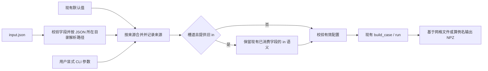

## Goal Capsule

以 `input.json` 配置 JAX 算例，逐步替代当前分散在命令行和 OCFD `.in` 中的运行参数。迁移期间保持现有算例与 Step 0 基准可用；`.in` 保留到 Step 4 的 CGNS 路径验证完成后再移除。

## Product Contract

### 已确认的决定

- 新增 JSON 运行配置；用户明确给出的命令行参数覆盖 JSON 中同名参数。
- 槽道迁移期间若同时提供 OCFD `.in`，重复物性暂按当前 `.in` 优先的行为处理。必须区分程序默认值与用户显式指定的参数，不能让默认值误覆盖 JSON。
- 过渡期 `.in` 所提供的网格维数、壁面参数和边界开关也保持现有优先关系；JSON 不设置网格维数或边界开关。初始化时程序从网格信息取得维数，边界信息按网格及后续边界方案处理。
- Sod、TG 等程序生成网格的内置算例，Step 3 继续通过现有命令行参数及默认值提供分辨率；这不要求在 JSON 中写入网格维数。
- `input.json` 中的网格、初场等相对路径，以该配置文件所在目录为基准解析。
- 输出前缀取网格文件名；没有网格文件的内置算例使用算例名，例如 `sod`。输出格式和滚动 PLT 仍在后续步骤处理。
- 输出文件名使用 `<前缀>-istep-00001000.npz` 形式：步号放在最右侧，不足八位时左补零。原六位 `_step` 基准保留原名，比较时按用例和步号对应。
- 按 jisen 决定，本步不新增物性取值检查；已有类型校验与配置来源记录不因此改动。
- Step 3 保留 `.in` 过渡入口；Step 4 的 CGNS 网格读取及边界信息经过验证后移除 `.in`。移除前需要保证基准和现有算例有等价配置及可复现路径。
- 后续网格文件格式采用 CGNS；Step 3 先支持现有内置网格和 OCFD 网格/初场路径，CGNS 解析属于 Step 4。
- 槽道等算例继续使用主流程读取配置和网格；普通边界由 `boundary.py` 提供，特殊边界由 case 侧设置或导入，不另建绕过 JSON 和网格读取的独立运行脚本。
- 后续代码改动须与现有七个 JAX 基准对照；保持基准本身和其来源记录。
- Step 3 完成后、Step 4 前单独执行计算方向命名整理：网格尺寸采用 `ni/nj/nk`，六侧面标签采用 `i-/i+/j-/j+/k-/k+`；先保留现有 `nx/ny/nz`、`x/y/z` 面标签及相关函数和命令行的兼容入口，再在验证后决定何时移除。

### Requirements

- R1. JSON 与现有过渡入口共同提供五类算例运行所需的网格来源、初场、物性、数值格式、时间、必要的边界数值参数、算例参数和输出控制。Step 4 移除 `.in` 前，槽道的必要信息仍可从 `.in` 取得。
- R2. JSON 不设置网格维数和边界开关；程序初始化时从网格信息取得维数，并从网格及适用的边界方案取得边界信息。槽道独立路径仍需取得物性、壁面温度和体积力等数值参数；具体来源应逐项核实。
- R3. 明确 JSON、用户显式命令行和过渡期 `.in` 的优先关系；出现冲突或缺失必要配置时能定位来源，不误把默认值当成用户覆盖。
- R4. 保持计算方向 `(i,j,k)=(ξ,η,ζ)` 和现有数组轴、`DIF_BOUND`/`JAC_BOUND` 的映射；现有 `x/y/z` 参数标签在过渡期按原含义兼容。
- R5. 同一组有效配置经旧入口及 JSON 入口运行，应得到相同的有效参数和数值结果；覆盖 Step 0 七例、固定步长与 CFL 路径。
- R6. Step 3 的 JSON 路径允许现有槽道继续使用 `.in`；Step 4 的 CGNS 路径验证完成后移除 `.in` 选项。迁移基准运行入口时保留原基准结果及历史来源，不靠重写基准消除差异。
- R7. 配置应明确区分普通边界和 case 特殊边界；Step 3 不实现 CGNS 解析，不提前假定 CGNS 必然包含全部边界数值参数。
- R8. 使用网格文件名作为输出前缀；没有网格文件时使用算例名。输出名称变化不得导致把等价结果误判为基准缺失；滚动 PLT 与输出格式改造仍属于 Step 8。

### Scope Boundaries

本步不实现 CGNS 网格读取、多块连接或新的边界物理公式，不调整数值格式、时间推进或 Step 0 基准数据。配置兼容适配属于本步；`.in` 退场以 Step 4 的 CGNS 路径验证为前提。

方向名称调整作为独立的 Step 3.5，不与 JSON 或 CGNS 读取改动混在一起。它不改变数组 `(k,j,i)` 布局、平板等算例的原码方向映射或物理边界行为；物理坐标 `x/y/z`、速度分量和 OCFD 度量键继续保留原意。完成后须验证尺寸与六侧映射、新旧兼容入口及七个 JAX 基准。

### Acceptance Examples

- A1. 七个 Step 0 用例分别用等价 JSON 配置启动；过渡期槽道仍可引用 `.in`，内置算例可由命令行提供网格分辨率。各用例字段、时间步元数据和结果与原 JAX 基准一致。
- A2. JSON 中写入某个数值参数，同时在命令行显式给出不同值时，采用命令行值；没有显式指定时不让命令行默认值覆盖 JSON。
- A3. 过渡期间同一槽道配置同时含 `.in` 与 JSON 时，`.in` 已提供的物性、壁温、网格维数和边界开关保持现有优先关系；最终 JSON 独立路径不再需要 `.in`。
- A4. 缺失槽道壁温或其他必要参数、配置类型错误、未知字段或不支持的网格格式时，给出可定位的诊断；不能静默改为其他物理条件。
- A5. Step 4 的无 `.in` 路径完成验证、替代基准启动入口后，移除 `.in` 选项，仍可复跑七例对照；原基准和来源记录保留。

### Planning Context

- 现有 OCFD 网格文件没有维数文件头，记录长度只能得到 `nx*ny`，无法仅凭文件确定 `nx`、`ny` 的分解；Step 3 继续通过 `.in` 提供这些信息，Step 4 验证 CGNS 网格读取后再移除 `.in`。
- 基准检查器当前按文件名匹配 NPZ；JSON 路径若改用网格前缀，需要确定如何映射到旧基准文件名，同时保留原基准及其哈希。
- 八位数不足以表示的更大步号如何处理待明确；不能截断步号或覆盖不同步的文件。

### Evidence

`src/run.py` 当前使用 argparse 默认值；`src/cases.py::build_case` 在槽道分支读取 `.in` 并构造物性、维数、边界和度量；`src/infile.py` 解析旧配置；`experiment/step0_cases.py` 的槽道用例依赖 `.in`。主路线见 `11-16 我建议先对齐的.md`。

---

## Planning Contract

**Product Contract 保持不变。** Goal Capsule 中 `.in` 的移除时点按已确认的 Step 4 前提消除歧义；R1～R8 和 A1～A5 不变。

### Key Technical Decisions

- KTD1. 新增 `src/runtime_config.py` 负责 JSON 解析、类型及字段校验、路径解析、配置来源合并；`src/run.py` 的现有 CLI、`run(args)` 和 `cases.build_case(args)` 仍可调用。合并结果适配现有参数对象，避免求解器同时读取两份配置。使用标准库，不新增依赖。
- KTD2. CLI 保留所有既有默认值；另外记录每个参数是否由用户显式给出，合并顺序是**代码默认值 → JSON 显式值 → CLI 显式值**。不要以解析后的值是否等于默认值判断是否显式给出；所有新增 `add_argument` 均提供 `default`，不用 `required=True`。
- KTD3. 槽道的特殊规则只针对当前 `cases.build_case` **实际使用**的 `.in` 字段：`GRID_3D/PARALLEL_3D`、`RE/AMA/T_REF`、可选 `GAMMA/PR`、`IBC/BC_RPARA`、`JAC_BOUND/DIF_BOUND` 保持原行为；对不含项的缺省与报错仍以现有实现为准。`.in` 中 `SCHEME_INVIS/SCHEME_VIS` 当前仅记录，`DT/EPSL_SW` 当前不驱动该运行入口；不得将它们悄悄改为优先来源。槽道的 `IPERIODIC` 当前虽然解析，实际 `bcs` 固定为周期、壁面、周期；本步保持现状。
- KTD4. JSON 是按功能分组的可选字段映射：网格格式与文件、初场文件及过渡期 `.in` 路径；物性；无粘和粘性格式、滤波；时间；算例及其参数；输出。逐项映射到现有运行参数并记录来源，未知字段报错。**禁止在 JSON 配置网格维数和边界开关**；内置网格分辨率继续由旧 CLI 和默认值提供。实际数值参数如体积力、壁温在 `.in` 过渡路径按 KTD3 读取。
- KTD5. JSON 内相对输入及输出路径以 JSON 所在目录解析；CLI 显式提供的相对路径沿用当前工作目录语义。用 JSON 所选网格文件的完整文件名去除最后一个扩展名形成前缀，无网格文件用算例名；该规则同样用于旧 CLI 的网格路径。非法输出前缀、无法读取文件或不支持的 `mesh.format` 在启动前报错。支持当前内置和 OCFD 网格；CGNS 留到 Step 4。
- KTD6. 根据用例 ID 和输出步号建立基准、候选 NPZ 的**一对一**匹配；检查器须兼容旧的 `<前缀>_step000001.npz` 基准与新的 `<前缀>-istep-00000001.npz` 输出。文件名和 `_meta.step` 必须一致，缺失、额外、重复步号和不合法元数据均 FAIL。对匹配对仍核验原基准文件 SHA-256、字段、dtype、shape、有限值、`t/step/dt` 及逐位数组；报告两侧实际文件名。不能修改或重命名基准，也不能以候选 NPZ 文件整体哈希相同作为数组等价要求。
- KTD7. 固定步长与 CFL 的现有规则保持：`dt` 有值时固定步长优先，否则采用 CFL。JSON 明确给出 `null` 的 `dt` 表示自适应；提供显式 CLI 自适应入口，以便覆盖 JSON 中的固定 `dt`，与显式 `--dt` 同时出现时报冲突。为 JSON 布尔开关提供显式关闭方式（例如滤波、TV、精度），不让 CLI 缺省值误覆盖；channel/poiseuille 的现有粘性强制行为需要准确提示，不能静默声称关闭成功。

### JSON 与运行参数的对应关系

`--config` 指向可选 JSON 文件，缺省 `None` 表示完全沿用旧 CLI。字段名固定如下；不存在的可选字段沿用旧路径缺省值。表中的映射用于实现和测试，配置不包含网格尺寸或边界开关。

| JSON 分组 | 支持字段 | 现有用途 |
|---|---|---|
| `mesh` | `format`、`file`、`field`、`infile` | 格式取 `builtin` 或 `ocfd`；网格、初场、过渡期 `.in` 路径，分别对应现有 `--mesh`、`--field`、`--in`。`builtin` 不要求网格文件 |
| `physics` | `Re`、`Ama`、`ref_t`、`pr` | 对应现有物性参数；槽道的实际使用遵循 KTD3 |
| `numerics` | `scheme`、`vis_order`、`viscous`、`weno_tv`、`filter`、`nstep_filter`、`filter_s0`、`filter_rth` | 对应同名运行选项；过滤和 TV 的布尔值须可由 CLI 显式开关覆盖 |
| `time` | `dt`、`cfl`、`end_time`、`end_step` | 固定步长或 CFL 以及停止条件 |
| `case` | `name`、`p_grad`、`forcing_work`、`plate_x0`、`plate_x1`、`plate_h` | 对应现有算例名称及参数；不包含 `plate_dif_bound` 或其他边界开关 |
| `output` | `dir`、`kstep_show`、`kstep_save` | 对应现有输出目录及日志、存盘频率 |
| `precision` | 顶层字符串 `fp64` 或 `fp32` | 对应现有精度选项；CLI 的显式 `--fp64` / `--fp32` 覆盖 |

当前非槽道算例未暴露可配置 `gamma`，表中不把它宣称为可用字段。槽道在过渡期继续从 `.in` 获取 `GAMMA`；统一可配置的 `gamma` 需要单独处理现有 CFL、滤波和元数据差异，不属于本步。每个分组及字段都要明确类型、缺省、适用算例和冲突报错；JSON 指定不适用的字段时不得静默忽略。

### Configuration Flow

仅 JSON 来源的路径相对 JSON 文件目录；CLI 路径按原工作目录解析。图中的 `.in` 优先只限 KTD3 列出的现有消费行为。

### Compatibility and Known Limits

- `src/run.py` 当前用于 CFL、滤波和 NPZ 元数据的 `gamma` 固定为 1.4；槽道 RHS 的 `case["gamma"]` 可来自 `.in`。NPZ 中的 `Re/Ama/N` 也可能取自 args 而非槽道实际物性。本步不得把旧元数据称为真实有效配置或顺手改变旧数值；应在独立的有效配置报告中区分来源与使用位置。JSON 值按优先级被 `.in` 或 CLI 合法覆盖时继续运行，并在来源报告标记；字段没有对应执行路径、未实现或无效时应明确报错。需要改变旧算法的情况另行提出。
- JSON 物性与 `.in` 冲突时，槽道已消费字段 `.in` 优先，即使 CLI 中也有该同名字段；CLI 覆盖 JSON 的规则适用于未由 `.in` 接管的字段。格式、滤波、时间等继续遵循实际运行入口而非被解析但未使用的 `.in` 值。
- 现有 OCFD 网格文件无完整维数头；Step 3 不能通过文件大小唯一推断各轴长度。`.in` 过渡直到 Step 4 的 CGNS 路径验证完成；Step 3.5 命名迁移独立进行。
- Step 0 基准、输入及运行/检查脚本当前未全部跟踪。实施前确认可访问、哈希和环境；缺失或不可比时报告阻塞，不使用 `run_step0.py` 的默认 baseline 路径覆盖原数据。

---

## Implementation Units

### U1. 固定现有配置来源与输出行为

**目标：** 记录现有五算例的有效配置和边界条件。对应 R1、R3～R6，依赖现有 Step 0。

**文件：** `src/run.py`、`src/cases.py`、`src/infile.py`；新增 `experiment/test_step3_config.py`；参考 `experiment/step0_cases.py`、`experiment/test_step1_mesh.py`。

**方法：** 先刻画 CLI 默认值、显式参数、槽道 `.in` 的逐字段实际消费、输出名称与元数据；补充能区分参数来源的行为检查。不要改动求解表达式或把未消费的 `.in` 字段升级为有效配置。

**测试场景：** 五个算例旧 CLI 构造；槽道 `.in` 中 `RE` 与 CLI 值冲突时实际 `PhysParams.Re` 来自 `.in`；`.in` 中格式及 `DT` 与 CLI 不同时仍维持现有使用方；`IPERIODIC` 与固定槽道边界不一致时记录当前表现；`dt` 和 CFL、布尔缺省及 `forcing_work` 的原路径。

**验收：** 旧路径的实际字段来源、历史元数据限制和测试结果可查；基准可用并未改写。

### U2. 解析 JSON 并合并配置

**目标：** 在保留现有 CLI 的基础上提供单一有效参数入口。对应 R1～R4、R7 和 A2～A4，依赖 U1。

**文件：** 新增 `src/runtime_config.py`；修改 `src/run.py`，必要时调整 `src/cases.py` 适配；扩展 `experiment/test_step3_config.py`。

**方法：** 实现 KTD1～KTD5、KTD7；定义清楚支持字段和类型，沿用现有默认值并单独记录 CLI 显式项；JSON 不含维数及边界开关。每个参数在进入 `build_case` 前可追溯来源；本步无 CGNS reader。为布尔开关和时间步模式提供显式覆盖，仍保持旧 CLI 行为。

**测试场景：** JSON 独有值生效；同名 CLI 显式值包括恰好等于默认值时仍覆盖 JSON；JSON true 可被明确关闭；JSON `dt` 与显式自适应、CFL 及相互冲突选项得到规定行为；槽道 `.in` 与 JSON/CLI 三方冲突依 KTD3；未知字段、非法类型、JSON 中网格维数/边界开关、不支持网格格式、缺文件和无法生效参数明确报错。不同工作目录下 JSON 路径和 CLI 路径各按指定基准解析。

**验收：** 现有 `run(args)` 与 CLI 可用；无 JSON 旧命令的算例及默认值不变。每项配置可说明最终来源和实际使用位置。

### U3. 输出前缀与基准一对一匹配

**目标：** 落实网格文件前缀而保持旧基准可验证。对应 R5、R8 与 A1，依赖 U2。

**文件：** `src/run.py`、`src/io.py`（按需）；`experiment/check_step0.py`、`experiment/test_check_step0.py`；扩展 `experiment/test_step3_config.py`。

**方法：** 按 KTD5 确定输出前缀，不改变 NPZ 中的物理字段。按 KTD6 扩展已有检查器，记录旧/新名称映射；绝不修改原基准。保持旧精度与 `t/step/dt` 比较，同时单独验证实际物性而不是仅看历史元数据。

**测试场景：** OCFD 真网格生成网格名文件、无网格生成算例名文件；新文件名以 `-istep-` 加八位步号结尾，旧 `_step` 基准与新输出的同一步可正确匹配；候选缺步、多步、重复步、文件名与 `_meta.step` 不一致均 FAIL；基准哈希损坏、字段缺失、dtype 或 `t/dt` 改变均 FAIL；覆盖固定与自适应多步序列。

**验收：** 原始基准哈希不变、映射一对一、报告明确对应文件；不能通过忽略文件名或只对交集比较产生假 PASS。

### U4. 七个 JSON 算例与回归交接

**目标：** 用现有基准证明新旧入口结果一致。对应 R1、R5、R6、R8 与 A1～A4，依赖 U2、U3；A5 的 `.in` 退场验收在 Step 4 执行，本步只记录前提。

**文件：** `experiment/step0_cases.py`、`experiment/run_step0.py`、新增 `experiment/cases/` 下的七个 JSON 配置；`experiment/README.md`、`src/README.md`；扩展 `experiment/test_step3_config.py`。

**方法：** 每例提供 JSON 入口；内置分辨率仍由 CLI 给出，槽道保留既有 `.in`、网格与初场。使用独立候选目录运行旧 CLI 和 JSON 两条路径，按用例 ID/步号与同一份基准对照；记录环境、有效参数来源及已知元数据差别。明确 `run_step0.py` 会清理候选下的同名用例目录，禁止指向基准。

**测试场景：** 七例包括两个槽道、固定与 CFL Sod、TG、Poiseuille、平板，旧 CLI 和 JSON 入口数值均与 80 个基准场相同；真实网格和无网格两种输出前缀；从 JSON 目录以外启动时仍找到相对文件；槽道强制粘性和 `forcing_work` 口径不变；有效参数与实际 `PhysParams` 一致。

**验收：** 两条路径的结果及日志可复核；所有遗留 `.in` 用途和 Step 4 退出条件有说明。只写本地，不触碰 GitHub。

---

## Verification Contract

执行 AI 先运行现有相关测试并记录基准，再按测试驱动修复配置解析、布尔与步长覆盖、输出映射的异常路径。实施后运行 `experiment/test_step3_config.py`、`experiment/test_check_step0.py` 及相关现有单块测试，并在与基准可比的环境中运行七例旧 CLI 与七例 JSON 候选。默认零容差比较 80 个场、`t/step/dt` 与基准哈希；还须独立验证槽道有效物性、来源和输出名映射。缺输入、环境差异或失败必须列明，不能修改已有基准或静默放宽阈值。

## Definition of Done

- JSON 和旧 CLI 都能运行现有五类算例，优先级、路径和显式开关符合 KTD；槽道 `.in` 仅按当前实际消费语义优先。
- 七个用例的新旧入口通过同一基准检查，文件映射无遗漏或歧义；原始基准未改动。
- `.in` 保留至 Step 4 的 CGNS 验证，Step 3.5 的方向重命名保持独立；未新增 JSON 网格维数或边界开关。
- 文档交代有效配置来源、已有槽道元数据限制、输出前缀和布尔/时间步覆盖方式；验证及未覆盖项均有记录。
