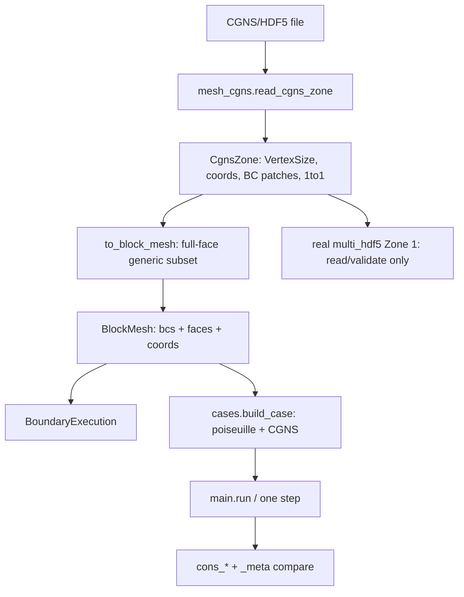

# Step 4 CGNS 单块读取与最小运行 - Plan

## Goal Capsule

实现结构网格 CGNS/HDF5 的单块读取：把 `Zone_t` 的尺寸、顶点坐标、`ZoneBC_t` 的边界 patch 和 `ZoneGridConnectivity_t` 的 1to1 连接读成独立的 `CgnsZone`，再适配成现有 `BlockMesh`；只对“整面、每侧单 patch、轴级同向”的 `PERIODIC` / `OUTFLOW` / `WALL` 组合执行，并用一个与内置 `poiseuille` 等价的单块算例完成一步结果对齐。

- **Authority.** 本计划以已确认的 grilling 决策为产品约束：`VertexSize` 直接对应求解器离散点；`CgnsZone` 是原始读取层，`BlockMesh` 是执行适配层；第 4 步只执行整面同向周期，不执行子区周期或 `Transform` 翻转。
- **Execution profile.** 只新增 CGNS 读取、适配、单块最小运行路径和测试/文档；不改变现有内置算例的数值公式，不删除 `.in`，不引入 `mesh.scale`。
- **Stop conditions.** 读取结果无法与 `multi_hdf5` Zone 1 或提交的 fixture 对齐、CGNS 维数与 `Grid` 发生一层错位、整面周期映射无法稳定、或实现需要修改 `boundary.py` 的周期执行模型时停止并报告。
- **Tail ownership.** 在本机完成实现、验证和本地 Git 提交；不推送远端、不创建 PR。

## Product Contract

### Summary

第 4 步交付一个只读的 CGNS 单块入口，而不是完整的 CGNS 求解器接入。读取器支持 HDF5/CGNS、`ZoneType=Structured`，按 `VertexSize` 建立求解器离散点，按 `CellSize` 做文件自洽校验；边界条件按 SIDS `BCType` 字符串读取为原始 patch，执行层仅接受现有 generic 能表达的整面周期、出流和 j 向壁面。另加一个最小 `poiseuille` CGNS 路径，用同一初值、同一步长跑一步，与内置网格的 NPZ 结果对齐。

### Problem Frame

当前仓库只有 OCFD 格式网格和内置 `Grid`，没有 CGNS 读取器；`Grid` 的 `ni/nj/nk` 实际是有限差分离散点数，而 CGNS 的 `VertexSize` 正是离散点、`CellSize` 是单元数。如果把 `CellSize` 直接塞给 `Grid`，会少一层；如果把 `VertexSize` 当单元并做全局八点平均，又会把壁面点移到半格之外。与此同时，`BlockMesh` 的 generic 路径只有轴级 `PERIODIC` / `OUTFLOW` / `WALL`，无法直接表达真实 CGNS 的六面异构 BC 或同面子 patch。第 4 步必须先建立原始读取层，再明确执行适配的窄边界。

### Requirements

**读取范围与数据契约**

- R1. `mesh_cgns` 只读 HDF5/CGNS 文件；文件可包含多个 `Zone_t`，但本步一次只返回一个选定 zone；ADF、非结构 zone 和多块执行明确不支持。
- R2. `Grid(ni,nj,nk)` 取 `Zone_t` 的 `VertexSize`，顶点坐标直接作为 `Axx/Ayy/Azz`，不做事先的全局平均；`CellSize` 只用于校验 `CellSize + 1 == VertexSize`。
- R3. `CgnsZone` 保存 zone 名、`VertexSize`、`CellSize`、`(nk,nj,ni)` 顶点坐标、BC patch 列表、1to1 连接列表；所有 SIDS 1-based 索引在读取时转成 0-based，并保留原始 `BCType` 字符串和 patch 名。
- R4. `CgnsZone` 必须能读取 `multi_hdf5.cgns` 的 Zone 1：`VertexSize=(2,123,25)`、`CellSize=(1,122,24)`、坐标范围与文件一致、BC patch 类型与 `PointRange` 可核对。
- R5. `CellSize` 不一致、`ZoneType != Structured`、坐标数组形状与 `VertexSize` 不一致、BC 缺少 `PointRange`/`PointList` 时，给出包含 zone/patch 名的明确错误。

**执行适配边界**

- R6. `to_block_mesh` 只接受每侧恰好一个 patch、覆盖整面、且同一计算轴两侧 kind 相同的布局；输出 `BlockMesh` 的 `bcs` 为 `(PERIODIC|OUTFLOW|WALL, ...)` 的三元组。
- R7. 可执行映射只包括：`BCExtrapolate` / `BCOutflow*` → `OUTFLOW`；`BCWall` / `BCWallViscous` → `WALL`（仅计算 j 方向）；同块自连接、整面、`Transform=[1,2,3]` 的 1to1 → `PERIODIC`。
- R8. 子区周期条带、`Transform` 翻转或轴交换、`BCInflow*`、`BCFarfield`、`BCSymmetryPlane`、`BCWallViscousHeatFlux`、`BCWallViscousIsothermal`、`BCTypeUserDefined`、`BCGeneral`、`FamilySpecified`、退化 BC 只读取并保留，不进入执行；适配或运行时必须报错并打印 patch 名。
- R9. `dxs` 是算例提供的计算空间步长，不由 CGNS 顶点距离自动推导；`to_block_mesh` 接收调用方传入的 `dxs`、`axes`、`dif_bound`，不替算例决定物理时间步长或方向。

**最小运行与验证**

- R10. `case=poiseuille` 新增 CGNS 网格路径：通过 `--mesh-format cgns` 和 `--mesh` 指向单块文件，维数取 `VertexSize`；显式 `--ni/--nj/--nk` 与文件不一致时报错，不静默覆盖。
- R11. CGNS `poiseuille` 用现有初值、物性、`dxs`、体积力和时间推进跑一步；与同尺寸内置 `poiseuille` 的 `cons_*` 和 `_meta` 判定字段对齐。
- R12. 提交一个小型单块 HDF5/CGNS fixture 到 `Grid/fixtures/`，并提供可复现生成脚本；真实 `multi_hdf5.cgns` 仍由 `Grid/download_cgns_samples.py` 管理，不入库。
- R13. 至少一个非均匀 CGNS 网格覆盖度量：`Ajac` 和坐标导数与解析/独立差分的参考值在明确容差内一致；该网格可由测试内存构造，不要求再提交第二个二进制 fixture。

**文档与范围**

- R14. 更新 `Grid/CGNS多块网格说明.md` 和 `src/fields.py::Grid` 的 docstring：把 `Grid` 口径改为 `VertexSize`/离散点，明确 `CellSize` 只做校验，删除“全局八点平均”的错误表述；同步修正 `src/cases.py` 中把壁面说成“格心”的遗留注释。补充第 4 步实际执行的 BC 子集。
- R15. 更新 `src/README.md` 和 `11-16 我建议先对齐的.md` 的第 4 步状态、入口命令和限制；不修改历史快照。
- R16. 第 4 步不实现多块执行、ADF、重叠网格、非结构网格、完整 Pointwise BC 表、`mesh.scale`/单位换算、`.in` 删除或 `BCDataSet` 全量解析。

### Key Decisions

- **KTD1：`CgnsZone` 与 `BlockMesh` 分层。** 原始 CGNS 信息和求解器执行描述分开；真实样例可以完整读取而不被现有 generic 边界卡住，执行层只接收已确认的可执行子集。
- **KTD2：`VertexSize` 是求解器离散点。** `compute_metrics_from_coords` 直接对坐标数组差分，`plate` 的壁面在第一个内区点；因此不做全局八点平均。`CellSize` 只用于文件自洽校验。
- **KTD3：HDF5 用 h5py 直读。** 不引入 CGNS C 库作为运行时依赖；按 `label` 属性和 `" data"` 子节点遍历，避免依赖 pyCGNS 的树 API。
- **KTD4：读写分离。** `CgnsZone` 保留所有已识别/未识别 `BCType`；执行层白名单窄，遇到不支持的类型在启动期失败，不静默按出流处理。
- **KTD5：周期先做整面同向。** `multi_hdf5` Zone 1 的子区周期 + `[1,-2,3]` 翻转只读；不修改 `boundary.py` 的周期 halo 模型。翻转/轴交换留到后续单块周期增强。
- **KTD6：最小运行复用 `poiseuille`。** 不新建 case 插件；用 `case=poiseuille` + CGNS 网格覆盖，保持第 4 步只验证“网格、边界、度量、RHS、NPZ”链路。
- **KTD7：fixture 生成优先官方库，当前用 h5py 兜底。** 官方 pyCGNS 在本机 Python 3.13 上已实测因 meson/Cython 构建失败；生成器改为用 h5py 按 `multi_hdf5.cgns` Zone 1 的 `label`/节点布局写最小 HDF5-CGNS，不凭空发明节点名，并用读取器和结构断言双重校验。若后续官方库可用，生成器可切换，不改变 fixture 契约。

### High-Level Technical Design

读取层的职责是“把文件读对”；适配层的职责是“把可执行子集翻译成现有 `BlockMesh`”；`main.py` 和 `init.py` 不直接理解 CGNS 节点。

### Scope Boundaries

**In scope**

- HDF5/CGNS 单 zone 读取、`VertexSize` 口径、顶点坐标、`ZoneBC_t` patch、`ZoneGridConnectivity_t` 1to1。
- 整面、每侧单 patch、轴级同向的 `PERIODIC` / `OUTFLOW` / `WALL` 适配。
- `case=poiseuille` 的 CGNS 单块一步运行与内置网格对齐。
- 单块 fixture、生成脚本、度量测试、文档修正。

**Deferred to follow-up work**

- 多块 `MeshData` 容器、跨块 1to1/halo 交换、Step 6。
- 子区周期条带、`Transform` 翻转/轴交换的执行支持。
- `BCInflow*`、`BCFarfield`、`BCSymmetryPlane`、`BCWallViscousHeatFlux`、`BCDataSet` 的求解器实现；其中通用 `FARFIELD` 的均匀 Dirichlet 执行归入 Step 4.n，CGNS `BCFarfield` 的 `BCDataSet` 参数读取仍在本步之后。
- `input.json` 的 `specificboundary` 入口（只填 `src/special_boundaries/` 下的脚本名）与“常规 halo 填充后叠加 special boundary”的执行顺序；见 `docs/plans/2026-11-18-002-feat-step4n-boundary-execution-plan.md`。
- `mesh.scale` / 单位换算、`origin` 平移、`.in` 删除。
- ADF 文件读取、真实样例入库、完整 Pointwise BC 表。

**Outside this product's identity**

- 非结构、重叠网格、自动块分解、并行 CGNS 分区。
- 用 h5py 手写任意 CGNS 文件作为生产写入路径。

### Acceptance Examples

- AE1. 读取提交的 `Grid/fixtures/poiseuille_box.cgns`：`VertexSize`、`CellSize`、坐标形状、六个面 BC 类型和 1to1 均与生成脚本一致。
- AE2. 同一个 fixture 经 `to_block_mesh` 得到 `bcs=(PERIODIC,WALL,PERIODIC)`，六个 `FaceBoundary` 均为 generic halo；`case=poiseuille` 跑一步后与内置 `poiseuille` 的 `cons_*`、`_meta` 对齐。
- AE3. 读取 `multi_hdf5.cgns` Zone 1：能读出 `BCSymmetryPlane`、`BCExtrapolate`、`BCFarfield`、`BCWallViscousHeatFlux` 和 `[1,-2,3]` 的 1to1；适配/运行对这些不支持项报错并打印 patch 名。
- AE4. 把 `CellSize` 人为改成与 `VertexSize` 不一致的文件被拒绝；把整面周期改成子区周期或翻转时，reader 成功、adapter 失败。

## Implementation Units

### U1. 生成并提交单块 CGNS fixture

**Goal.** 生成一个确定性、足够小、可入库的单块 structured HDF5/CGNS fixture，作为第 4 步 reader、adapter 和 run 对比的固定输入。

**Requirements.** R12, AE1.

**Dependencies.** None.

**Files.** `Grid/make_cgns_fixture.py`; `Grid/fixtures/poiseuille_box.cgns`; `Grid/fixtures/README.md`.

**Approach.** 官方 Python CGNS 库在本机 py3.13 构建失败，因此生成脚本用 h5py 按 `multi_hdf5.cgns` Zone 1 的 `label`/节点布局写一个 `VertexSize=(ni,nj,nk)`、`CellSize=(ni-1,nj-1,nk-1)` 的单 zone：i-/i+ 与 k-/k+ 各写整面自连接 1to1（`Transform=[1,2,3]`），j-/j+ 写 `BCWallViscous`；坐标采用 `x=(i+0.5)*dx`、`y=(j+0.5)*dy`、`z=k*dz`，其中 `dx=dz=2π/ni`、`dy=1/nj`，与现有 `poiseuille` 的 `dxs=(2π/ni,1/nj,2π/ni)` 对齐，且 z 向离散间距必须等于 `dxs[2]`。生成脚本保留可重复调用，并可选对照 `Grid/samples/multi_hdf5.cgns` 的节点层级；fixture 提交到未被 `.gitignore` 排除的 `Grid/fixtures/`。

**Patterns to follow.** `Grid/download_cgns_samples.py` 的样例管理方式；`src/cases.py::make_initial_poiseuille` 的 `dxs=(2π/ni,1/nj,dx)` 与 y 坐标约定；`src/cases.py::build_case` 的 `poiseuille` 分支。

**Test scenarios.**

- 生成脚本能重复生成 fixture；h5py 打开后存在 `Base/Zone`、`ZoneType=Structured`、三个 `Coordinate*`、`ZoneBC` 和 `ZoneGridConnectivity`。
- `Zone_t` 的 `CellSize+1 == VertexSize` 逐向成立；坐标形状为 `(nk,nj,ni)`；三个内区方向的相邻坐标差分别等于 `dxs=(2π/ni,1/nj,2π/ni)`。
- 六个面的 BC/1to1 类型与生成脚本声明一致；fixture 文件大小保持在可入库范围。

**Verification.** `Grid/fixtures/poiseuille_box.cgns` 存在且能被 h5py 遍历；`Grid/make_cgns_fixture.py` 再次运行得到同结构文件；节点名/`label` 与 `multi_hdf5` Zone 1 的层级对照通过（样例不存在时跳过错位对照，但不跳过 fixture 自身断言）。生成器不再依赖 pyCGNS。

---

### U2. 实现 `CgnsZone` HDF5 reader

**Goal.** 在 `src/mesh_cgns.py` 中实现只读 `read_cgns_zone`，把 HDF5/CGNS 的 zone 元数据、顶点坐标、BC patch 和 1to1 连接读成不可变 `CgnsZone`。

**Requirements.** R1, R2, R3, R4, R5, AE1, AE3.

**Dependencies.** U1.

**Files.** `src/mesh_cgns.py`; `experiment/test_step4_cgns_reader.py`.

**Approach.** 用 h5py 遍历节点；以 `label` 属性识别 `CGNSBase_t`、`Zone_t`、`GridCoordinates_t`、`ZoneBC_t`、`BC_t`、`ZoneGridConnectivity_t`、`GridConnectivity1to1_t`；节点数据取 `" data"` 子 dataset。`read_cgns_zone(path, zone=None)` 在文件只有一个 zone 时自动选择，多 zone 时必须显式给名字，否则报错。`VertexSize` 解析为 `(ni,nj,nk)` 后转成 `(nk,nj,ni)` 坐标轴；`BCType` 去字节前缀和空格；`PointRange` 1-based 转 0-based；1to1 保存 donor zone、两个范围、`Transform`。`CgnsBC`/`CgnsConnection` 使用冻结数据类。

**Patterns to follow.** `src/mesh_data.py` 的冻结数据类与 shape 校验；`src/mesh.py::read_ocfd_mesh` 的 `(nk,nj,ni)` 轴序；`Grid/CGNS多块网格说明.md` 的 h5py 节点布局。

**Test scenarios.**

- 读取 `Grid/fixtures/poiseuille_box.cgns`：`vertex_size`、`cell_size`、坐标 shape 和数值端点正确；`BCType`、`PointRange`、`Transform` 与生成脚本一致。
- `CellSize` 故意不一致时抛错并指出 zone；`ZoneType=Unstructured` 抛错；坐标 shape 不匹配时抛错。
- 多 zone 文件不指定 zone 名时抛错；指定 `Zone   1` 时只返回该 zone；zone 名空格被 `strip()`。
- 本地存在 `multi_hdf5.cgns` 时读取 Zone 1，核对 `VertexSize=(2,123,25)`、四个 BC 类型和 `Transform=[1,-2,3]`；文件不存在时跳过该测试并标记 skip。
- BC 没有 `PointRange`/`PointList` 时抛错并包含 patch 名。

**Verification.** `CgnsZone` 能被独立构造；真实样例和 fixture 的尺寸/坐标/BC 原始字段可打印核对；错误路径给出 zone/patch 名。

---

### U3. 实现 `BlockMesh` 适配与度量

**Goal.** 把 `CgnsZone` 的整面、每侧单 patch、轴级同向子集翻译成现有 `BlockMesh`，并生成含鬼胞的坐标/度量，供现有 RHS 使用。

**Requirements.** R6, R7, R8, R9, R13, AE2, AE4.

**Dependencies.** U2.

**Files.** `src/mesh_cgns.py`; `experiment/test_step4_cgns_adapter.py`.

**Approach.** `to_block_mesh(zone, dxs, axes, dif_bound=None)` 先按 `PointRange` 判断每个 patch 是否覆盖整面；每个 side 只允许一个 patch；按 `BCType` 白名单映射到 `OUTFLOW`/`WALL`，按整面自连接 1to1 identity 映射到 `PERIODIC`。同一轴两侧 kind 必须相同，`WALL` 只允许 j 轴。输出 `Grid(VertexSize)`、`coords`、六个 `FaceBoundary(executor="halo")`、`bcs`、`dif_axis_map=(0,1,2)` 和调用方提供的 `dxs`/`axes`；`dif_bound` 默认 `None`。另提供 `build_cgns_block(...)`：用 `mesh.pad_coords` 补 LAP 鬼胞，按 `compute_metrics_from_coords` 生成 `metrics`；不支持的布局在构造 `BlockMesh` 前失败。

**Patterns to follow.** `src/mesh_data.py::BlockMesh`、`FaceBoundary`、`_generic_faces` 的六侧顺序；`src/mesh.py::pad_coords`、`compute_metrics_from_coords` 的鬼胞与 `dxs` 口径；`src/boundary.py::kinds_for` 的轴级展开。

**Test scenarios.**

- fixture 的 i/k 整面周期 + j 壁面适配成功：`bcs=(PERIODIC,WALL,PERIODIC)`，`faces` 六侧顺序正确，`BlockMesh` shape 与 `VertexSize` 一致。
- 内存构造的整面 `BCExtrapolate` 两侧成功映射为 `OUTFLOW`；同轴一侧 `OUTFLOW`、另一侧 `PERIODIC` 时报错。
- 每侧多个 patch、同轴两侧 kind 不同、i/k 上出现 `WALL`、子区周期条带、`Transform` 翻转/轴交换、未识别 `BCType` 均在 adapter 处失败并包含 side/patch 名。
- 内存构造的非均匀 `CgnsZone`（不必是第二个二进制文件）的 `Ajac` 和坐标导数与解析/独立差分参考在约定容差内一致；`metrics` shape 为 `(nk+2*LAP,nj+2*LAP,ni+2*LAP)`。
- `coords` 内区 shape 为 `(nk,nj,ni)`；`pad_coords` 的周期方向按 `bcs` 选择，wall 方向复制最近内点。

**Verification.** `to_block_mesh` 对 fixture 返回可被 `BlockMesh` 校验通过的描述；所有不支持布局在 JIT 前失败；非均匀度量测试有明确容差和参考值。

---

### U4. 接入 `poiseuille` 的 CGNS 单块运行

**Goal.** 通过正式入口用 CGNS 网格跑一个最小 `poiseuille` 算例，并与同尺寸内置网格的一步结果对齐。

**Requirements.** R10, R11, AE2.

**Dependencies.** U3.

**Files.** `src/main.py`; `src/cases.py`; `experiment/test_step4_cgns_run.py`; `src/init.py` (read-only reference).

**Approach.** 在 `main.build_parser` 增加 `--mesh-format {ocfd,cgns}`（默认 `ocfd`）和 `--cgns-zone`；`--mesh` 仍表示网格路径。`cases.build_case` 在 `case=poiseuille` 且 `mesh_format=cgns` 时读取 `CgnsZone`，用 `to_block_mesh`/`build_cgns_block` 取 `grid/coords/metrics/bcs`，再走现有 `make_initial_poiseuille`、`forcing` 和 `dxs`。维数以 CGNS 为准；显式 `--ni/--nj/--nk` 与文件不一致时报错：用 `argparse` 的 `default=None`/`SUPPRESS` 或单独记录 argv 区分“未给”和“给定默认值”，未显式给出时不校验。`init.prepare` 和 `main.run` 的职责不变；不新增 case 插件，不删除 `.in`。

**Patterns to follow.** `src/cases.py::build_case` 的 `poiseuille` 分支；`src/main.py::build_parser`/`resolve_cli` 的参数合并；`src/init.py::prepare` 的 `from_case`/`build_execution` 顺序。

**Test scenarios.**

- `--help` 显示 `--mesh-format`、`--cgns-zone`，默认值与旧命令兼容。
- fixture 通过 `--case poiseuille --mesh-format cgns --mesh Grid/fixtures/poiseuille_box.cgns` 跑一步，输出 NPZ 的 `cons_*` shape 与 `_meta.N` 为 fixture `VertexSize`。
- 同一尺寸/参数的内置 `poiseuille` 跑一步，比较 `cons_0..cons_4` 和 `_meta` 判定字段；差异在约定容差内。
- 显式 `--ni` 与 CGNS `VertexSize` 不一致时启动报错；`--mesh-format cgns` 但 `case != poiseuille` 时报错；缺少 `--mesh` 时报错。
- `case=channel` 的 `.in`/OCFD 网格路径不受影响；`src/run.py` 不存在后仍通过 `python -m opencfd_jax.src.main` 运行。

**Verification.** CGNS 与内置 `poiseuille` 都完成一步运行；NPZ 场与 `_meta` 对齐；错误输入在进入时间循环前失败。

---

### U5. 修正文档与第 4 步状态

**Goal.** 让文档与代码的新口径一致，避免后续实现继续按 `CellSize` 或八点平均施工。

**Requirements.** R14, R15, R16.

**Dependencies.** U2, U3, U4.

**Files.** `Grid/CGNS多块网格说明.md`; `src/fields.py`; `src/cases.py`; `src/README.md`; `11-16 我建议先对齐的.md`; `experiment/README.md`.

**Approach.** 把 `Grid` 口径改为 `VertexSize`/离散点，`CellSize` 只做校验；删除“现有代码是格心量、要八点平均”的表述，改为“当前是离散点有限差分，顶点坐标直接使用；如后续需要格心输出再单独转换”。同步把 `src/fields.py::Grid` 的“内区 ni/nj/nk 个 cell”改成“内区 ni/nj/nk 个离散点”，并把 `src/cases.py` 的“壁面在格心”注释改成“壁面在第一个内区点”。补充第 4 步实际 BC 子集、`CgnsZone`/`BlockMesh` 分层、`--mesh-format cgns` 用法、子区周期/翻转只读限制。更新路线图 Step 4 状态和 `src/README` 文件职责。历史快照不改。

**Patterns to follow.** `src/README.md` 现有模块职责表；`11-16 我建议先对齐的.md` 的 Step 4 段落；第 3.5 步文档修正的写法。

**Test expectation.** none -- 本单元只改文档与状态说明，行为由 U1–U4 的测试覆盖。

**Verification.** 文档中不再出现“`Grid` 用 `VertexSize` 之外的 cell 数”或“全局八点平均”的当前口径；第 4 步的限制与代码实际错误路径一致；README 示例命令可复制。

## Verification Contract

| Gate | Applies to | Evidence |
| --- | --- | --- |
| `python -m pytest opencfd_jax/experiment/test_step4_cgns_reader.py opencfd_jax/experiment/test_step4_cgns_adapter.py opencfd_jax/experiment/test_step4_cgns_run.py` | U2, U3, U4 | reader、adapter、run 三层测试通过；真实样例缺失时只跳过对应测试，不把 skip 当成通过。 |
| `python -m opencfd_jax.src.main --help` | U4 | 新参数可见，旧参数默认行为不变。 |
| CGNS fixture 一步运行 + 内置 `poiseuille` 一步运行 | U4 | 两套 NPZ 的 `cons_0..cons_4` 与 `_meta` 判定字段在约定容差内一致。 |
| 非均匀 CGNS 网格度量检查 | U3 | `Ajac`、坐标导数与解析/独立差分参考在约定容差内一致；网格由测试内存构造。 |
| `python -m pytest opencfd_jax/experiment` | 全计划 | 现有 experiment 套件无回归；新增测试不依赖未被提交的 `multi_hdf5.cgns`。 |
| `rg` 检查当前文档/代码中的旧口径 | U5 | 不再出现“Grid 用 CellSize”“全局八点平均”作为当前实现描述。 |

## Definition of Done

- `Grid/fixtures/poiseuille_box.cgns` 已生成并提交；`Grid/make_cgns_fixture.py` 可重复生成同结构文件。
- `src/mesh_cgns.py` 的 `read_cgns_zone` 能读取 fixture；在 `Grid/samples/multi_hdf5.cgns` 存在时读取 Zone 1 并核对原始 BC/1to1 字段。
- `to_block_mesh` 对 fixture 返回 `bcs=(PERIODIC,WALL,PERIODIC)` 的可执行描述；子区周期、翻转、异构 BC、未知 BC 都有明确错误。
- `case=poiseuille` 的 CGNS 单块路径通过正式入口完成一步运行，并与内置网格的 NPZ 判定字段对齐。
- 非均匀度量测试覆盖 `Ajac` 和坐标导数，容差与参考值明确。
- 第 4 步文档与实际口径一致，明确“本步不执行子区周期/翻转、多块、ADF、完整 BC 表、单位换算”。
- 代码、fixture、测试和文档通过本地验证并完成本地 Git 提交；不推送远端、不创建 PR。
- 清理标准：删除实现过程中产生但未被任何单元或验证使用的临时脚本、调试输出和未采用分支，不把死代码留在 diff 中。

## Risks & Dependencies

- **fixture 生成改用 h5py 的合法性风险。** 官方 pyCGNS 在 Python 3.13 上实测构建失败，生成器按 `multi_hdf5` 节点布局写 HDF5-CGNS；风险是属性/节点细节写错。缓解：生成后用 h5py 逐层断言，并与真实样例的 label/属性层级对照；reader 只作为第二道验证，不能单独证明文件符合 SIDS。
- **`VertexSize`/`CellSize` 的 off-by-one 是最高风险点。** 所有读取和适配测试都必须显式断言 `CellSize+1 == VertexSize` 与 `Grid=VertexSize`，不能只测“能打开”。
- **真实样例的 BC 超出执行子集。** `multi_hdf5` Zone 1 的 symmetry/extrapolate/farfield/heat flux 只能读；适配测试必须断言错误包含 patch 名，不允许静默降级。
- **周期子区与翻转尚未实现。** `multi_hdf5` Zone 1 的 `[1,-2,3]` 只能读；如果后续误把它适配成整面周期，会导致物理错误，必须由 adapter 明确拒绝。
- **`dxs` 仍由算例提供。** CGNS reader 不自动从顶点距离推导计算步长；`poiseuille` 的 `dxs` 必须与内置路径逐项一致，否则一步对比会失真。
- **`h5py` 节点遍历依赖 label/name 属性。** 读取器以 `label` 为主、`" data"` 为数据入口；真实样例的 CFL3D 私有节点应被忽略，测试要覆盖未知节点不导致失败。
- **fixture 入库。** `Grid/samples/` 已被 `.gitignore` 排除；新 fixture 必须放在 `Grid/fixtures/`，不能把真实下载样例提交进去。
