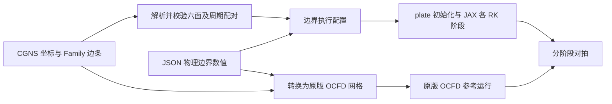

## Goal Capsule

将单块 plate 的普通边界从 CGNS 边条识别并接入正式 JAX 运行链，用同一网格和初场先尝试未修改的 OCFD，逐阶段核对。失败或度量不合理时保留证据并报告，不打补丁掩盖。只本地交付。

## Product Contract

### Requirements

- R1. `Grid/testcgnstest.cgns` 的 `FamilySpecified → FamilyName_t → FamilyBC_t` 解析到实际边界类型，保留 zone、patch、范围和 family 来源；缺失、重复、未知及不支持的分段边条在启动前报错。
- R2. 本项目约定 `BCSymmetryPolar` 表示周期，必须同一计算轴正负整面成对；不同轴或缺一侧报错。`BCSymmetryPlane` 明确不支持；不按坐标几何或容限检查配对，制网格者负责几何正确性。
- R3. 状态及 Ev 周期鬼层使用原版 OCFD 索引次序，不跳过重复端点，不强制用低侧覆盖高侧。原始坐标周期处理和流场交换须区分；原版度量先验证、报告其合理性。
- R4. 将入口、出口、无滑移等温壁、远场和周期整面接入 plate；复用 `boundary.py` 中可用实现，修正写入区域和调用次序前先以原版分阶段证据定位，不预设边界公式或鬼层全零。
- R5. JSON 分别给入口和远场的密度、物理三速度、温度，给等温壁壁温；同类型面共享一组，缺必需数值启动报错。对拍使用双方可表达的均匀单位来流，初场全域均匀；不新增未授权的物性数值范围检查。
- R6. 先使用未修改 OCFD，网格和初值从相同 CGNS 坐标与配置生成，保持物理轴、计算轴及速度分量映射明确；入口使用 `IF_WITHLEADING=0` 取均匀初场入口面。原版失败时记录日志、退出状态、非有限值与度量，定位原因并停在该结果，不预加补丁。
- R7. 对拍分初场、度量、边界点/鬼层、分裂/重构通量、RHS、RK 和末态报告逐变量、逐区域绝对/相对误差与非有限值。首次先记录精度和误差再确定阈值；可运行不等于物理正确，出现不合理度量或周期行为须明确报告且不视为物理标准。
- R8. 只以 plate 进行算例验证；历史 JAX 基准按 jisen 的要求删除，不再用作验收。保留 OCFD 参考和相关报告，不修改原版 OCFD；输出与临时文件使用独立目录，来源与哈希可追溯；不推送或发 PR。

### Sample and Scope

`Grid/testcgnstest.cgns` 的 SHA-256 为 `51e5f44f33924c1cf7d50dd7b7a67f17ea3a2b42123498b01a9c237d63d9f4ae`。单块 `100×40×40`；`i-` 入口、`i+` 出口、`j-` 壁、`j+` 远场、`k±` 为 `BCSymmetryPolar`。六边均整面 `FamilySpecified`，没有 `BCDataSet` 或连接。k 两端物理 z 为 0 与 3；两端按原码保留和交换，不以几何容限约束网格。样例当前未被 Git 跟踪，保留用户文件，不擅自覆盖。

不支持同面分段、多块、旋转周期、真实对称面、其他新增边界物理和 Poiseuille 验收。本项目的 Polar 周期是使用约定，不是 CGNS 标准等价声明。

---

## Planning Contract

### Data Flow

### Decisions and Risks

- 每个整面同一轴只接受成对 Polar；不从对称面推断周期或单侧 `any` 推导整个轴。其他连接及子区沿用明确拒绝，避免误执行。
- 保留内置 plate 入口供历史对照；CGNS 路径的网格、维数、面类型来自文件，不被 case 硬编码覆盖。入口/远场原始量和壁温从 JSON 取得，各类字段缺失报错。
- 先精确还原原版状态/坐标/度量来源，尤其周期端点重复与原版 40 点环绕的冲突；不把物理坐标的平移处理悄然等同流场周期。用户明确不做几何匹配容限，若度量异常在结果中披露。
- 在原版上做诊断时使用独立构建副本，运行算法保持原版；必要的 dump 插桩与原版输出分离并比对其末态一致，不能把此前非周期鬼层复制补丁混入。无可用原版编译环境或原版失败时仍完成可独立验证的 CGNS 接入，标记对拍阻塞，不宣称全流程通过。

---

## Implementation Units

### U1. 固定样例和旧行为

**目标与依赖：** R1、R3、R8；无前置。

**文件：** `Grid/testcgnstest.cgns`（只读）、`src/mesh_cgns.py`、`src/boundary.py`、`experiment/test_step4_cgns_reader.py`、新增 `experiment/test_step49_plate.py`。

**方法：** 验证文件哈希及现有原版源码/可执行文件来源；建立可重复测试，用有区分度的周期层记录状态、Ev 鬼层和内区端点的现状。旧 JAX/OCFD 数据只读。

**测试：** 报告 sample 的 Family、范围和轴；在每层值不同的场检查原版索引到鬼层的映射；确认不更改内区端点；记录原样例不通过当前 reader 的原因。

### U2. CGNS Family 和周期校验

**目标与依赖：** R1、R2；依赖 U1。

**文件：** `src/mesh_cgns.py`；`experiment/test_step4_cgns_reader.py`、`experiment/test_step4_cgns_adapter.py`、`experiment/test_step49_plate.py`。

**方法：** 按所选 Base 解析 FamilySpecified 和 FamilyBC，保留原始类型、解析来源与 patch；支持样例的 `BCInflow`，将 Polar 按用户约定映射周期并校验同轴对侧整面配对。Plane 明确拒绝；缺 family/类型、重复、非整面、跨轴或单侧周期报 zone 和 patch。无坐标容限或平移几何检查。

**测试：** 样例六面解析；直接 BC 类型和 Family 间接类型；i±、j±、k± 各合法周期对；单侧、错轴、重复、缺 family、未知类型、Plane、分段均失败；不以坐标相等作为条件。

### U3. JSON 状态及 plate CGNS 接入

**目标与依赖：** R4、R5；依赖 U2。

**文件：** `src/runtime_config.py`、`src/cases.py`、`src/init.py`、`src/mesh_data.py`、`src/boundary.py`；`experiment/test_step49_plate.py`、`experiment/test_step3_config.py`。

**方法：** 在 JIT 前使用 CGNS 的尺寸、坐标和 faces 装配 plate，保留 Family 信息；JSON 分别提供入口/远场五个原始量及等温壁温，转换成守恒量，不同类型分别使用，同类型面共享。初场由入口均匀值生成；保留原有内置 plate 路径。边界沿现有顺序执行（当前为边界点、鬼层、特殊回调），此阶段只视为链路接通；口径修正及对齐验收须经 U4 的原版证据支持，不依赖硬编码算例面名掩盖 CGNS。

**测试：** 使用真实样例和 JSON 启动前核对六面、维数和不同入口/远场值；缺任一必需项、非法 family/类型报错；输入速度与守恒量转换正确；修改边条改变选择，不能继续走固定 plate 面；边界点、四层鬼胞、角点和重复 `prepare` 用非均匀测试场核对；旧内置入口可运行。

### U4. 原版参考与分阶段核对

**目标与依赖：** R3、R6、R7；依赖 U1，JAX 完整对照依赖 U2、U3。

**文件：** 新增 `experiment/step49/` 内可追踪的输入转换、诊断与对照工具和 `experiment/test_step49_plate.py`；原版为工作区兄弟目录 `../OpenCFD-SCU-v3.0`，只读；输出使用独立目录。

**方法：** 原版计算前记录源文件/二进制/输入哈希、构建和运行命令、参数、轴及速度分量映射；先用原版网格与初值文件生成并运行。检查进程退出码、完成标志、原始输出、NaN 和有限正度量，不能只看退出码。必要的只读诊断/插桩与原版对照并验证不改变末态。逐阶段导出并按变量、区域定位差异；原版失败或不合理即停止将其作为物理标准，报告事实与限制，不应用补丁或预设阈值。

**测试：** 生成数据尺寸、坐标及速度分量映射与 CGNS 一致；周期层取值不跳过端点；失败日志、NaN、负/零 Jacobian 不误报成功；逐阶段对比能定位首次差异；非均匀周期测试单独检验两端，不以均匀场掩盖交换差异。

### U5. 验证与本地交付

**目标与依赖：** R7、R8；依赖 U2～U4。

**文件：** `experiment/test_step49_plate.py`、`experiment/README.md`、`src/README.md`、`11-16 我建议先对齐的.md`；保留历史 baseline。

**测试：** 先复现不支持 Family/Polar 与配对漏检，再验证 U2/U3；用 sample 真实运行 plate，并与原版按 U4 逐阶段对比；分别报告各区域/变量及精度；对原版非正常或度量不合理路径记录证据；确认旧 plate 基准与历史文件均未覆盖。

**验收：** 明确列出通过、失败、跳过与对拍限制；用户确认新的误差标准前只报告结果，不用未经验证阈值判通过。检查样例是否可在本地 Git 跟踪，保存必要输入或说明可重建来源及哈希；不擅自覆盖用户文件。不再对照历史 JAX 基准。只创建必要本地提交，不推送/发 PR。

---

## Verification Contract

针对新缺陷取得失败证据；实现后运行受影响的 CGNS、配置、边界、周期、plate 和 RK 测试。执行真实 CGNS 入口与原版 OCFD 参考并分阶段核查；环境不具备或原版失败时保留证据并如实报告。不再以历史 JAX 输出为回归参照；Poiseuille 和全七例不作为物理验证门槛。

## Definition of Done

- plate 正式入口由真实 CGNS Family 边条驱动；JSON 数值、配对校验、原版索引周期交换及失败路径有持久测试。
- 原版 OCFD 同网格对拍及各阶段证据完成；若原版失败或度量不合理，独立可完成的工作仍保留，但总体对拍明确标记阻塞，不声称完成或物理正确。
- 保留样例、OCFD 参考和现有用户改动；本地审查、测试及 Git 状态清晰，无推送或 PR。
