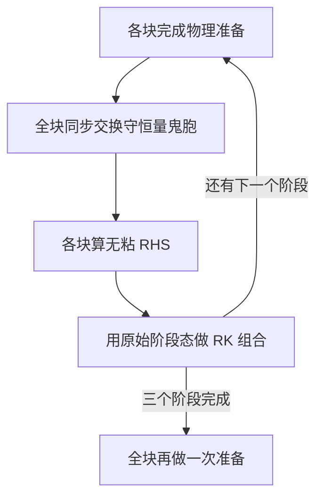

# 第六步 多块串行读取与块间状态交换 - Plan

## Goal Capsule

- 目标：读进一个多块 CGNS 文件，按文件里的连接关系在各块之间交换鬼胞，串行地逐块跑无粘 RHS 和 RK3，结果与等价单块逐阶段一致。
- 依据：`11-16 我建议先对齐的.md` 里“第 6 步”的定义，以及 jisen 在讨论和 grilling 中定下的决定（见 Key Decisions）。
- 约束：只单进程；不改单块代码路径，默认口径逐位不变；原码树不动。
- 未决：没有阻塞实施计划的疑问。实施时再定的细节见 Outstanding Questions。

---

## Product Contract

### Summary

第六步让程序读得多块 CGNS 并串行跑通：块与连接来自文件，只认同向的连接（整面或分段），逐块计算，按静态映射交换守恒量，度量在各块算好后交换。验收是 plate 网格切出的五个算例与等价单块逐阶段一致。

### Problem Frame

现在正式运行链只接了受限的单块 CGNS。跨块连接和分段面都被读取器明确拒绝，真实的多块网格读不进来。

只交换守恒量不够，界面旁鬼胞上的度量也必须和单块相同。做法和原码一致：先交换坐标的面条带，各块算内区度量，再交换度量的面条带。直接在扩展后的坐标上算会出两个错：切口被当成物理边界，套了单侧公式；鬼胞度量又被最近内点的值覆盖。实测切口末内点的 `Ajac` 是 1923.20，单块同一位置是 1851.09。

守恒量的情况简单些。无粘 RHS 逐方向求解，内点只用到面内区范围对应的四层鬼胞，棱角处的守恒量鬼胞不参与。原码的分块交换也只覆盖内区。原码换的是原始变量、度量和粘性通量，并且只在全域的外边缘套物理边界带。JAX 换守恒量、接口不按边界处理，后者与原码一致，前者是两边口径不同的地方。

ε 的尺度换算现在由程序按网格尺寸推断。拆块后必须沿用等价单块的全局尺度：按各块自己的尺寸算，WENO7 的面值会差 2.21×10⁻⁵，远超舍入。多块文件不携带“等价单块的尺寸”，所以这个尺度只能显式给出。

### Key Decisions

- **分块与连接只认文件。** 程序内部不做自动切块；验收网格由一个脚本从单块网格切出来。jisen 之后的真实多块网格走同一条路。
- **验收矩阵是五个网格，各块不要求同形。** x 切、y 切、z 切各两块，分别暴露流向、壁向拉伸、展向周期三类问题；2×2×2 八块检验棱和角；“左块全高、右半上下分开”的三块检验部分面。对照连续比较至少两个整步。
- **对照基准只有 JAX 单块。** 自洽对照能抓出交换逻辑的全部错误。原码的分块口径读源码后作为设计依据，不跑原码多进程。
- **连接只认同向。** `Transform` 必须是 `(1,2,3)`，低侧面对高侧面。翻转、轴交换、块的同一个侧面接自己都在读取时报错，不做“只读不跑”的入口。同块内相对两个面的周期自连接按现有做法继续执行。jisen 的真实网格如果写出不合法的连接，读文件时就能发现。
- **跨块周期用“块间 1to1 连接加 `Periodic_t`”表达。** 配对由文件写明，不靠坐标匹配去找。jisen 会尽量避免周期方向跨块；z 切和八块两个验收仍然需要它。
- **逐块数组加静态交换计划，放在新的多块编排模块。** 每块有自己的数组、网格、度量和六侧描述，调用现有的单块函数求导。`boundary.py` 的接口是“一个块、一个数组”，不放跨块的东西。
- **度量先算后换，周期接缝除外。** 各块先算内区度量，普通接口的面条带再换成供体的。全局周期接缝沿用单块周期端的规则。块角处的坐标与单块一致不在第六步的验收里，粘性项（第七步）才需要它。
- **ε 用等价单块的全局参考尺度。** 多块运行时在配置里显式给出；单块路径保持现在按网格尺寸推断的做法。
- **每个 RK 阶段先准备、再交换、后求导。** 所有块从自己的原始阶段态完成物理准备，全块同步交换，然后各块用准备且交换过的状态算 RHS。RK 组合仍用原始阶段态。
- **多块模式只放行验收过的配置。** plate、WENO7、FP64、固定步长、无粘、不带特殊边界脚本，也没给 `weno_tv`、`outlet_ghost` 和网格尺寸。
- **特殊边界脚本配多块现在报错。** 以后要支持：多块也要能用特殊边界，它一般靠约束绝对坐标施加，不需要按块寻址。
- **对照比较三个 RK 阶段和整步末态，两边都关粘性项。** 只比初场 RHS 和末态会漏掉第二、三阶段的交换错误；均匀来流的初场分辨不出 RK 操作数的错误。
- **输出按块分文件是过渡。** 第六步每块各存一份 NPZ；第八步换成每个保存步一个 NPZ，内含所有块，带多块标记。
- **不带 `--cgns-zone` 就读全部块。** 多块 CGNS 文件本身就是多块网格。带 `--cgns-zone` 的单块路径不变。

### Requirements

**读取与校验**

- R1. 不给 `--cgns-zone` 时读入文件里全部 Structured zone；给出时保持现有的单块行为，包括选中不能独立执行的块时的报错。
- R2. 多块入口先校验连接，再装配边条的可执行性。
- R3. 读取全部 `GridConnectivity1to1_t`。每条连接的 `Transform` 必须是 `(1,2,3)`，并且把本块某个轴的低侧面接到供体同轴的高侧面，或反过来。其他情况读取时报错，消息指明连接名和错处。供体的范围按供体自己的尺寸校验。
- R4. 同块、同轴、相对整面、双向 identity、不带 `Periodic_t` 的自连接，在多块文件里继续按块内周期执行。同一块的同一个侧面接自己报错。
- R5. 一个面可以由多条连接分段覆盖，各段接同向的供体。相邻段在交界的一条线上重叠是合法的；带面积的重叠和缺口报错。
- R6. `GridConnectivity_t`、网格的 `Rind`、非匹配界面、带旋转的周期都明确报错。
- R7. 跨块周期只能用“块间 1to1 连接加 `Periodic_t`”表达。不同块上的成对周期边条、同块自连接带 `Periodic_t` 都报错。平移量定义为供体坐标减接收坐标，反向记录取负。文件给了平移量时用它核对；没给时核对“平移在整个面上是常向量”，这是本项目的兼容约定。
- R8. 以下情形在启动前报错并指出块、面与范围：块的外表面没有可执行的边条；同一段面既被边条覆盖又被连接覆盖；普通接口两侧对应顶点的坐标超出容差；连接的两个方向记录不一致；内表面没有被连接盖满。覆盖按面元计，顶点可以被相邻段共享。
- R9. CFL3D 样例 `Grid/samples/multi_hdf5.cgns` 是负例：读到第一条不合法的连接就报错，消息指明这条连接和它的 `Transform`。另有一个只含 `1to1InterfaceA 7` 那条记录的定向样例，用来精确核对报错对象。
- R10. 启动时输出接口报告。两条方向记录合计为一个接口对；同一对块可以同时有普通切口和周期接缝，接口对的标识要含面与范围。报告列出每个接口对的两侧块、面、范围、对应点数、最大坐标差、周期接缝的平移向量与扣除平移后的残差、缺口或重叠。
- R11. 一个面上既有边条段又有连接段时，读取与覆盖校验照做，为块建立六侧描述时报错。
- R12. 块的尺寸按实际启用的模板在启动时诊断，不够就报错：普通接口的供体在法向至少 5 个顶点，度量单侧带至少 7 个，面通量边界带至少 6 个。

**块与算例**

- R13. 一个 Structured zone 对应一个运行块，各块不要求同形。算例共用物性、步长和初值的定义。初值在各块的物理坐标上取同一个函数，这个函数沿 i、j、k 三向都有变化，物理域外按既定的鬼胞规则取值。每块持有自己的坐标、状态、度量和六侧描述。
- R14. 接口上的共享顶点两个块各存一份、各自推进。直接从供体复制来的守恒量鬼胞、从同一源切出的重复坐标，与供体逐位相同。各自推进的副本之间、每份副本与单块之间，按 R31 的容差在每个 RK 阶段比较，拼回全局去重之前先做这项比较。
- R15. 六侧描述只让真实的物理面进入现有的写点和填充函数；接口段由多块编排模块接管，不伪装成物理面。同一个侧面上既有普通接口段又有周期接口段时报错。
- R16. 每块有自己的 4 层鬼胞；每个连接段的收发下标映射在运行前算成静态表。
- R17. 设供体在法向的内区下标是 0 到 n−1，鬼层号是 r=1 到 4。普通接口的两面共用一层顶点：接低侧供体时取下标 r，接高侧供体时取 n−1−r。周期接缝沿用单块现在的环绕下标：接低侧供体取 r−1，接高侧供体取 n−r。
- R18. T 形交界按固定规则处理：共线的接收位置只写一次；所有供体候选从同一份已准备的状态取出，先核对一致，再按固定的归属写入。坐标和度量的面条带用同一套归属。交换连接或块的遍历顺序，结果不变。

**交换与度量**

- R19. 每次 RHS 之前，接口上的守恒量鬼胞等于按 R17 的映射从供体块取到的当前值。守恒量只交换面内区范围对应的部分。
- R20. 拼回后各块内区和参与计算的面条带上，坐标与度量与单块对应点一致。普通接口旁鬼胞的度量取自供体块的内区度量；接口一侧的坐标导数用中心模板，物理面一侧沿用单块对应侧的规则。全局周期接缝是例外：那里的度量鬼胞沿用单块周期端的规则，复制本端最近内点的值。
- R21. 内部接口不套物理边界带、不丢分裂通量、不清零鬼胞；只有带物理边条的面执行各自的边界规则。
- R22. ε 的尺度换算用等价单块的全局参考尺度，覆盖主模板 ε、边界带 ε 和阈值的换算。多块运行时三轴参考尺度在配置里显式给出，单块路径保持现状。plate 验收网格用 (1521, 3861, 3861)，每个算例与同一源文件的单块对照。
- R23. 常数场交换后接口鬼胞等于该常数；线性场的界面导数与单块一致。

**运行**

- R24. 每个 RK 阶段按固定顺序：各块从自己的原始阶段态出发完成物理准备；全块都准备好后，从这份固定的状态同步交换守恒量鬼胞；各块用准备且交换过的状态算无粘 RHS。RK 组合用原始阶段态和整步起点，不用准备过的状态。所有块做完一个阶段才进入下一个阶段。整步组合完成后，全块再做一次准备，用于输出和下一整步。各块用同一个步长，最后一步用 `min(dt, end_time−t)`。单块正式入口现有的 RK 语义不变。
- R25. 多块模式只放行验收过的配置：plate、WENO7、FP64、固定步长、无粘、不带特殊边界脚本。`weno_tv`、`outlet_ghost`、`--ni/--nj/--nk` 显式给出时也报错。入口、远场、壁温沿用 CGNS plate 现有的参数和规则。这项校验在合并配置之后、识别出“没选 zone 且文件有多个 zone”时执行，早于分配数组、构造度量、加载脚本和 JIT。单 zone 和显式选 zone 走原路径。
- R26. 各块用现有的单块无粘 RHS 逐块求导。不用多块网格时，现有的单块行为逐位不变。
- R27. 多块运行按块各存一份 NPZ，文件名带块名，格式与单块相同。各块在同一步保存，保存时机沿用单块现在的规则。

**验收**

- R28. 五个验收网格由同一个脚本从 plate 单块网格派生，可复建：x 切、y 切、z 切各两块，2×2×2 八块，以及左块全高、右半上下分开的三块。源网格的 y 向是拉伸的。脚本同时记下各块的全局顶点范围，供独立拼回。
- R29. 拼回全局后，多块与等价单块逐阶段一致。比较项是三个 RK 阶段的 `du1`、`du2`、`du3`，共享点的各份副本，求 RHS 之前准备态上的接口四层，以及整步准备后的末态。连续比较至少两个整步。两边都关闭粘性项，初场按 R13 给出。
- R30. 部分面和周期接缝另有小型交换测试：用沿 i、j、k 各不相同的场逐层核对映射。
- R31. 一致性的阈值在实施的第一步确定，并写进测试：先在 FP64 后端实测是否逐位相同以及最大绝对差，再用同一参考运算的舍入量级给每个守恒量定绝对容差和相对容差。近零的量由绝对容差控制，出现非有限值直接判失败。按变量、接口邻域和全域分别报告，报告最差的块、全局下标和变量。不得把实现已有的错位或 ε 差异吸收进容差。
- R32. 验收覆盖单块回归和落盘。现有单块测试全部照常通过。多块输出的文件数等于块数，块名不冲突，同一步号和时间，`cons_0…4` 只含各块内区，保存后能回读。验收里包含一个非保存步、一个保存步和一个截短的末步。

### Key Flows

- F1. 多块下的一个 RK 阶段
  - **Trigger:** 多块网格读入并通过校验后，每个 RK 阶段都按同一顺序执行。
  - **Steps:** 各块从自己的原始阶段态完成物理准备（写物理边界点、按面填物理鬼胞）→ 全块都准备好后同步交换守恒量鬼胞 → 各块用准备且交换过的状态算无粘 RHS → 用原始阶段态做 RK 组合。三个阶段都完成后，全块再做一次准备。
  - **Outcome:** 接口鬼胞在每个阶段都来自所有块同一阶段的准备态；没有任何一块先于其他块走完三个阶段。
  - **Covered by:** R19, R21, R24

### Acceptance Examples

- AE1. **同一段面被重复覆盖**
  - **Given:** 某块一个面的某一段既有 `BC_t` 又有 1to1 覆盖。
  - **When:** 读取。
  - **Then:** 报错，消息带块名、面和范围。
  - **Covers R8.**
- AE2. **连接两侧坐标不符**
  - **Given:** 一条普通接口两侧对应顶点的坐标差超出容差。
  - **When:** 读取。
  - **Then:** 报错，消息带连接名和最大差值。
  - **Covers R8.**
- AE3. **整文件的负例**
  - **Given:** CFL3D 样例。
  - **When:** 读取。
  - **Then:** 报错，消息指明实际遇到的第一条不合法连接：Zone 1 的 `1to1InterfaceA 1`，`Transform=[1,-2,3]`。
  - **Covers R2, R3, R9.**
- AE4. **定向的负例**
  - **Given:** 只含 `1to1InterfaceA 7` 那条记录的样例。
  - **When:** 读取。
  - **Then:** 报错，消息指明这条连接和它的 `Transform`。
  - **Covers R9.**
- AE5. **一面接两个邻居**
  - **Given:** 三块验收网格，左块的 i+ 面分两段，分别接右下块和右上块的 i− 面。
  - **When:** 运行。
  - **Then:** 拼回后与单块逐阶段一致。
  - **Covers R5, R28, R29.**
- AE6. **T 形交界的写入归属**
  - **Given:** 三块验收网格，左块 i+ 面的两段在 j=20 这条线上重叠。
  - **When:** 任意交换连接或块的遍历顺序后再运行。
  - **Then:** 各阶段的结果与原来相同；共线处的四层鬼胞只有一个写入者。
  - **Covers R18, R29.**
- AE7. **内部接口不是边界**
  - **Given:** y 切成的两个块，y 向网格是拉伸的。
  - **When:** 算无粘 RHS。
  - **Then:** 紧贴接口的内点用的是满模板，不出现边界带的单侧公式；拼回后的度量、RHS 与单块的差都在阈值内。
  - **Covers R20, R21, R29.**
- AE8. **周期接缝的下标与度量**
  - **Given:** z 切成的两个块。
  - **When:** 交换并算度量。
  - **Then:** 左块 k− 的四层鬼胞依次是右块 k+ 端点起的四层；度量鬼胞复制本端最近内点。两者都与单块的周期端相同。
  - **Covers R7, R17, R19, R20.**
- AE9. **阶段屏障**
  - **Given:** 任意一个多块验收网格。
  - **When:** 运行。
  - **Then:** 任一块在任一阶段用到的接口鬼胞，都等于其他块同一阶段准备态上的值。把一块的三个阶段连续走完而其他块还没动，是被禁止的。
  - **Covers R24.**
- AE10. **没验收过的开关**
  - **Given:** 多块网格配 `viscous=true`、`--fp32`、WENO7 以外的格式、显式的 `weno_tv`、`outlet_ghost` 或网格尺寸。
  - **When:** 启动。
  - **Then:** 在分配数组和编译之前报错。
  - **Covers R25.**
- AE11. **混合面**
  - **Given:** 一个面上既有边条段又有连接段。
  - **When:** 启动。
  - **Then:** 读取与覆盖校验通过，建立六侧描述时报错。
  - **Covers R11.**
- AE12. **接口报告**
  - **Given:** 2×2×2 验收网格，同一对块之间既有普通切口又有周期接缝。
  - **When:** 启动。
  - **Then:** 报告把它们列为两个接口对，各带范围、平移向量和残差。
  - **Covers R10.**
- AE13. **ε 的参考尺度**
  - **Given:** 多块配置里没有给三轴参考尺度。
  - **When:** 启动。
  - **Then:** 报错。
  - **Covers R22.**
- AE14. **按块落盘**
  - **Given:** 多块运行，保存间隔设为 2，跑到第 5 步。
  - **When:** 第 1、2、5 步结束。
  - **Then:** 第 1 步没有文件；第 2 步每块各有一个文件，步号与时间相同，能回读；第 5 步是截短的末步，同样每块一个文件。
  - **Covers R27, R32.**

### Scope Boundaries

- 粘性通量 `Ev` 的块间交换与多块粘性 RHS，属第七步。块角处坐标与单块一致也在第七步处理。
- 输出系统属第八步：替换为每个保存步一个 NPZ，内含所有块，带多块标记。
- 多 GPU 与统一块维布局，属第九步。
- 翻转、轴交换、块的同一个侧面接自己：第六步一律报错，要不要支持留到第十步再定。
- 同一个侧面上混有普通接口段和周期接口段：第六步报错。
- 非匹配界面与重叠网格，属第十步。
- 与原码多进程分块运行对拍：本步不做。
- 为缺少连接信息的文件做坐标匹配：本步不做。
- 除 plate 以外的算例、WENO7 以外的格式、FP32、粘性项、`weno_tv`、`outlet_ghost`：多块下都报错，各自验收后再放开。
- 特殊边界脚本配多块：现在报错。后续要求来自 jisen：多块也要能用特殊边界，它一般靠约束绝对坐标施加（例如旁路转捩区），不需要按块寻址。
- 内站壁面梯度偏低：作为已知的物理验证问题带着走，本步不处理。

### Dependencies / Assumptions

- 原码分块口径来自读源码，没有用运行结果核实：`PARALLEL_3D` 把网格均分、余数给靠前的块；`exchange_boundary_{x,y,z}` 每次换 4 层，横向循环只走内区；无粘阶段换原始变量，粘性阶段换 `Ev`；几何初始化先换坐标、算内区度量、再换度量；物理边界带只在全域外边缘生效。
- “守恒量只交换面内区范围”的适用对象是物理准备之后的无粘内区 RHS。在三维 WENO7 小场上改动双轴、三轴越界处的全部守恒量，内区 RHS 逐位相同。坐标、度量、回调、粘性算子不适用这条结论。
- `compute_metrics_from_coords` 给一条轴的两侧传同一对边界标志，最后把全部度量鬼胞覆盖为最近内点的值；底层的 `cd_along_axis` 已支持两侧独立的标志。在 y 向拉伸网格的 j=20 处切开做内存探针：两侧标志独立后，两块全部内点的十个度量与单块逐位相同。
- 全局周期端不能换成对端的度量：换了之后 16000 个值里有 15917 个位型不同，最大差 2.1×10⁻¹⁰。单块 CGNS 的周期端开着 `JAC_BOUND`。
- `du` 在全数组上乘 `Ajac`，不参与无粘计算的鬼区也必须有有限的度量值。
- 现有正式路径对原始阶段态调用 `build_rhs`，准备在函数内部完成，`rk3_step` 不传 `bc_apply`。对交换后的状态再调用 `build_rhs` 会重复准备；把准备传给 `rk3_step` 会改变组合的操作数。均匀来流的 plate 无粘一步分辨不出这两种错误，差恰为零。
- `_read_connections` 已能读出跨块的供体名、带符号的 `Transform` 和倒序范围。`_side_of` 遇到倒序范围会丢掉原端点。`_collect_sides` 一个侧面只能登记一次。`_validate_executable` 的“同轴两侧都是周期”检查不适用于跨块周期。
- SIDS 把 `Periodic_t` 的 `Translation`、`RotationAngle`、`RotationCenter` 列为必需数组。验收网格的生成脚本把它们写齐。
- 两个候选的源网格在 `flux_scales_for` 下都给出 (1521, 3861, 3861)。它们的 y 向间距不同，会改变度量和参考 RHS，所以每个算例只和同一源文件的单块对照。
- jisen 之后会提供一个真实的多块 CGNS 网格做实验，并且会尽量避免周期方向跨块。第六步只验收 plate。
- 验收网格以 y 向拉伸的 plate 网格为源，否则 y 切暴露不了镜像外推坐标的错误。
- 讨论中查出的欠账已清理到 Astra 第十三轮指出的三处为止。动第六步的代码之前，要等 Astra 复核确认。

### Outstanding Questions

**Resolve Before Planning**

无。

**Deferred to Planning**

1. 验收网格的源文件、切分位置、对照步数。
2. ε 参考尺度与多块输出在配置 JSON 和命令行里的字段名。
3. 初场的光滑非均匀场取什么形式。
4. 多块结果拼回全局并做对照的工具放在哪里。
5. 度量函数如何逐侧选择规则，以及不参与计算的鬼区怎样填有限的度量值。
6. T 形交界共线处的固定归属取哪一段。
7. 接口段在多块编排里的数据结构，以及它怎样与现有的六侧描述并存。

### Sources / Research

- 路线图：`11-16 我建议先对齐的.md` 的“第 6 步”“第 7 步”“第 8 步”和第五节“对齐计算”（InterfaceMap 的字段、接口报告）。
- 早期分析稿：`多块网格GPU.md`。它的“先 x 再 y 再 z 顺序交换”和“内部接口不套物理边界带”仍然有效；全局 CFL 步长、滤波、`channel.py`/`plate.py` 的内容已被后来的决定取代。
- CGNS 格式与样例：`Grid/CGNS多块网格说明.md`，尤其第四节（1to1、`Transform` 的含义、同面自连接）和第五节的边条映射。
- 读取器现状：`src/mesh_cgns.py`。多 zone 必须指定 `--cgns-zone`；只接受同块、`Transform=(1,2,3)` 的整面自连接；跨块连接、`GridConnectivity_t`、`Periodic_t`、`Rind` 都拒绝；周期要求在同一块内同轴成对。
- 运行链：`src/boundary.py` 的 `BoundaryExecution.prepare`、`write_faces` 与 `fill_faces`；`src/mesh.py` 的 `compute_metrics_from_coords`、`cd_along_axis` 与 `pad_coords`；`src/solver.py` 的 `flux_scales_for`、`_rhs_along_axis`、`inviscid_rhs`、`rk3_step`；`src/main.py` 的 `build_rhs` 与时间推进循环；`src/cases.py` 的 `CaseSpec`；`src/mesh_data.py` 的 `BlockMesh` 与 `FaceBoundary`。
- 原码：`src/OCFD_mpi.c` 的 `part` 与 `exchange_boundary_{x,y,z}`；`src/OCFD_Stream.cu` 里 `du_invis_Jacobian3d` 的交换调用；`src/OCFD_Comput_Jacobian3d.cu` 对坐标与度量的交换；`src/OCFD_bound_Scheme.cu` 的 `OCFD_bound`。原码不读 CGNS，网格读自 `OCFD3d-Mesh.dat` 后按 `PARALLEL_3D` 分块。
