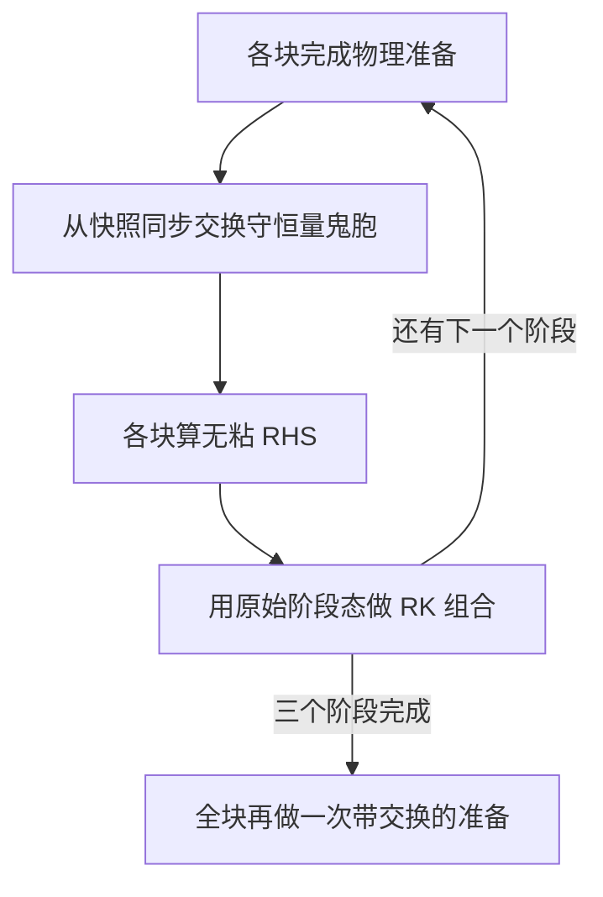
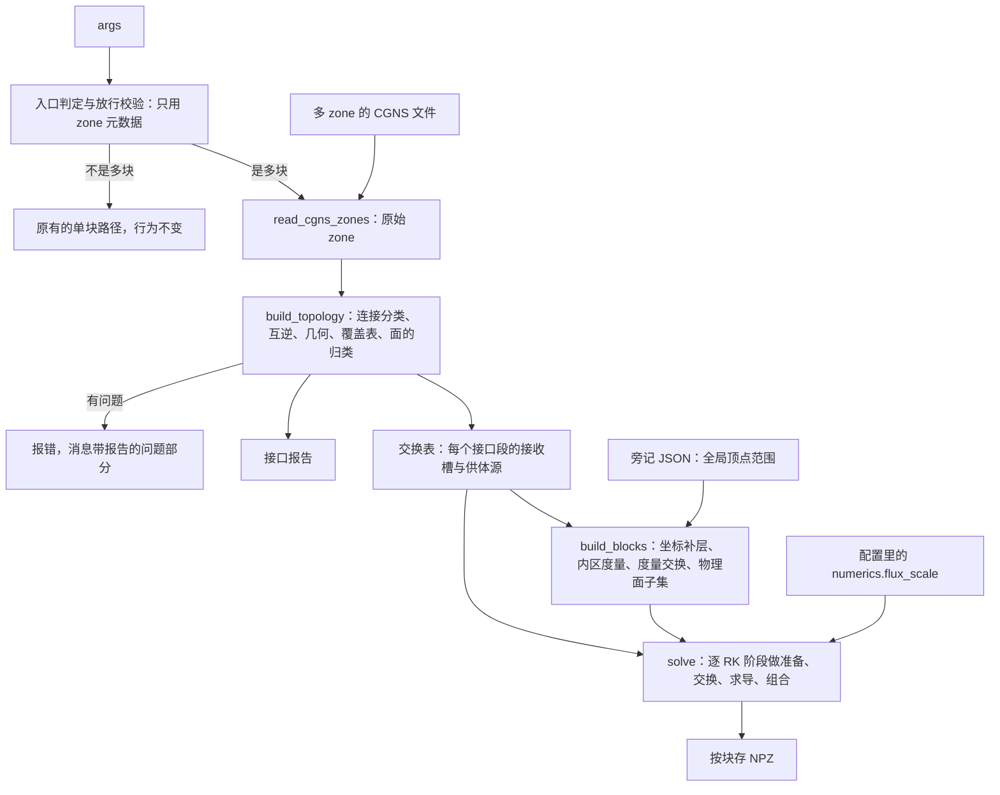

# 第六步 多块串行读取与块间状态交换 - Plan

## Goal Capsule

- 目标：读进一个多块 CGNS 文件，按文件里的连接关系在各块之间交换鬼胞，串行地逐块跑无粘 RHS 和 RK3，结果与等价单块逐阶段一致。
- 依据：`11-16 我建议先对齐的.md` 里“第 6 步”的定义，以及 jisen 在讨论和 grilling 中定下的决定（见 Key Decisions）。
- 约束：只单进程；单块路径的结果和报错行为不变，默认口径逐位不变；原码树不动。
- 未决：没有阻塞实施的疑问。

---

## Product Contract

### Summary

第六步让程序读得多块 CGNS 并串行跑通：块与连接来自文件，只认同向的连接（整面或分段），逐块计算，按静态映射交换守恒量，度量在各块算好后交换。验收是 plate 网格切出的五个算例与等价单块逐阶段一致。

### Problem Frame

现在正式运行链只接了受限的单块 CGNS。跨块连接和分段面都被读取器明确拒绝，真实的多块网格读不进来。

只交换守恒量不够，界面旁鬼胞上的度量和坐标也必须和单块相同。做法和原码一致：先交换坐标的面条带，各块算内区度量，再交换度量的面条带。直接在扩展后的坐标上算会出两个错：切口被当成物理边界，套了单侧公式；鬼胞度量又被最近内点的值覆盖。实测切口末内点的 `Ajac` 是 1923.20，单块同一位置是 1851.09。

守恒量的情况简单些。无粘 RHS 逐方向求解，内点只用到面内区范围对应的四层鬼胞，棱角处的守恒量鬼胞不参与。原码的分块交换也只覆盖内区。原码换的是原始变量、度量和粘性通量，并且只在全域的外边缘套物理边界带。JAX 换守恒量、接口不按边界处理，后者与原码一致，前者是两边口径不同的地方。

ε 的尺度换算现在由程序按网格尺寸推断。拆块后必须沿用等价单块的全局尺度：按各块自己的尺寸算，WENO7 的面值会差 2.21×10⁻⁵，远超舍入。多块文件不携带“等价单块的尺寸”，所以这个尺度只能显式给出。

### Key Decisions

- **分块与连接只认文件。** 程序内部不做自动切块；验收网格由一个脚本从单块网格切出来。jisen 之后的真实多块网格走同一条路。
- **验收矩阵是五个网格，各块不要求同形。** x 切、y 切、z 切各两块，分别暴露流向、壁向拉伸、展向周期三类问题；2×2×2 八块检验棱和角；“左块全高、右半上下分开”的三块检验部分面。对照连续比较至少两个整步。
- **对照基准只有 JAX 单块。** 自洽对照能抓出交换逻辑的全部错误。原码的分块口径读源码后作为设计依据，不跑原码多进程。
- **连接只认同向。** `Transform` 必须是 `(1,2,3)`，低侧面对高侧面。翻转、轴交换、块的同一个侧面接自己都在读取时报错，不做“只读不跑”的入口。同块、同轴、相对整面、双向 identity、不带 `Periodic_t` 的周期自连接按现有做法继续执行。jisen 的真实网格如果写出不合法的连接，读文件时就能发现。
- **跨块周期用“块间 1to1 连接加 `Periodic_t`”表达。** 配对由文件写明，不靠坐标匹配去找。jisen 会尽量避免周期方向跨块；z 切和八块两个验收仍然需要它。
- **逐块数组加静态交换计划，放在新的多块编排模块。** 每块有自己的数组、网格、度量和六侧描述，调用现有的单块函数求导。`boundary.py` 的接口是“一个块、一个数组”，不放跨块的东西。
- **度量先算后换，周期接缝除外。** 各块先算内区度量，普通接口的面条带再换成供体的。全局周期端的坐标、坐标导数和度量鬼层都沿用单块周期端的规则。块角处的坐标与单块一致不在第六步的验收里，粘性项（第七步）才需要它。
- **ε 用等价单块的全局参考尺度。** 多块运行时在配置里显式给出；单块路径保持现在按网格尺寸推断的做法。
- **每个 RK 阶段先准备、再交换、后求导。** 所有块从自己的原始阶段态完成物理准备，全块同步交换，然后各块用准备且交换过的状态算 RHS。RK 组合仍用原始阶段态。
- **多块模式只放行验收过的配置。** plate、WENO7、FP64、固定步长、无粘、不带特殊边界脚本，也没显式给 `weno_tv`、`outlet_ghost` 和网格尺寸。
- **特殊边界脚本配多块现在报错。** 以后要支持：多块也要能用特殊边界，它一般靠约束绝对坐标施加，不需要按块寻址。
- **对照比较三个 RK 阶段、组合的中间状态和整步末态，两边都关粘性项。** 只比 RHS 和末态会漏掉第二、三阶段的交换错误，也分辨不出 RK 操作数的错误。
- **输出按块分文件是过渡。** 第六步每块各存一份 NPZ；第八步换成每个保存步一个 NPZ，内含所有块，带多块标记。
- **不带 `--cgns-zone` 就读全部 Structured zone。** 多块 CGNS 文件本身就是多块网格。带 `--cgns-zone` 的单块路径不变。

### Requirements

**读取与校验**

- R1. 不给 `--cgns-zone` 时读入文件里的全部 zone。多块模式要求文件只有一个 `CGNSBase_t`，所有 zone 都是 Structured；出现多个 base 或其他类型的 zone 时读取报错。给出 `--cgns-zone` 时保持现有的单块行为，包括选中不能独立执行的块时的报错。
- R2. 多块入口先校验连接，再装配边条的可执行性。
- R3. 连接分三类，各类有自己的配对判据和坐标判据。同块、同轴、相对整面、双向 identity、不带 `Periodic_t` 的自连接按块内周期环绕处理，不做坐标重合的检查。跨块的普通切口要求两侧对应顶点坐标重合。跨块的平移周期要求按 `Translation` 平移后对应顶点重合。
- R4. 所有连接的共同要求：`Transform` 是 `(1,2,3)`，缺省即 identity；本块某个轴的低侧面接供体同轴的高侧面，或反过来；接收和供体两侧的有向端点都保留，范围按各自 zone 的尺寸验界；两个切向轴的有向增量分别相等，只比总点数不够；两侧一同倒写合法，只倒写一边报错；两条方向记录互逆。其他情况读取时报错，消息用原名指明连接和错处。CGNS 允许而第六步不支持的写法（例如把法向的冗余分量写成 0）提示“第六步暂不支持”，不说文件格式错。供体按原始 zone 名解析。
- R5. 一个面可以由多条连接分段覆盖，各段接同向的供体。相邻段在交界的一条线上重叠是合法的。
- R6. `GridConnectivity_t`、带正厚度的网格 `Rind`、非匹配界面、带旋转的周期都明确报错。
- R7. 跨块周期只能用“块间 1to1 连接加 `Periodic_t`”表达。不同块上的成对周期边条、同块自连接带 `Periodic_t` 都报错。平移量定义为供体坐标减接收坐标，反向记录取负。文件给了 `Translation` 时用它核对；只有缺 `Translation` 时才走“平移是常向量”的兼容分支。旋转信息缺失、数组长度不对、出现非有限值、旋转角非零，各自报错。
- R8. 几何检查的容差独立于 R37 的守恒量容差。
- R9. 启动前为每个面建立覆盖表：每个面元恰好被一个来源覆盖，来源是边条或连接。边条对边条、连接对连接、边条对连接三种带面积的重叠，以及缺口，都报错；闭区间共线不算重叠。
- R10. 块的外表面没有可执行的边条时，启动前报错并指出块、面与范围。
- R11. CFL3D 样例 `Grid/samples/multi_hdf5.cgns` 是负例：读到第一条不合法的连接就报错，消息用原名指明 `Zone   1 / 1to1InterfaceA   1` 和它的 `Transform`。另有两个定向样例，分别只含 `1to1InterfaceA 7` 那条记录、以及一条把两个坐标轴对调的连接，用来精确核对报错对象。
- R12. 启动时输出接口报告。两条方向记录合计为一个接口对，报告给出接口对总数。同一对块可以同时有普通切口和周期接缝，接口对的标识要含面与范围。报告列出每个接口对的两侧块、面、范围、对应点数、最大坐标差、周期接缝的平移向量与扣除平移后的残差、缺口或重叠。
- R13. 一个面上既有边条段又有连接段时，读取与覆盖校验照做，为块建立六侧描述时报错。同一个侧面由几段同类边条覆盖时合并成一个面；段与段的边条类型不同时，在建立六侧描述时报错。
- R14. 块的尺寸按实际启用的模板在启动时诊断，不够就报错：普通接口的供体在法向至少 5 个顶点，度量单侧带至少 7 个，面通量边界带至少 6 个。

**块与算例**

- R15. 一个 Structured zone 对应一个运行块，各块不要求同形。算例共用物性、步长和初值的定义。每块持有自己的坐标、状态、度量和六侧描述。
- R16. 验收用的初场是一个按全局坐标给出的光滑非均匀场，沿 i、j、k 三向都有变化，单块和多块取同一个函数，物理域外按既定的鬼胞规则取值。初场在物理边界上不满足边界条件，所以第一次物理准备至少改写一个内区的边界点。现有正式单块 plate 把入口常量铺满内区，对照两边的单块参考也要用这个验收初场。
- R17. 接口上的共享顶点两个块各存一份、各自推进。直接从供体复制来的守恒量鬼胞、从同一源切出的重复坐标，与供体逐位相同。各自推进的副本之间、每份副本与单块之间，按 R37 的容差在每个 RK 阶段比较，拼回全局去重之前先做这项比较。周期两端是两个不同的全局离散点，拼回时两端都保留。
- R18. 六侧描述只让真实的物理面和块内的周期面进入现有的写点和填充函数，并按规范的六侧顺序传入，因为现有的写点函数按传入顺序写值。块内的周期面对照旧做本块的环绕，每个阶段都做。x 切、y 切和三块算例属于这种情况；z 切和八块算例里，这两个面换成了跨块的周期连接。接口段由多块编排模块接管，不伪装成物理面。没有物理面的块显式跳过物理准备，不走 `prepare` 对空 `faces` 的回退。同一个侧面上既有普通接口段又有周期接口段时报错。
- R19. 每块有自己的 4 层鬼胞；每个连接段的收发下标映射在运行前算成静态表。
- R20. 设供体在法向的内区下标是 0 到 n−1，鬼层号是 r=1 到 4。普通接口的两面共用一层顶点：接低侧供体时取下标 r，接高侧供体时取 n−1−r。周期接缝沿用单块现在的环绕下标：接低侧供体取 r−1，接高侧供体取 n−r。
- R21. T 形交界按固定规则处理：共线的接收位置只写一次；所有供体候选从同一份已准备的状态取出；选定的供体到接收槽逐位相同，独立推进的其他供体候选按 R37 的容差核对；最后按固定的归属写入。坐标和度量的面条带用同一套归属。交换连接或块的遍历顺序，结果不变。

**交换与度量**

- R22. 每次 RHS 之前，接口上的守恒量鬼胞等于按 R20 的映射从供体块取到的当前值。守恒量只交换面内区范围对应的部分。
- R23. 交换从交换前的快照读取。一个方向的处理读不到另一个方向刚写入的接收值。
- R24. 普通切口旁：坐标取供体的内区坐标，切口一侧的坐标导数用中心模板，面条带的度量取供体的内区度量。拼回后各块内区和参与计算的面条带上，坐标与度量与单块对应点一致。
- R25. 全局周期端：坐标直接环绕，不对坐标加减平移；端部保留单块现有的单侧坐标导数带；度量鬼胞复制本端最近内点的值。这三样都与正式单块的周期端相同。
- R26. 物理面一侧沿用单块现有的规则，通量边界带开不开都一样：坐标鬼层按等价单块的规则生成，取决于等价单块的轴长而不是本块的轴长；坐标导数用单侧带；度量鬼胞复制本端最近内点的值。验收网格的等价单块轴长由切分脚本记录的全局顶点范围给出。
- R27. 内部接口不套物理边界的通量边界带、不丢分裂通量、不清零鬼胞；只有带物理边条的面执行各自的边界规则。这里的通量边界带与 R25 的单侧坐标导数带是两回事。
- R28. ε 的尺度换算用等价单块的全局参考尺度，覆盖主模板 ε、边界带 ε 和阈值的换算。多块运行时三轴参考尺度在配置里显式给出，三个分量都是有限正数；单块路径保持现状。plate 验收网格用 (1521, 3861, 3861)，每个算例与同一源文件的单块对照。
- R29. 常数场交换后接口鬼胞等于该常数；线性场的界面导数与单块一致。

**运行**

- R30. 每个 RK 阶段按固定顺序：各块从自己的原始阶段态出发完成物理准备；全块都准备好后，从这份固定的状态同步交换守恒量鬼胞；各块用准备且交换过的状态算无粘 RHS。RK 组合用原始阶段态和整步起点，不用准备过的状态。所有块做完一个阶段才进入下一个阶段。整步组合完成后，全块再做一次准备，包含一次同步的接口交换，用于输出和下一整步。各块用同一个步长，最后一步用 `min(dt, end_time−t)`。单块正式入口现有的 RK 语义不变。
- R31. 多块模式只放行验收过的配置，分两组判断。按合并后的生效值：算例是 plate，格式是 WENO7，精度是 FP64，步长是有限的正数且固定，粘性项关闭，不带特殊边界脚本。按是否显式给出：`weno_tv`、`outlet_ghost`、命令行的网格尺寸，显式给了就报错，取值与缺省相同也算。入口、远场、壁温沿用 CGNS plate 现有的参数和规则，内置算例专用的 `--tw`、`--inflow-profile` 和几何参数不在多块下使用。这项校验在共同装配入口执行：合并配置之后，先读 zone 元数据判定“没选 zone 且有多个 zone”，在读取大坐标数组、构造度量和 JIT 之前完成。单 zone 和显式选 zone 走原路径。
- R32. 各块用现有的单块无粘 RHS 逐块求导。不用多块网格时，现有的单块行为逐位不变。
- R33. 多块运行按块各存一份 NPZ，文件名带块名，各块的名字互不冲突，格式与单块相同。各块在同一步保存，保存时机沿用单块现在的规则：步号是保存间隔的整数倍，或到达终止时间。单独到达步数上限不保存。命令行的显示与保存间隔在取模之前校验为正。

**验收**

- R34. 五个验收网格由同一个脚本从 plate 单块网格派生，可复建：x 切、y 切、z 切各两块，2×2×2 八块，以及左块全高、右半上下分开的三块。源网格的 y 向是拉伸的。脚本同时记下各块的全局顶点范围，供独立拼回，并写齐 `Periodic_t` 的标准字段。
- R35. 拼回全局后，多块与等价单块逐阶段一致。比较项是三个 RK 阶段的 `du1`、`du2`、`du3`，RK 组合的中间状态 `q1`、`q2`（准备之前的），共享点的各份副本，求 RHS 之前准备态上的接口四层，以及整步准备后的末态。连续比较至少两个整步。两边都关闭粘性项，初场按 R16 给出。
- R36. 部分面和周期接缝另有小型交换测试：用沿 i、j、k 各不相同的场逐层核对映射。
- R37. 一致性的阈值在实施的第一步确定，并写进测试：先在 FP64 后端实测是否逐位相同以及最大绝对差，再用同一参考运算的舍入量级给每个守恒量定绝对容差和相对容差。近零的量由绝对容差控制，出现非有限值直接判失败。按变量、接口邻域和全域分别报告，报告最差的块、全局下标和变量。不得把实现已有的错位或 ε 差异吸收进容差。
- R38. 验收覆盖单块回归和落盘。现有单块测试全部照常通过。每个保存步的文件数等于块数，块名不冲突，同一步号和时间，`cons_0…4` 只含各块内区，保存后能回读。

### Key Flows

- F1. 多块下的一个 RK 阶段
  - **Trigger:** 多块网格读入并通过校验后，每个 RK 阶段都按同一顺序执行。
  - **Steps:** 各块从自己的原始阶段态完成物理准备（写物理边界点、按面填物理鬼胞）→ 全块都准备好后，从交换前的快照同步交换守恒量鬼胞 → 各块用准备且交换过的状态算无粘 RHS → 用原始阶段态做 RK 组合。三个阶段都完成后，全块再做一次带同步交换的准备。
  - **Outcome:** 接口鬼胞在每个阶段都来自所有块同一阶段的准备态；没有任何一块先于其他块走完三个阶段。
  - **Covered by:** R22, R23, R27, R30



### Acceptance Examples

- AE1. **带面积的重叠**
  - **Given:** 某块一个面的某一段既有 `BC_t` 又有 1to1 覆盖。
  - **When:** 读取。
  - **Then:** 报错，消息带块名、面和范围。
  - **Covers R9.**
- AE2. **普通切口两侧坐标不符**
  - **Given:** 一条跨块普通切口两侧对应顶点的坐标差超出几何容差。
  - **When:** 读取。
  - **Then:** 报错，消息带连接名和最大差值。
  - **Covers R3, R8.**
- AE3. **整文件的负例**
  - **Given:** CFL3D 样例。
  - **When:** 读取。
  - **Then:** 报错，消息用原名指明实际遇到的第一条不合法连接 `Zone   1 / 1to1InterfaceA   1`，`Transform=[1,-2,3]`。
  - **Covers R2, R4, R11.**
- AE4. **定向的两个负例**
  - **Given:** 只含 `1to1InterfaceA 7` 那条记录的样例，以及一条把 i、j 对调的连接的样例。
  - **When:** 读取。
  - **Then:** 各自报错，消息指明这条连接和它的 `Transform`。
  - **Covers R4, R11.**
- AE5. **只倒写一边**
  - **Given:** 一条连接的接收范围和供体范围点数相同，但只有一侧是倒序写的。
  - **When:** 读取。
  - **Then:** 报错。两侧一同倒序写的同样连接通过。
  - **Covers R4.**
- AE6. **一面接两个邻居**
  - **Given:** 三块验收网格，左块的 i+ 面分两段，分别接右下块和右上块的 i− 面。
  - **When:** 运行。
  - **Then:** 拼回后与单块逐阶段一致。
  - **Covers R5, R34, R35.**
- AE7. **T 形交界的写入归属**
  - **Given:** 三块验收网格，左块 i+ 面的两段在 j=20 这条线上重叠。
  - **When:** 任意交换连接或块的遍历顺序后再运行。
  - **Then:** 各阶段的结果与原来相同；共线处的四层鬼胞只有一个写入者。
  - **Covers R21, R35.**
- AE8. **内部接口不是边界**
  - **Given:** y 切成的两个块，y 向网格是拉伸的。
  - **When:** 算无粘 RHS。
  - **Then:** 紧贴接口的内点用的是满模板，不出现边界带的单侧公式；拼回后的坐标导数、度量、RHS 与单块的差都在阈值内。
  - **Covers R24, R27, R35.**
- AE9. **周期接缝**
  - **Given:** z 切成的两个块。
  - **When:** 交换并算度量。
  - **Then:** 左块 k− 的四层鬼胞依次是右块 k+ 端点起的四层，右块 k+ 的四层依次是左块 k− 端点起的四层；坐标直接环绕；端部的坐标导数用单侧带；度量鬼胞复制本端最近内点。都与单块的周期端相同。
  - **Covers R3, R7, R20, R22, R25.**
- AE10. **平移量的符号写反**
  - **Given:** 一条跨块周期连接的 `Translation` 与“供体减接收”符号相反。
  - **When:** 读取。
  - **Then:** 报错，消息带连接名、给出的平移和实测的平移。
  - **Covers R7.**
- AE11. **阶段屏障与操作数**
  - **Given:** 任意一个多块验收网格，初场是 R16 的非均匀场。
  - **When:** 运行两个整步。
  - **Then:** 任一块在任一阶段用到的接口鬼胞，都等于其他块同一阶段准备态上的值；块内周期面的鬼胞等于本块同一阶段的对端值；准备之前的 `q1`、`q2` 与单块逐位或按容差一致。初场不满足边界条件（R16），所以把准备过的状态用于 RK 组合会在 `q1` 的内区产生超过容差的差异，这条验收能发现它。
  - **Covers R30, R35.**
- AE12. **没验收过的开关**
  - **Given:** 多块网格配生效值为 `viscous=true`、`--fp32`、WENO7 以外的格式，或显式给了 `weno_tv`、`outlet_ghost`、网格尺寸，即使取值与缺省相同。
  - **When:** 启动。
  - **Then:** 在读取大坐标数组和编译之前报错。JSON 里 `viscous=true` 而命令行给 `--no-viscous` 时，生效值是关闭，通过。
  - **Covers R31.**
- AE13. **接口报告**
  - **Given:** 2×2×2 验收网格，只有 z 向是周期的。
  - **When:** 启动。
  - **Then:** 报告给出 16 个接口对：12 个普通切口、4 个周期接缝；同一对块之间的普通切口和周期接缝列为两个接口对，各带范围、平移向量和残差。
  - **Covers R12.**
- AE14. **ε 的参考尺度**
  - **Given:** 多块配置里没有给三轴参考尺度，或某个分量不是有限正数。
  - **When:** 启动。
  - **Then:** 报错。
  - **Covers R28.**
- AE15. **按块落盘**
  - **Given:** 三块验收网格，`dt=0.0001`，步数上限 5，保存间隔 2，跑两组。
  - **When:** 第一组终止时间是 0.00045，第二组是 0.001。
  - **Then:** 第一组在第 2、4、5 步保存，第 5 步是截短的末步；第二组只在第 2、4 步保存。每个保存步每块各有一个文件，第 1 步没有文件。
  - **Covers R33, R38.**

### Scope Boundaries

- 粘性通量 `Ev` 的块间交换与多块粘性 RHS，属第七步。块角处坐标与单块一致也在第七步处理。
- 输出系统属第八步：替换为每个保存步一个 NPZ，内含所有块，带多块标记。
- 多 GPU 与统一块维布局，属第九步。
- 翻转、轴交换、块的同一个侧面接自己：第六步一律报错，要不要支持留到第十步再定。
- 同一个侧面上混有普通接口段和周期接口段、段与段的边条类型不同：第六步报错。
- 非 Structured 的 zone、多个 `CGNSBase_t`：第六步报错。
- 非匹配界面与重叠网格，属第十步。
- 与原码多进程分块运行对拍：本步不做。
- 为缺少连接信息的文件做坐标匹配：本步不做。
- 除 plate 以外的算例、WENO7 以外的格式、FP32、粘性项、`weno_tv`、`outlet_ghost`：多块下都报错，各自验收后再放开。
- 特殊边界脚本配多块：现在报错。后续要求来自 jisen：多块也要能用特殊边界，它一般靠约束绝对坐标施加（例如旁路转捩区），不需要按块寻址。
- 内站壁面梯度偏低：作为已知的物理验证问题带着走，本步不处理。

### Dependencies / Assumptions

- 原码分块口径来自读源码，没有用运行结果核实：`PARALLEL_3D` 把网格均分、余数给靠前的块；`exchange_boundary_{x,y,z}` 每次换 4 层，横向循环只走内区；无粘阶段换原始变量，粘性阶段换 `Ev`；几何初始化先换坐标、算内区度量、再换度量；物理边界带只在全域外边缘生效。
- “守恒量只交换面内区范围”的适用对象是物理准备之后的无粘内区 RHS。在三维 WENO7 小场上改动双轴、三轴越界处的全部守恒量，内区 RHS 逐位相同。坐标、度量、回调、粘性算子不适用这条结论。
- `compute_metrics_from_coords` 给一条轴的两侧传同一对边界标志，最后把全部度量鬼胞覆盖为最近内点的值；底层的 `cd_along_axis` 已支持两侧独立的标志。在 y 向拉伸网格的 j=20 处切开做内存探针：两侧标志独立后，两块全部内点的十个度量与单块逐位相同。
- 周期端不能按普通切口处理。同一个低端点的 ∂z/∂k，用中心模板算出来约是 −1.82，按正式单块的单侧带是 +0.077。低端四层 `Ajac` 若换成对端的，16000 个值里有 15917 个位型不同，最大差 2.1×10⁻¹⁰。
- `pad_coords` 对长度不足的非周期轴退化为边缘复制，对长轴用奇镜像。线性坐标下，同一个物理低端的第一层鬼点，两种规则分别给出 0 和 −1。
- `du` 在全数组上乘 `Ajac`，不参与无粘计算的鬼区也必须有有限的度量值。
- 现有正式路径对原始阶段态调用 `build_rhs`，准备在函数内部完成，`rk3_step` 不传 `bc_apply`。把准备传给 `rk3_step` 会改变组合的操作数。用三向变化的光滑初场连续跑两步，这种错写的六份 `du` 和两份准备后的末态都与正确写法逐位相同，只有准备之前的 `q1` 在内区有 47600 个值不同，最大差 3.7。所以验收必须比较 `q1`、`q2`。
- 现有单块的保存条件是步号为保存间隔的整数倍，或到达终止时间。
- `_read_connections` 已能读出跨块的供体名、带符号的 `Transform` 和倒序范围。`_side_of` 遇到倒序范围会丢掉原端点。`_collect_sides` 一个侧面只能登记一次。`_validate_executable` 的“同轴两侧都是周期”检查不适用于跨块周期。现有读取器只在 `Rind` 带正厚度时拒绝。
- SIDS 把 `Periodic_t` 的 `Translation`、`RotationAngle`、`RotationCenter` 列为必需数组。plate 的 z 向平移实测在 2.9999999999999996 到 3.0000000000000004 之间，所以“平移是常向量”只能按容差核对。
- 两个候选的源网格在 `flux_scales_for` 下都给出 (1521, 3861, 3861)。它们的 y 向间距不同，会改变度量和参考 RHS，所以每个算例只和同一源文件的单块对照。
- jisen 之后会提供一个真实的多块 CGNS 网格做实验，并且会尽量避免周期方向跨块。第六步只验收 plate。
- 验收网格以 y 向拉伸的 plate 网格为源，否则 y 切暴露不了镜像外推坐标的错误。
- 讨论中查出的欠账已清理。派生网格不记哈希是 jisen 的决定。代码完成后交 Astra 审查，只看代码功能、不谈哈希值；Astra 对代码的结论由 Yami 转述给 jisen，经 jisen 审查确认后再动手；Astra 对文档的意见由 Yami 直接改，不再送审。

### Outstanding Questions

**Resolve Before Planning**

无。

**Deferred to Implementation**

1. 一致性阈值的具体数值：在 U4 实测后确定（R37）。
2. 真实网格的参考尺度怎么取：非矩形的块装配没有唯一的“等价单块”。等 jisen 提供真实网格时再定，不影响 plate 的验收。

原列在这里的八项待定细节已在 Planning Contract 的 Assumptions 里定夺。

### Sources / Research

- 路线图：`11-16 我建议先对齐的.md` 的“第 6 步”“第 7 步”“第 8 步”和第五节“对齐计算”（InterfaceMap 的字段、接口报告）。
- 早期分析稿：`多块网格GPU.md`。它的“内部接口不套物理边界带”仍然有效。“先 x 再 y 再 z”只能当遍历顺序，三个方向读同一份快照（R23），不能让后一个方向读前一个方向刚写的值。全局 CFL 步长、滤波、`channel.py`/`plate.py` 的内容已被后来的决定取代。
- CGNS 格式与样例：`Grid/CGNS多块网格说明.md`，尤其第四节（1to1、`Transform` 的含义、同面自连接）和第五节的边条映射。
- 读取器现状：`src/mesh_cgns.py`。多 zone 必须指定 `--cgns-zone`；只接受同块、`Transform=(1,2,3)` 的整面自连接；跨块连接、`GridConnectivity_t`、`Periodic_t` 都拒绝；周期要求在同一块内同轴成对。
- 运行链：`src/boundary.py` 的 `BoundaryExecution.prepare`、`write_faces` 与 `fill_faces`；`src/mesh.py` 的 `compute_metrics_from_coords`、`cd_along_axis` 与 `pad_coords`；`src/solver.py` 的 `flux_scales_for`、`_rhs_along_axis`、`inviscid_rhs`、`rk3_step`；`src/main.py` 的 `build_rhs` 与时间推进循环；`src/cases.py` 的 `CaseSpec`；`src/mesh_data.py` 的 `BlockMesh` 与 `FaceBoundary`。
- 原码：`src/OCFD_mpi.c` 的 `part` 与 `exchange_boundary_{x,y,z}`；`src/OCFD_Stream.cu` 里 `du_invis_Jacobian3d` 的交换调用；`src/OCFD_Comput_Jacobian3d.cu` 对坐标与度量的交换；`src/OCFD_bound_Scheme.cu` 的 `OCFD_bound`。原码不读 CGNS，网格读自 `OCFD3d-Mesh.dat` 后按 `PARALLEL_3D` 分块。

---

## Planning Contract

Product Contract 保留说明：Product Contract unchanged。R1–R38 和 AE1–AE15 的编号与文字没有改动。原列在“Deferred to Planning”的八项已在 Assumptions 里定夺。

### Key Technical Decisions

- **KTD1. 多块走一条独立的路径；单块路径的结果和报错行为不变。** 入口在 `main.run` 的开头：给了网格、没有 `--cgns-zone`、文件里不止一个 zone，就转给 `src/multiblock.py`；其余情况原样走 `init.prepare`。单块的结果将由 U7 的入库测试逐位锁住。它的六侧约束嵌在 `BlockMesh`、`from_case`、`build_execution` 和特殊边界校验四处，在里面加“接口”会牵动所有算例。共用的模块允许做行为不变的变化：只增不改，或把现有代码原样抽成函数。逐处列在下面的触及清单里，每一处都有护栏。
- **KTD2. 接口不进六侧描述；块的边界执行器由 `boundary.py` 新增的构造函数产生。** 每块只持有“物理面加块内周期面”这个子集。`BoundaryExecution` 有 12 个字段、没有构造后校验：漏填 `band` 会悄悄关掉边界带，漏填 `phys` 会跳过壁面点，漏填 `inflow` 会把入口写成远场。所以不直接构造，而是在 `src/boundary.py` 里追加一个构造函数，入参是网格、面的子集、入口状态、远场状态和物理参数，内部沿用 `build_execution` 里现成的两条：由改写后的面派生 `band`，校验远场状态。既有函数一行不动。
- **KTD3. 校验按固定的两级顺序做，报告以文本提供。** 阶段之间：文件结构、连接、边条的可执行性、覆盖表、每个面的归类、尺寸诊断。逐条连接内部：`Transform`、所在侧面、范围、切向增量、倒写、互逆记录。接口报告由拓扑对象以字符串提供并打印。发现缺口或重叠时，报错信息附上报告里的问题部分。R2、R9、R12 由此同时满足；AE3 的那条连接同时违反三条规则，先查 `Transform` 才能点出它。
- **KTD4. 度量和坐标补层的逐侧规则都靠可选参数。** `compute_metrics_from_coords` 增加可选参数：每个计算轴一对标志（低侧、高侧），给出时优先于 `jac_bound`，内部交给已经支持两侧独立标志的 `cd_along_axis`。这个函数现有的 `periodic` 形参在函数体内没有被读到。`pad_coords` 增加可选参数：每个轴给出用来选“奇镜像还是边缘复制”的轴长，缺省是本块轴长；它的 `periodic` 形参仍在用，负责块内周期的对端环绕。两者的缺省行为都不变。`_edge_ghosts` 不变，它保证全部鬼胞有限；普通切口的四层随后被供体的内区度量覆盖。
- **KTD5. 坐标补层先铺满、再覆盖。** 每条轴的两端各有四种规则之一：块内周期取对端；物理面按等价单块的轴长选奇镜像或边缘复制；普通切口取供体从共享层向内的四层；周期接缝取供体从端点向内的四层。前两种由 `pad_coords` 完成，后两种在 `src/multiblock.py` 里按交换表覆盖到铺满的结果上。
- **KTD6. 交换在宿主端按下标表完成。** 交换表在 U3 建，每个接口段算好接收槽和供体源的下标。成立靠一条不变量：接收槽全在鬼胞，供体源全在内区，两者不相交，所以遍历顺序无关，R23 由此满足。T 形共线处在建表时就从非拥有者段里剔除，拥有者是切向起点较小的段。坐标、度量、守恒量共用这一张表。求解函数带审计开关，导出每个共线槽的全部候选；核对留在验收里做，运行路径不开销。
- **KTD7. 多块的无粘 RHS 自己组装，参考尺度作为参数传入。** 直接调用 `inviscid_rhs`，每个实参的来源在 U4 里列成一张表，与 `main.build_rhs` 逐项对应。`build_rhs` 每次都走 `from_case` 的六侧校验，并按本块尺寸推尺度，两处都不适用于多块。护栏是一条等价测试：把单 zone 的 plate 网格当成“只有一块、没有接口”的多块跑一步，末态与正式路径在 R37 的容差内一致；是否逐位相同由 U4 实测后记进风险表。
- **KTD8. 时间推进照抄 `rk3_step_stages` 的三条公式，诊断量在准备之前导出。** 逐块的 RK 组合做成 `src/solver.py` 里的一个小函数，多块专用；`rk3_step_stages` 本身不动。每个阶段：各块 `prepare` → 交换 → 各块 `inviscid_rhs` → 组合，组合只用原始阶段态和整步起点。整步后做一次带交换的准备。步长累加在 Python 里做，与 `main.run` 相同。组合分在单独的 jit 里，与正式入口整步一个 jit 的写法可能差在舍入上；一致性阈值因此在 U4 实测并写定，U6 沿用。
- **KTD9. 放行校验分两组判断，并与入口判定放在一起。** 生效值读 `args`；是否显式给出读 `args.config_sources`，取值不是 `default` 就算给了。判定与校验做成一个接收 `args` 的函数 `enter`，`main.run` 只调用它，测试也能直接调用。它只用 `mesh_cgns.zone_metadata` 读 zone 的个数和类型，不读坐标。
- **KTD10. 输出文件名带块名，元数据带原始 zone 名。** 文件名是前缀、块名的 slug、步号。slug 把连续空白换成下划线，把字母、数字、下划线、点、短横以外的字符换成下划线，冲突就报错。`_meta` 只增加 `zone`。拼回用 `_meta["zone"]`，不从文件名反推。多块标记留给第八步。

  2026-11-26 补记：第八步已替换这一条的做法。多块每个保存步一个 NPZ，里面每块一个数组 `b{块号}`（原始变量），块清单 `_blocks` 是多块标记。见 `docs/plans/2026-11-25-002-feat-step8-checkpoint-restart-plan.md`。
- **KTD11. 验收夹具现生成，不入库。** `Grid/make_cgns_fixture.py` 增加写多 zone 文件的函数，建数据集时关闭时间戳。`Grid/split_cgns.py` 用它从 plate 单块切出验收网格，同时写一份旁记 JSON 记录各块的全局顶点范围。脚本缺省写到 `Grid/step6_meshes/`，这个目录加进 `.gitignore`。测试不用这个目录：辅助模块在一个进程里只生成一次，放系统临时目录。
- **KTD12. 模块划分。** `src/mesh_cgns.py` 只加“读全部 zone”“只读元数据”、解析 `Periodic_t`，并把逐 zone 的读取抽成两个读取器共用的一段。`src/multiblock.py` 承担拓扑、装配、交换表、编排和运行循环。`src/cases.py` 从生效的 `build_case` 和 `_build_plate` 的 CGNS 分支里，把物理参数、原始量换算和面改写原样抽成函数；第 196 行那段同名残片不碰。`src/main.py` 把保存条件和存盘元数据原样抽成小函数，两个运行循环共用。

### 触及清单

| 文件 | 改动 | 护栏 |
|---|---|---|
| `src/mesh_cgns.py` | 新增 `read_cgns_zones`、`zone_metadata`；`_check_location`、`_read_connections` 加允许 `Periodic_t` 的开关，缺省关；`CgnsConnection` 加可选字段；逐 zone 的读取抽成共用的一段 | U7；现有读取器测试；单 zone 文件往返不变的测试 |
| `Grid/make_cgns_fixture.py` | 新增写多 zone 文件的函数，既有函数不动 | U1 的写入器往返测试；U7 |
| `src/mesh.py` | `compute_metrics_from_coords`、`pad_coords` 各加一个可选参数 | 改动前先存下抽样点的度量与补层坐标，改动后逐位比对；U7 |
| `src/boundary.py` | 追加一个构造函数 | 既有函数不动；U7；现有边界测试 |
| `src/solver.py` | 追加多块专用的 RK 组合函数 | `rk3_step_stages` 不动；用预设的 `du` 与它对照 |
| `src/cases.py` | 抽出物理参数、原始量换算、面改写三个函数 | U7；`experiment/test_step49_plate.py` |
| `src/main.py` | `run` 开头加入口判定；`--flux-scale`；抽出保存条件与存盘元数据；更新 `--cgns-zone`、`--mesh`、`--mesh-format` 的帮助文本 | 文件打不开时交给原路径报错；单 zone 或选了 zone 时走原路径；U7 |
| `src/runtime_config.py` | 新字段类型“三个数”；`numerics.flux_scale` | 现有配置测试；新字段只在多块路径消费 |
| `.gitignore` | 加 `/Grid/step6_meshes/`，从仓库根写全 | 不盖住 `Grid/fixtures/` |

### High-Level Technical Design



多块复用而不改的单块函数：`write_faces`、`fill_faces`、`inviscid_rhs`、`cd_along_axis`、`io.save_npz`。

下标映射（R20；供体在法向的内区下标是 0 到 n−1，鬼层号 r 从 1 到 4）：

| 接口类型 | 两侧的关系 | 接供体的低侧面时取（供体在接收块的高侧） | 接供体的高侧面时取（供体在接收块的低侧） |
|---|---|---|---|
| 普通切口 | 两面共用一层顶点 | r | n−1−r |
| 周期接缝 | 平移后重合 | r−1 | n−r |

R20 说的“接低侧供体”“接高侧供体”就是这两列的意思，后文沿用这个说法。

从一个面的面元覆盖到它的归类：

- 每个面元恰好被一个来源覆盖，来源是边条 patch 或接口段；带面积的重叠和缺口都报错。
- 全部来自边条且类型相同，归为物理面；多段合并成一个面。
- 全部来自接口段，并且都是普通切口或都是周期接缝，归为接口面。
- 边条段与连接段并存、边条段类型不同、普通接口段与周期接缝并存，报错。

### Assumptions

**对需求的澄清**（不改变范围）

- 三类之外的连接一律报错，包括同一个块两个相对面各取一段的自连接。
- 边条 patch 必须是落在某个侧面上的矩形；点状、线状、体型的报错。
- 校验按文件顺序遍历 zone 和连接，遇到第一条不合法的连接就报错。
- 同一个面上不同段的倒写方向可以不同，每段各自满足 R4。
- “边条段与连接段并存”在面的归类这一步报错，也就是建立六侧描述的时候（R13）。
- T 形共线处的候选核对在验收里做；运行路径只保证共线槽有一个写入者。
- 几何容差取两侧坐标最大绝对值与 1 两者中较大的那个的 10⁻⁶，最小 10⁻¹²；接口报告里印出这个数。取 10⁻⁶ 而不是更小，是为了让以单精度存坐标的真实网格也能通过；它仍比验收网格的最小间距小三个量级。
- `--tw`、`--inflow-profile`、`--plate-x0`、`--plate-x1`、`--plate-h`、`--plate-dif-bound` 在多块下显式给出就报错，与其他开关一致。
- R31 列举的判断项，取值不在放行清单内就报错。

**需要 jisen 知道的四个默认处理**

这四处比需求的字面更具体，我按下面的默认值写进了计划，把关时有异议可以改：

1. 接口报告里的“接口对”只数跨块的，块内周期对另列一行。R12 的字面是“两条方向记录合计为一个接口对”，按字面块内周期的自连接也算。
2. 带 `Periodic_t` 而平移量约为零的连接报错，提示去掉 `Periodic_t`。按 R3、R7 的字面它读得进来；但它的两侧其实共用一层顶点，按周期接缝取下标会错开一行。
3. 上面清单末的那几个内置 plate 参数，R31 写的是“不在多块下使用”，这里收紧成“显式给出就报错”。
4. 真实网格没有旁记时，物理面的坐标鬼层按本块轴长选规则，与单块相同。R26 的规则是按等价单块的轴长；这个差别只在某个轴少于 8 个顶点时出现，而且这些坐标在第六步不参与任何计算。

**已定夺的待定项**

1. 切口约定：切在下标 m 的顶点层，该层归相邻两块共有。源网格是 `Grid/testcgnstest.cgns`，100×40×40。x2 在 i=50 切，两块是 51×40×40 和 50×40×40。y2 在 j=20 切，两块是 100×21×40 和 100×20×40。z2 在 k=20 切，两块是 100×40×21 和 100×40×20。xyz8 的每块在 i 向是 51 或 50、在 j 和 k 向是 21 或 20 个顶点。t3 是左块 51×40×40，右半在 j=20 分成 50×21×40 和 50×20×40。对照跑两个整步，dt=0.0001，物性取 `experiment/cases/plate_cgns_step49.json`，粘性关闭。
2. 参考尺度在 JSON 里是 `numerics.flux_scale`，三个有限正数；在命令行是 `--flux-scale SX SY SZ`，三个数按 i、j、k 排列。取法：把等价单块的全局顶点数记作 (Ni, Nj, Nk)，第 axis 个分量是其余两轴 (N−1) 的乘积，与 `flux_scales_for` 的算法相同；100×40×40 对应 (1521, 3861, 3861)。它不是顶点数，也不是某一块的尺寸。缺省不给。多块运行缺它就报错。没有走多块路径而显式给了它也报错：内置网格、单 zone 文件、显式选了 zone 都算。
3. 验收初场是归一化坐标上的三角函数扰动：密度 1±0.10，u 为 1±0.05，v 和 w 各 ±0.03，温度 1±0.05，三个方向都变。按坐标求值，内区和鬼胞用同一个函数；守恒量用 plate 同一个换算。它在入口面和壁面上不满足边界条件。
4. 测试辅助放在 `experiment/step6_support.py`，先例是 `experiment/step0_cases.py`，不引入 `conftest.py`。分工：U2 建生成（一个进程里只做一次，放系统临时目录，带缓存）、读旁记、按旁记拼回、按预设返回文件路径；U3 加单块参考；U4 加带容差的比较和阈值；U6 加验收初场。
5. 度量的逐侧规则见 KTD4；不参与计算的鬼区由 `_edge_ghosts` 填成最近内点的值。
6. T 形共线处由切向起点较小的段拥有，在建表时落实。（已推广到阶梯和角点，见下面“实施和审查后补的决定”第 1 条。）
7. 接口段的数据结构见 KTD2 和 KTD6。
8. 输出文件名见 KTD10。
9. 测试以进程内为主。只有走命令行启动的报错和退出码用子进程，先例是 `experiment/test_outlet_ghost.py` 和 `experiment/test_step4_cgns_run.py`。
10. 遍历换序和验收初场都做成求解函数的入参，不为测试重建块。
11. 验收模块不加环境变量开关。仓库里没有这种做法。若全量测试因此明显变慢，再和 jisen 商量。
12. 多块的异常沿用主程序的三层：配置错误是 `ConfigError`，读取、拓扑、放行的错误转成 `SetupError`，运行期错误转成 `RuntimeExecutionError`。`enter` 读元数据时文件打不开就返回空，交给原路径报错；zone 不止一个就走多块路径，多个 Base、非 Structured 这些文件结构错误由多块路径按 R1 报错。多块路径自己调 `init.configure_precision`。（读文件时出的其他异常怎么分流，见下面“实施和审查后补的决定”第 4 条。）

**实施和审查后补的决定**（2026-11-24，jisen 审定）

这些是实施中试出来的，或者 Astra 第 17 到 21 轮审查指出的。它们比需求的字面更具体，或者修订了上面某一条。每条写明决定了什么、因为什么、落在哪。

1. **相接顶点的归属**（修订上面第 6 条）。一个面上的几段只在棱或角上相接时，相接的顶点归“两个切向轴上下标都较小的那个相邻面元”所属的段；顶点在面的边上时，取有的那个面元。T 形处它就是“切向起点较小的段拥有那条棱”。
   - 原因：只按整条棱共线让棱时，四块的阶梯网格有 52 个鬼胞槽被写两遍，表序一颠倒这些槽的值就变；T 形处一格宽的条带漏写 28 个槽。
   - 落点：`multiblock._vertex_owners`；`experiment/test_step6_exchange.py` 的阶梯、条带两项。
2. **建表后的自检逐槽比对**。应收的面取拓扑里每个跨块接口的两侧，应收的槽取接口面的内区顶点往面外四层，逐面比较写到的槽集合；表挂到别的面上也报错。
   - 原因：只数个数不够。把一个槽换成 `(0,0,0)`，或者删掉一个方向的整张表，数个数的自检都发现不了。
   - 落点：`multiblock._expected_slots`、`_check_single_writer`；出错时 `multiblock.run` 包成 `SetupError`；`experiment/test_step6_exchange.py` 的 `test_table_self_check_compares_the_slots_and_the_faces`、`test_independent_check_notices_tables_that_are_missing_or_stray`。
3. **周期接缝的判据只用整面上的对称量**。实测位移（供体坐标减接收坐标）在每个分量上取最小值和最大值，中点当作实测平移，半个跨度当作最大偏离。“位移是常向量”看半个跨度不超过容差；“平移量约为零”看中点。文件给的 `Translation` 只用来核对：每个顶点按它平移的残差不超过容差；两条记录都给时，彼此相差不超过容差（反向记录取负）。报告里的平移量是前一条记录给的 `Translation`，没给就是中点。
   - 原因：两条互逆的记录可以各自倒写，首点可以是不同的物理顶点。拿首点当参考，换一下 zone 的先后结论就变：位移从 1.4e-5 变到 2.4e-5、容差 1.8e-5 时，正序判成近零拒绝，逆序通过。这个问题连续三轮（第 17、18、19 轮）没修干净，才换成现在的方法。
   - 与原先“离首点不超过容差”的差别：“半个跨度不超过容差”略宽，位移线性变化时允许的总变化从一倍容差变成两倍。
   - 细则：半个跨度按“先减后除”算；中点按“最小值的一半加最大值的一半”算；报告里的平移量用 Python 的 `round`。原因有两条。第一，最小值加最大值、`np.round` 在 1e308 这样的位移上会溢出（Astra 第 20 轮）。第二，除以 2 和取负在浮点里是精确的，加法对正负号对称，所以这样算的中点在换序后恰好只差符号；写成“最小值加半个跨度”时两者会差最后一位，中点恰好压在容差上时，结论就随 zone 的先后而变（Astra 第 21 轮；在容差附近扫 218791 对端点，旧写法有 109 对如此，改后 0 对）。另外随机生成了 4000 组位移、倒写和声明的组合，走真实的校验代码，换序后结论全部相同（放行 309 组，拒绝 3691 组）。测试：`test_seam_with_a_huge_constant_shift_stays_finite`、`test_seam_verdict_at_the_tolerance_edge_does_not_depend_on_zone_order`。
   - 落点：`multiblock._pair_interfaces` 里周期接缝的一段；`experiment/test_step6_topology.py` 的 `test_seam_verdict_is_the_same_whatever_the_zone_order`、`test_seam_report_does_not_depend_on_which_declaration_comes_first`、`test_given_translation_is_checked_at_every_vertex`。
4. **读文件这一层的异常**（修订上面第 12 条）。
   - 入口探测 `mesh_cgns.zone_metadata` 只为选路径，只抛 `CgnsError`：打不开文件、没有 Base 或 Zone 时抛读取器自己的那句；其余异常（标成 Base 的节点不是组、zone 名不是 UTF-8 等）在函数里转成带原始异常的 `CgnsError`。zone 读不出来（不是 `Structured`、节点残缺、尺寸解不出）不报错，原因记进 `CgnsZoneMeta.problem`；悬空的链接当作不存在。`multiblock.enter` 把探测时出的任何异常都当作“探不出来”，交回单块路径，由它照旧报错；探测时的异常不显示。
   - 多 zone 文件里，只看元数据就知道读不出来的 zone（类型不是 `Structured`、节点残缺、尺寸解不出）：早于放行校验，按“多块网格没有通过校验”报错。坐标、边条、连接是放行之后才读的，它们的问题在放行之后报。
   - 多块读取器 `read_cgns_zones` 只抛 `CgnsError`：逐个 zone 读取时出的其他异常带上 zone 名和原始异常；列 Base 这一步出的其他异常也带上原始异常；Base 下打不开的链接点名报错，不跳过。一个 zone 自己就是打不开的外部链接时，跳过等于悄悄少算一块。
   - `enter` 里读取和拓扑校验出的异常都包成 `SetupError`：读取器自己的 `CgnsError` 保留原消息，其余异常的消息里带原始异常的类型和文字。
   - 原因：文件残缺的方式枚举不完。第 18、19、20 轮各接住几种，每轮都被找到漏的；而探测这一步一旦漏出异常，单 zone 文件的报错就与没有多块路径时不同。
   - 代价：读取和校验代码里如果混进程序错误，也会被包成“网格没通过校验”，只是消息里写明原始异常的类型和文字。探测时的异常是例外：它只用来决定交回单块路径，不显示。
   - 单块的严格读取（`read_cgns_zone` 及它调用的函数）与第六步之前相同。依据（2026-11-24）：把提交前的 `src/mesh_cgns.py` 单独载入，对 64 个正常和残缺的文件，按每个文件适用的方式各读若干次（缺省、`validate=False`；每个 zone 名两种，带不带可执行校验；再选一个不存在的 zone），共 422 次；每一次抛出的异常类型和消息、或者读出的内容，都逐项相同。中途发现并改回一处：抽取维数检查时，把“逐个 Base 先验维数、再列出它的 zone”变成了“先验完所有 Base 的维数再列 zone”，两个 Base 各坏一处时先报的错就不同（Astra 第 20 轮）。残缺的文件在单块读取里抛的仍是原始异常，这是原有的行为，测试把它锁住了。
   - 落点：`mesh_cgns._check_base`、`_openable`、`_zone_header_or_problem`、`_zones_under`、`read_cgns_zones`、`zone_metadata`；`multiblock.enter`；`experiment/test_step6_reader.py` 的 `test_single_reader_keeps_the_order_it_had_before_step6`、`test_single_reader_keeps_its_raw_errors_on_damaged_files`、`test_both_readers_raise_only_cgns_errors_on_damaged_files`，`experiment/test_step6_config.py` 的 `test_damaged_mesh_files_never_raise_raw_exceptions`。
5. **连接的检查次序**（KTD3 的范围）。多块读取时，接收范围的越界和下标非正都不在读取器里报，留给拓扑校验，排在 `Transform` 之后；下标非正报成范围越界。
   - 原因：只挪上界越界不够，`Transform` 和下标 0 同时出错时仍然先报下标。
   - 落点：`mesh_cgns._range` 的 `positive` 参数、`_read_connections`；`multiblock._check_record`；`experiment/test_step6_topology.py` 的 `test_transform_is_reported_before_an_out_of_range_point_range`、`test_transform_is_reported_before_a_non_positive_index`、`test_receiving_range_beyond_the_zone_is_rejected`、`test_non_positive_index_is_rejected_in_the_multiblock_path`。
6. **互逆配对只比范围的覆盖**。正反两条记录可以各自选择书写方向；每条记录自己的接收范围和供体范围，要在同一轴上一同倒写，只倒一侧仍然报错。比较两条记录时去掉书写方向。每条记录已有“两侧一同倒写”的检查，所以覆盖相同就互逆。
   - 原因：只把反向记录倒写的合法连接曾被报“不互逆”。
   - 落点：`multiblock._span`、`_pair_interfaces`；`test_reverse_record_may_also_be_written_backwards_on_its_own`。
7. **普通切口的几何校验先查两侧坐标有限**。
   - 原因：含一个 NaN 时 `nan > 容差` 恒为假，原来会放行（Astra 第 17 轮）。
   - 落点：`multiblock._pair_interfaces` 里取两侧面片之后；`experiment/test_step6_topology.py` 的 `test_non_finite_coordinate_on_a_cut_is_rejected`。
8. **旁记**（上面第 4 条说的那份 JSON）。没有旁记文件、或旁记里没记 `global_vertices`，才算不知道，各块按自己的轴长选坐标鬼层的规则。文件在而读不出来（语法坏了、嵌套太深），或者这一项不是三个 1 到 2³¹−1 的整数，报 `SetupError`。整数值的小数可以；字符串、布尔值、`null` 都不行。上限取 2³¹−1：本项目的网格写入器把尺寸和下标写成 32 位整数，旁记的上限跟它取一致（CGNS 标准本身也允许 64 位下标）。整数性按解码出来的值判断。
   - 原因：悄悄当作没有，短块物理面旁的坐标会变。
   - 落点：`multiblock._global_sizes`、`_why_not_sizes`；`experiment/test_step6_run.py` 的 `test_sidecar_that_cannot_be_read_is_an_error`。
9. **文件名的 slug 不分大小写判重**。
   - 原因：Windows 的文件名不分大小写，块名 `A`、`a` 会写进同一个文件（Astra 第 17 轮）。
   - 落点：`multiblock.block_slugs`；`experiment/test_step6_run.py` 的 `test_block_slugs_that_differ_only_in_case_are_rejected`。
10. **显式给了 `--cgns-zone ""` 算显式选了 zone**，走单块路径。
    - 原因：空串曾被当成没给，走进了多块路径（Astra 第 17 轮）。
    - 落点：`multiblock.enter`；`experiment/test_step6_config.py` 的 `test_empty_cgns_zone_keeps_the_single_block_path`。
11. **验收阈值每个守恒量各定相对容差和绝对容差**（R37），数值和实测见下面风险表；绝对容差里的“五个分量的最大值”，给了 `mask` 时取掩码内的。R37 里“按变量、接口邻域和全域分别报告”由验收实现：`experiment/test_step6_acceptance.py` 的 `_check` 先逐块比，再拼回后比全域、接口邻域、其余三部分，每部分报出差得最多的变量。（2026-11-25 订正：这里原写“这一句没有做”，不对。）
    - 原因：五个分量共用一个容差时，能量分量是 1e4 的话，把原为零的动量改成 5e-9 仍能通过（Astra 第 17 轮）。
    - 落点：`experiment/step6_support.py` 的 `RTOL`、`ATOL`、`compare`；`experiment/test_step6_run.py` 的 `test_compare_gives_each_conserved_variable_its_own_tolerance`。
12. **`compare` 的三条细则**：容差为零时超差倍数记无穷大，倍数相同时按绝对差挑；`mask` 只比其中的点，非有限值也只在其中查，掩码全为假直接报错；数组最后几个轴不是三维时（共线审计拿来比较的 `(5, 点数)`），下标按实际的维数报；掩码的形状要与单个守恒量的空间形状相同；定位最差的点只在掩码内做。
    - 原因：参考场全零时做除法崩掉；`(5, 点数)` 的数组超差时按三维下标解包出错；掩码全为假时抛出裸异常（Astra 第 18、19 轮）；掩码比场短时会悄悄少比一些点，定位时对整场做减法，掩码外的 inf 减 inf 会盖住掩码内该报的错（Astra 第 20 轮）。
    - 落点：`experiment/step6_support.py` 的 `compare`；`experiment/test_step6_run.py` 的 `test_compare_reports_the_place_when_the_tolerance_is_zero`、`test_compare_reports_a_flat_index_for_point_sets`、`test_compare_reports_the_largest_error_when_every_tolerance_is_zero`、`test_compare_follows_the_mask`、`test_compare_requires_a_mask_shaped_like_the_field`、`test_compare_locates_the_worst_point_only_inside_the_mask`。

**其他假设**

- 多块运行的初场沿用 plate 的做法：每块内区铺满入口状态，鬼胞为零。验收初场由测试注入。
- 块内周期沿用单块的两条约定：`BCSymmetryPolar` 同轴成对，不与自连接混配。
- 拓扑和纯交换的测试用小合成网格（每块 10×8×6）。接 RK 的测试每块每条轴至少 8 个顶点。
- 切网格脚本“重复运行结果相同”指读回的内容逐位相同，不比文件字节。

### Risks & Dependencies

| 风险 | 应对 |
|---|---|
| 每种块形状各编译一次，五个网格共有 16 种块形状，定向预设另有三种，另有单块参考一种 | 参考只编译一次并缓存；验收只跑两个整步；明显变慢时再和 jisen 商量开关 |
| 形状不同的编译可能让共享点的两份副本在舍入级别不同 | 直接复制的量要求逐位相同，各自推进的量按 R37 的容差比较。**实测（2026-11-24）**：直接复制的量（准备态上的接口四层）逐位相同。各自推进的量差在舍入量级：du 的最大绝对差 1.6e-10，全场最大值 1.06e4。x2、z2 第一步的 du1 与单块逐位相同，y2、xyz8、t3 的就不相同，三个网格都有沿拉伸方向或某条轴长度不是 8 的倍数的块 |
| 多块的 RK 组合在单独的 jit 里，可能与正式入口差在舍入上 | U4 做定向核对并在这里记下结论；只有一块的等价测试和末态都以 R37 的容差比较。**结论（2026-11-24）**：`rk3_from_rhs` 用预设的 du 得到的 q1、q2、q3 与 `rk3_step_stages` 逐位相同。只有一块、没有接口的多块跑一步，末态与正式入口不逐位相同，差在舍入量级（ρE 1.4e-13，其余到 8.9e-16）。两个整步的对照：状态最大差 2.8e-14，全场最大值 202.6；du 最大差 1.6e-10。阈值按 R37 每个守恒量各定相对容差和绝对容差：相对 1e-11 乘自身最大值，绝对 1e-13 乘参考场五个分量的最大值（给了 mask 时取掩码内的），近零的守恒量由后者控制。实测最紧的一处用到容差的 9%，近零的守恒量用到 0.5%（2026-11-24 按 Astra 第 17 轮的意见改：此前五个分量共用 1e-12 乘全场最大值，能量分量是 1e4 时把原为零的动量改成 5e-9 仍能通过） |
| 一个面上的几段不只在整条棱上共线：长棱对着两条短棱的阶梯、四段相接的角点、T 形处一格宽的条带 | 相接的顶点按顶点归属：归两个切向轴上下标都较小的那个相邻面元所属的段，T 形处就是 R21 的“切向起点较小的段”。建表后自检每个接收槽恰好被一张表写到。**实测（2026-11-24，Astra 第 17 轮）**：只按整条棱共线让棱时，四块的阶梯网格有 52 个鬼胞槽被写两遍，表序一颠倒这些槽的值就变；T 形处一格宽的条带漏写 28 个槽。改后五个合成网格和六个预设都恰好一个写入者，六个预设的交换表逐元素不变 |
| 坐标补层按本块轴长选规则，与等价单块不同 | 只在本块某轴少于 8 个顶点时出现，且这些坐标不参与计算；U3 仍用定向网格验证 |
| h5py 写出的 CGNS 不保证被其他工具接受 | 只承诺本项目的读取器能读；文件布局沿用 `Grid/make_cgns_fixture.py` |
| 与第七步、第九步的接缝 | 见下面的 Future Considerations |

### Future Considerations

- 第七步交换粘性通量时，`viscous_rhs` 在鬼胞里再做一次中心差分，模板会越出四层鬼胞。届时需要另一套取层规则，不能只靠在各块的守恒量鬼胞上调用它。
- 交换表只换守恒量，棱与角的归属没有定义，跨块周期接缝的粘性通量要另行处理。某条轴一端是块内周期面、另一端是接口时，铺满的坐标该用哪种规则，也到那时再定。
- 路线图第 7 步列的“坐标 halo 交换、每块度量计算”已由本计划的 U3 完成；届时只做粘性通量交换和“块角处坐标与单块一致”。
- 残缺文件和极端数值的反例不再扩展（jisen 2026-11-24 定）。第 17 到 21 轮审查里，第 17 轮的问题是正常网格会遇到的。后面几轮在网格读取和拓扑校验里找到的，除周期接缝换序这一条外，都是文件本身被弄坏、或数值大到没有物理意义时才出现（测试工具那边另有第 12 条记的几处，与此无关）。接缝换序的问题是正常量级下出现的，第 18 到 21 轮共修了四次才干净，最后靠“只用恰好对称的量”解决（见上面第 3 条），有回归测试。读文件这一层已经由通用规则兜住（见上面“实施和审查后补的决定”第 4 条），再找到的同类问题记在这里，不为它们开新一轮修改。
- 宿主端的交换到第九步（多 GPU）要换成设备间的通信。

---

## Implementation Units

单元的执行顺序是 U7、U1、U8、U2、U5、U3、U9、U4、U6。编号保持不变，顺序由各自的依赖决定。

### U7. 单块默认口径的逐位回归

**Goal:** 给“单块逐位不变”装上自动检查，作为后面每个单元的护栏。

**Requirements:** R32。

**Dependencies:** 无。

**Files:**
- 新建 `experiment/test_step49_frozen.py`
- 新建 `experiment/step6_baseline_samples.npz`
- 新建 `experiment/test_step6_baseline.py`

**Approach:**
- 冻结结果 `experiment/step49_eps_scaled_20261122/testcgnstest-istep-00000001.npz` 已入库，但现在没有测试去比它。现有的逐位测试都是同一次运行里两条路径互比，两条路径一起偏移时照样通过。
- 冻结文件只用来检查单块逐位不变，是回归护栏，不是数值正确性的标准。路线图第 0 步记着 jisen 的决定：不再以历史 JAX 基准作为验收条件。
- 第一个测试：进程内走正式入口，用 `experiment/cases/plate_cgns_step49.json` 跑一步，五个守恒量与冻结文件逐位比较，先比类型和形状。缺冻结文件时跳过。
- 第二个测试守护 `src/mesh.py`。在改代码之前，用一个一次性的脚本把抽样点上的结果存下来：`compute_metrics_from_coords` 在 plate 网格、拉伸网格和三种 `jac_bound` 下的十个度量；`pad_coords` 在轴长 7、8、15 和周期、非周期两种情况下的补层坐标。抽样点取内区与鬼胞里固定的下标，存的是原值。脚本存完即删。改代码之后逐位比对。

**Execution note:** 这必须是整个第六步第一个落地的代码。动任何代码之前，先在未改动的代码上跑一步与冻结文件比较：相同才开始；不同就在未改动的代码上重新生成冻结文件并记下原因，因为它守住的是第六步改动前的口径。U1、U3、U4、U5 收尾时都要跑它。

**Patterns to follow:** `experiment/test_outlet_ghost.py` 的进程内装配写法；缺文件用 `skipif`。

**Test scenarios:**
- 正式入口跑 plate 4.9 一步，五个守恒量与冻结文件逐位相同。
- 把结果副本里翻转一个位，比较必须失败。这条证明测试有判别力。
- 两个函数在抽样点上的结果与存下的原值逐位相同。

**Verification:** 两个测试文件通过。

### U1. 多 zone 的读取与写入

**Goal:** 能读入一个多 zone 文件的全部原始 zone，能只读元数据，能给测试写多 zone 的小网格。

**Requirements:** R1（文件结构）、R6、R7（只解析 `Periodic_t` 的字段，不校验）。

**Dependencies:** U7。

**Files:**
- 修改 `src/mesh_cgns.py`
- 修改 `Grid/make_cgns_fixture.py`
- 新建 `experiment/test_step6_reader.py`

**Approach:**
- `zone_metadata(path)` 只读 zone 的个数、原名、类型和尺寸，不碰坐标，也不因为多个 Base 或非 Structured 而报错。
- `read_cgns_zones(path)` 只接受一个 `CGNSBase_t`，所有 zone 必须是 Structured，按文件顺序返回全部 zone，不做单块的可执行校验。
- `read_cgns_zone` 里逐 zone 的读取现在是内联的。把它抽成一段，两个读取器共用。单块读取器的行为不变。
- `_check_location` 和 `_read_connections` 加一个允许 `Periodic_t` 的开关，缺省不允许。`CgnsConnection` 加可选的周期信息字段，记录旋转中心、旋转角、平移和各项是否存在。
- `Grid/make_cgns_fixture.py` 加写多 zone 文件的函数：输入 zone 列表（名字、尺寸、坐标、边条 patch）和连接记录，输出单个 Base 的文件。连接记录可以带 `Periodic_t`，也可以不带 `Transform`。建数据集时关闭时间戳。

**Execution note:** 先写“单 zone 文件往返不变”的测试，再动读取器。

**Patterns to follow:** `CgnsError` 带名字的报错写法；`_range`、`_check_extent`；`Grid/make_cgns_fixture.py` 的 `_group`、`_text_group`、`_range_group`；`Grid/override_cgns_bc.py` 关闭时间戳的写法。

**Test scenarios:**
- 对 plate 网格、`Grid/fixtures/poiseuille_box.cgns` 和 CFL3D 样例，`read_cgns_zones` 返回的 zone 与 `read_cgns_zone(validate=False)` 逐个相同：名字、尺寸、坐标、边条、连接。
- 两个 zone 的文件：按文件顺序返回，名字里的连续空格原样保留，坐标的形状是 `(nk, nj, ni)`。
- 带 `Periodic_t` 的连接被读出：三个数组都在时记下它们的值；缺某个数组时记为不存在。
- 不带 `Transform` 节点的连接，读出的 `Transform` 是 `(1,2,3)`。
- `GridConnectivity_t`、带正厚度的 `Rind`、多个 Base、非 Structured 的 zone，各自被拒绝并点名。
- `zone_metadata` 不读坐标也不挑文件结构：把一个文件的 `CoordinateX` 数据集删掉，它照常返回；`read_cgns_zones` 对这个文件报错。
- 写入器写出的文件读回后，坐标和边条与写入的逐位相同。

**Verification:** 新测试通过；现有读取器测试不变；U7 通过。

### U8. 拓扑校验与接口报告

**Goal:** 对读入的全部 zone 做完连接、覆盖和尺寸的校验，给出拓扑和接口报告。

**Requirements:** R2–R14；R18 的最后一句（同一个侧面上普通接口段与周期接口段并存时报错）。

**Dependencies:** U1。

**Files:**
- 新建 `src/multiblock.py`
- 新建 `experiment/test_step6_topology.py`

**Approach:**
- `_side_of` 不动。新的判定写在 `src/multiblock.py`，直接用 `_range` 保留下来的有向端点。
- 三类数据：接口段、每个面的信息、拓扑。接口段记录类别、接收与供体的 zone 和侧面、两侧的有向范围、平移量、两条记录的原名。面的信息记录归类、边条类型与来源、接口段。拓扑汇总全部 zone、跨块的接口段、面的信息和报告文本。
- 校验按 KTD3 的两级顺序。逐条连接按 R3 和 R4；`Periodic_t` 的字段按 R7；覆盖表与面的归类按 R9、R13、R18；尺寸诊断按 R14，每个侧面分别判：物理面、周期接缝和块内周期面所在的轴至少 7 个顶点，普通切口的供体在法向至少 5 个。
- AE4 的两个定向样例在测试里用 U1 的写入器合成：一条跨块连接带 `Transform=[1,-2,3]`，等价于 CFL3D 的 `1to1InterfaceA 7`；一条把 i、j 对调的连接。仓库里的样例没有轴对调的 `Transform`。

**Execution note:** 先用写入器造出小网格并写好测试，再写校验。合成网格用两块 10×8×6 的 i 向切口和三块的 T 形。

**Patterns to follow:** `CgnsError` 带 zone 和节点名的报错写法；缺 CFL3D 样例时用 `skipif`。

**Test scenarios:**
- 两块的 i 向切口通过校验，报告给出一个接口对，含两侧的块、面、范围、对应点数、最大坐标差和所用的容差。
- Covers AE3. 整个 CFL3D 样例被拒绝，消息用原名指出 `Zone   1 / 1to1InterfaceA   1` 和它的 `Transform`。
- Covers AE4. 两个合成的定向样例被拒绝，消息指明连接和它的 `Transform`。
- `Transform` 把法向的冗余分量写成 0 时，消息是“第六步暂不支持”，不是说文件格式错。
- Covers AE5. 只倒写一边的连接被拒绝；两侧一同倒写的通过。
- 不带 `Transform` 节点的连接按 identity 通过。
- 两个切向轴的点数分配不同（2×6 对 3×4）被拒绝。
- 低侧对低侧、供体范围超出供体的尺寸、供体名找不到，各自被拒绝并点名连接。
- 缺反向记录、反向记录的范围不互逆，各自被拒绝。
- 同一个侧面接自己、同块两个相对面各取一段的自连接，被拒绝。
- 同块相对整面的自连接归为块内周期，不算接口对，报告里另列一行；与一对 `BCSymmetryPolar` 混配时沿用单块的报错。
- 同块自连接带 `Periodic_t`、不同块上的成对周期边条，被拒绝。
- `Periodic_t` 缺旋转信息、数组长度不对、出现非有限值、旋转角非零，各自被拒绝。
- Covers AE10. `Translation` 与实测的符号相反时被拒绝，消息带给出的值和实测的值。
- `Translation` 约为零而两侧坐标重合时被拒绝，消息提示去掉 `Periodic_t`。
- 缺 `Translation` 时的兼容分支：平移在整个面上是常向量则通过，否则报错。
- Covers AE2. 普通切口两侧的坐标差超过容差时被拒绝，消息带连接名和最大差值。
- Covers AE1. 边条段与连接段带面积重叠时被拒绝，消息带块、面和范围；边条对边条、连接对连接的重叠和缺口同样被拒绝。
- 同一个面上既有边条段又有连接段时，读取与覆盖校验通过，面的归类这一步报错。
- 同一个面的边条分成两段同类型时归并为一个物理面；两段类型不同时被拒绝。
- 同一个侧面上普通接口段与周期接口段并存时被拒绝。
- 点状、线状、体型的边条被拒绝。
- 某块一个轴 6 个顶点而一端是物理面时被拒绝；一端是块内周期面时同样被拒绝，消息带块名和面；普通切口的供体在法向只有 4 个顶点时被拒绝。
- zone 名和连接名里的连续空格在报错与报告中原样出现。
- 有缺口的网格：`CgnsError` 的消息里能看到缺口所在的面和范围。
- 三块的 T 形网格通过校验，报告给出三个接口对，共线处没有带面积的重叠。

**Verification:** 新测试通过；U1、U7 的测试不变。

### U2. 切网格脚本与测试辅助模块

**Goal:** 从 plate 单块网格切出五个验收网格、两种定向网格和旁记，并给后面的测试提供共用的辅助函数。

**Requirements:** R34；R26 的全局顶点范围；R7 的 `Periodic_t` 标准字段。

**Dependencies:** U1、U8。

**Files:**
- 新建 `Grid/split_cgns.py`
- 新建 `experiment/step6_support.py`
- 新建 `experiment/test_step6_meshes.py`
- 修改 `.gitignore`

**Approach:**
- 用 `read_cgns_zone(validate=False)` 读源网格，按给定的索引面切开；切口约定见 Assumptions 第 1 项，切口那一层顶点属于相邻两块。
- 每块写一个 zone：尺寸、类型、坐标。外表面上的边条从源网格的边条类型裁剪而来，整面或分段。
- 块与块相接的面写两条方向记录，`Transform` 是 `(1,2,3)`。z 被切开时，两个块朝外的 k 面互为周期，写上 `Periodic_t`，三个数组写齐，平移量取供体坐标减接收坐标。
- 预设五种：`x2`、`y2`、`z2`、`xyz8`、`t3`。另加两种定向预设，供 U3 和 U4 使用：`x2i6`（x 在 i=6 切，左块 7×40×40，右块 94×40×40）和一个 3×3×3 切开的全周期小网格（每块 9×9×9，用写入器直接生成，不从 plate 派生）。
- 旁记 JSON 与网格同目录同名，记录源网格、全局顶点数和每块的全局起止下标（从 0 开始、左闭右开）。
- `experiment/step6_support.py`：生成、读旁记、按旁记拼回、按预设返回文件路径。生成这一步直接调用脚本里的函数。
- 写文件先写临时文件再替换；输出路径等于源路径时拒绝。

**Execution note:** 命令行参数一律给缺省值，缺省值就是当前验收用的那一组。

**Patterns to follow:** `Grid/override_cgns_bc.py` 的临时文件替换与参数写法；`experiment/step0_cases.py` 作为辅助模块的先例。

**Test scenarios:**
- 五个网格和两种定向预设各自通过 U8 的校验，接口对的个数是 x2 为 1、y2 为 1、z2 为 2、xyz8 为 16（12 个普通切口、4 个周期接缝）、t3 为 3、x2i6 为 1、全周期小网格为 81（54 个普通切口、27 个周期接缝）。
- 各块的顶点数与 Assumptions 第 1 项一致，例如 x2 的左块是 51×40×40。
- Covers AE13. xyz8 的报告把同一对块之间的普通切口和周期接缝列为两个接口对，各带范围、平移向量和残差。
- 按旁记把各块的坐标拼回去，与源网格的坐标逐位相同；旁记的范围连续且覆盖全部下标，每块的顶点数等于范围的长度。
- 每个块外表面上的边条类型与源网格一致。例如 x2 的两块都有壁面、远场和一对周期面，入口只在左块、出口只在右块。
- 周期接缝的平移向量是 (0, 0, 3)，误差在 10⁻¹² 以内。
- 同一个预设生成两次，读回的坐标逐位相同；输出路径等于源路径时被拒绝。
- 辅助模块在一个进程里对同一个预设只生成一次，返回的路径相同。
- 预设从命令行各自跑通，输出到临时目录。

**Verification:** 测试通过；生成的网格能被本项目读取器读入并通过校验。不承诺其他 CGNS 工具能读。

### U5. 配置、放行校验与入口

**Goal:** 给多块运行加上参考尺度的配置入口，把入口判定和放行校验做成一个函数，并在读坐标之前拦住没验收过的配置。

**Requirements:** R1（入口判定与回到单块路径）、R28、R31、R12（启动时打印报告）、R33（间隔为正）。

**Dependencies:** U1、U8、U2。

**Files:**
- 修改 `src/runtime_config.py`
- 修改 `src/main.py`
- 修改 `src/multiblock.py`
- 新建 `experiment/test_step6_config.py`

**Approach:**
- `runtime_config`：加字段类型“三个数”，校验每个分量是有限正数；加 `numerics.flux_scale`，适用范围是 plate；`--flux-scale` 接三个数。
- `multiblock.enter(args)` 是入口判定与放行校验（KTD9、Assumptions 第 12 项）。返回空表示走原路径；否则返回校验过的拓扑和配置。它依次做：调 `init.configure_precision`，读元数据并判定，放行校验，读取与拓扑校验，打印接口报告。
- 放行校验（KTD9）：生效值要求算例是 plate、格式是 WENO7、精度是 FP64、dt 是有限的正数、粘性关闭、没有特殊边界脚本。显式给出就报错的项：`weno_tv`、`outlet_ghost`、三个网格尺寸、内置 plate 专用的几个参数、`--plate-dif-bound`。显示和保存间隔必须是正数。纯命令行运行缺入口、远场、壁温时给出明确报错。
- 没有走多块路径而显式给了参考尺度时，在 `enter` 里报错。
- 参考尺度加一条必要的下界校验：每个分量不小于任何一块按自身尺寸算出的对应分量。按某一块的尺寸误填时会被拦住。各块的尺寸来自元数据，校验仍在读坐标之前。
- 异常按 Assumptions 第 12 项分层。
- `main.run` 只在开头调用 `enter`，并更新 `--cgns-zone`、`--mesh`、`--mesh-format` 的帮助文本。
- 本单元收尾时，多 zone 文件已经能通过校验并打印报告；运行要到 U4 才接上。

**Execution note:** 负例逐条写，确认每一种都被拦住，并且都发生在读坐标之前。

**Patterns to follow:** `runtime_config._validate_value` 的类型分支；`experiment/test_outlet_ghost.py` 里覆盖命令行、JSON、两者合并三种入口的写法。

**Test scenarios:**
- Covers AE12. 下列情况都报错：生效值为粘性开、`--fp32`、WENO7 以外的格式；显式给了 `--weno-tv`、`--no-weno-tv`、`--outlet-ghost keep`、与网格相同的 `--ni`。
- JSON 里 `viscous=true` 而命令行给 `--no-viscous` 时，生效值是关闭，通过。
- Covers AE14. 没给参考尺度，或某个分量不是有限正数时，报错。
- 按某一块的尺寸填写参考尺度时报错，消息带块名、给出的值和下界。
- 内置网格的 plate、单 zone 的文件、显式选了 zone，这三种情况显式给了参考尺度时报错。
- 非 plate 的算例配多块网格、dt 不是有限的正数、带特殊边界脚本、显式给了 `--tw` 或 `--inflow-profile` 或 `--plate-dif-bound`、命令行的显示或保存间隔不是正数、纯命令行缺入口或远场或壁温，各自报错。
- 顺序：一张多 zone 文件，坐标数据集不可用。配置不放行时读到放行的报错；配置放行时读到读取器的报错。
- Covers AE13. 配置放行时打印接口报告。
- 文件打不开的单 zone 网格，报错与改动前相同，是一行“初始化错误”。
- 单 zone 且带多个 Base 的文件仍走原路径，报错与改动前相同；多个 zone 且带多个 Base 的文件走多块路径，按 R1 报错。
- 进程内先关掉 x64 再调 `enter`，进入多块路径时精度是 FP64。
- 从命令行启动一个配置不放行的多块运行，输出一行“初始化错误”，退出码是 2，没有整段 traceback。
- 命令行的帮助文本写明：不带 `--cgns-zone` 时读全部 zone。

**Verification:** 测试通过；现有配置测试不变；U7 通过。

### U3. 块的装配、交换表与度量

**Goal:** 把校验过的拓扑变成可计算的块：交换表、坐标、度量、物理面的子集和边界执行器。

**Requirements:** R15、R18、R20、R21、R24、R25、R26。

**Dependencies:** U2、U8。

**Files:**
- 修改 `src/mesh.py`
- 修改 `src/boundary.py`
- 修改 `src/cases.py`
- 修改 `src/multiblock.py`
- 修改 `experiment/step6_support.py`
- 新建 `experiment/test_step6_blocks.py`

**Approach:**
- 交换表（KTD6）：为每个接口段算好接收槽和供体源的下标，映射按 High-Level Technical Design 的表。建表时核对不变量：接收槽全在鬼胞，供体源全在内区。T 形共线处从非拥有者段里剔除，拥有者是切向起点较小的段。坐标、度量、守恒量共用这一张表。
- `src/mesh.py`：两个函数各加可选参数（KTD4、KTD5）。
- `src/boundary.py`：追加块的边界执行器的构造函数（KTD2）。
- `src/cases.py`：抽出物理参数、原始量换算、面改写三个函数（KTD12）。面的改写与 plate 的 CGNS 分支相同：壁面等温并带壁温，远场关带。
- `build_blocks` 对每块做四件事。按 KTD5，用交换表补坐标。用逐侧标志算度量，接口一侧为 0，物理面和周期接缝为 1。按交换表把普通切口旁四层的度量换成供体的内区度量，周期接缝不换。取出物理面和块内周期面的子集，按规范的六侧顺序排列，交给新的构造函数。
- 执行器的四个字段各有来源：`phys` 来自抽出来的物理参数函数，`inflow` 和 `farfield` 来自原始量换算，`band` 由构造函数从面派生。
- 轴级的 `bcs` 每轴填一个占位值：该轴的低侧是物理面或块内周期面就填它的类型，否则填出口类型。faces 非空时它不会被读到。
- 等价单块的轴长由调用方从旁记给；没有时按本块轴长。
- 每块的默认初场是内区铺满入口状态、鬼胞为零。
- `experiment/step6_support.py` 加单块参考：装配一次并缓存。

**Execution note:** 两个函数的可选参数先写“不传时逐位不变”，再写多块的用法。

**Patterns to follow:** `build_cgns_block` 算度量的做法；`_build_plate` 的 CGNS 分支里对 faces 的改写；`experiment/test_nonreflecting_outlet.py` 里对 `band` 的断言。

**Test scenarios:**
- 不传新参数时，两个函数在抽样点上的结果与存下的原值逐位相同（U7 的第二个测试）。
- 五个网格每块内区的十个度量，与单块在同一全局点的度量逐位相同。若某个网格实测只在容差内一致，直接复制的面条带仍要求逐位，内区按 U4 的阈值比较，并记进风险表。
- Covers AE8. 普通切口旁四层鬼胞的度量等于供体的内区度量，逐位相同。
- Covers AE9. 周期接缝旁的度量鬼胞等于本端最近内点的值，坐标直接环绕，与单块的周期端逐位相同。
- 物理面旁的坐标和度量鬼胞与单块逐位相同。
- 定向网格 x2i6：左块 x 向只有 7 个顶点，它存下来的入口面坐标鬼层按等价单块的轴长选规则，与单块逐位相同；按本块轴长选规则是边缘复制，测试要能分辨。
- 普通切口旁的坐标等于供体从共享层向内的四层，周期接缝旁的等于供体从端点向内的四层。
- 全部坐标和度量都是有限值。
- 每块的 faces 只含物理面和块内周期面，顺序是规范的六侧顺序，接口面不在其中。
- 全周期小网格的中心块 faces 为空。
- 带壁面和远场的块，执行器的 `band` 等于 `(0, 0, 1, 0, 0, 0)`，接口所在的侧是 0；`phys`、`inflow`、`farfield` 都不为空。
- 块的 `prepare` 作用在单块状态数组的对应区域上，结果与单块的 `execution.prepare` 逐位相同。
- 每块的默认初场在各自内区与单块的 `cons0` 逐位相同，鬼胞为零。
- 交换表的不变量成立：所有接收槽在鬼胞，所有供体源在内区。t3 的共线槽只出现在拥有者段里。

**Verification:** 测试通过；现有单块测试不变；U7 通过。

### U9. 守恒量交换

**Goal:** 用 U3 建好的交换表实现一次正确的守恒量交换，并提供审计导出。

**Requirements:** R19、R21、R23、R29、R36。

**Dependencies:** U3。

**Files:**
- 修改 `src/multiblock.py`
- 新建 `experiment/test_step6_exchange.py`

**Approach:**
- 交换函数：输入各块的准备态，逐段从供体的内区读、往接收块的鬼胞写。审计开关打开时，另外导出每个共线槽的全部候选。
- 接口段的遍历顺序是交换函数的入参，缺省按拓扑里的顺序。
- 下标映射、T 形共线处的归属和不变量核对都在 U3 的交换表里，本单元只使用。

**Execution note:** 测试里的场要沿 i、j、k 各不相同，并且用一个块与其邻居的对应点已经不同的状态，才能分辨取错层和取错供体。

**Patterns to follow:** `boundary._fill_face_halos` 里周期环绕的下标写法；`Grid.inner()` 与 `LAP` 的下标约定。

**Test scenarios:**
- Covers R29. 常数场交换后接口鬼胞等于该常数；线性场的界面导数与单块一致。
- Covers R36. 用沿 i、j、k 各不相同的场逐层核对四种取法：普通切口接低侧供体和接高侧供体、周期接缝接低侧供体和接高侧供体。
- 部分面的分段映射：左块的两段各取到正确的供体下标。
- 两侧一同倒写的连接，映射结果与正写相同。
- Covers R23. 把接口段的遍历顺序打乱，交换结果逐位相同。测试用的状态里，两个供体块在共线处的副本故意不同。
- Covers R21. T 形共线处只有拥有者写入，与遍历顺序无关；审计导出两个候选，第一步时它们逐位相同。
- 交换不改动任何内区的值。

**Verification:** 测试通过；U7 通过。

### U4. 编排、运行循环与存盘

**Goal:** 让多块串行跑起来：每个 RK 阶段做准备、交换、求导、组合，并按块存盘。

**Requirements:** R17、R22、R27、R28、R30、R32、R33、R37（阈值的测定）。

**Dependencies:** U3、U5、U9。

**Files:**
- 修改 `src/solver.py`
- 修改 `src/main.py`
- 修改 `src/multiblock.py`
- 修改 `experiment/step6_support.py`
- 新建 `experiment/test_step6_run.py`

**Approach:**
- 无粘 RHS（KTD7）：直接调用 `inviscid_rhs`，`fill_state_halos=False`，参考尺度取调用方传入的三元组。把 `main.build_rhs` 调用它时的每个实参列成一张表，写进 `src/multiblock.py` 的说明，注明多块里恒为空的项：粘性、源项、体积力。
- RK 组合（KTD8）：`src/solver.py` 加多块专用的小函数，输入整步起点、步长和三个 `du`，输出 `q1`、`q2`、`q3`。
- 求解函数（KTD8）：每个阶段对每块调 `prepare`（faces 为空的块跳过），然后交换，然后各块调 `inviscid_rhs`，然后组合。整步后做一次带交换的准备。每块的 `prepare` 和 `inviscid_rhs` 各自 jit。求解函数的入参里有遍历顺序、审计开关、是否返回 trace、可选的初场。
- 运行循环照 `main.run`，保存条件和存盘元数据用 U7 之后从 `main.run` 抽出来的小函数。每个显示步对每块各打印一行 `diagnostic_line`，行首带块名。每块各存一份文件（KTD10）。
- 阈值（R37）：在本单元实测。只有一块的等价测试和两个整步的对照给出每个守恒量的最大绝对差，按 R37 的规则定绝对容差和相对容差，写进 `experiment/step6_support.py`，U6 沿用。
- `main.run` 调用 `enter`（U5），拿到结果后执行运行。

**Execution note:** 先做“只有一块、没有接口的多块与正式路径对照”，定下阈值，再接多块。

**Patterns to follow:** `rk3_step_stages` 的三条公式；`main.run` 的时间循环与诊断打印；`io.save_npz` 与 `io.checkpoint_name`。

**Test scenarios:**
- 把单 zone 的 plate 网格当成只有一块、没有接口的多块跑一步，末态与正式入口在 R37 的容差内一致。实测的差是零就记“逐位相同”，不是零就把量级记进风险表。
- RK 组合函数：喂预设的 `du`，输出与 `rk3_step_stages` 用同一个预设 `du` 得到的 `q3` 比较，结论记进风险表。
- Covers R30. 求解函数的 trace 里，每块每个阶段的 `du` 都来自所有块同一阶段的准备态；`q1`、`q2` 是准备之前的值。
- 参考尺度的三个分量按 i、j、k 的顺序到达 `inviscid_rhs`。用一个三个分量互不相同的值核对。
- Covers AE15. 三块网格，dt=0.0001，步数上限 5，保存间隔 2：终止时间 0.00045 时在第 2、4、5 步保存，第 5 步是截短的末步；终止时间 0.001 时只在第 2、4 步保存。每个保存步每块一个文件。
- 文件名由前缀、块名的 slug、步号组成；`_meta` 带 `zone`；slug 冲突时报错。
- 显示步对每块各打印一行诊断，行首是块名。
- 全周期小网格：中心块跳过物理准备，trace 里没有它的 `prepare`；一步后的内区与单块全周期的参考在阈值内一致。
- 入口判定：多 zone 文件且没有选 zone 时进多块；单 zone 或选了 zone 时走原路径。
- 注入的初场被使用：把一块的内区换成一个可辨认的值，trace 的第一步里它原样出现。
- `experiment/step6_support.py` 的比较：给两个相同的数组和一对相差已知量的数组，前者通过，后者报出最差的变量、位置和数值。

**Verification:** 测试通过；现有单块的运行测试不变；U7 通过。

### U6. 验收

**Goal:** 证明五个验收网格与等价单块逐阶段一致。

**Requirements:** R16、R17、R27、R35、R38。

**Dependencies:** U2、U3、U4、U5。

**Files:**
- 新建 `experiment/test_step6_acceptance.py`
- 修改 `experiment/step6_support.py`
- 修改 `src/README.md`
- 修改 `Grid/CGNS多块网格说明.md`
- 修改 `11-16 我建议先对齐的.md`

**Approach:**
- 初场函数按 Assumptions 第 3 项，输入坐标数组，输出五个守恒量。放在 `experiment/step6_support.py`。
- 单块参考走正式入口的装配：`init.prepare` 之后把内区换成验收初场，RHS 用 `main.build_rhs`。`rk3_step_stages` 在外层 jit 之外逐步调用，用一个包装记下它传给 RHS 的每一次入参：第 2、3 次的入参就是准备之前的 `q1`、`q2`。整步的末态另与正式入口的整步 jit 对照。
- 多块：每块的内区换成同一个初场函数在该块坐标上的值，用求解函数的 trace 取各阶段的量。
- 拼回：按旁记的全局范围把各块内区放回全局数组；共享点先在各副本之间比较，再去重。
- 比较：用 U4 写定的阈值，按变量、接口邻域、全域分别报告最差值，做法参照 `experiment/step49/compare_rhs.py` 的 `compare_regions`。
- 落盘：多块运行的保存文件读回后拼回，与单块末态比较。
- 文档：`src/README.md` 写多块的用法、放行清单和参考尺度的取法；路线图记下第六步的落地情况，并注明冻结文件只是回归护栏。

**Execution note:** 先跑通一个网格，再铺开到五个，最后做判别力的两条。

**Patterns to follow:** `experiment/test_outlet_ghost.py` 的进程内装配写法；`experiment/test_step49_plate.py` 里对分区域比较的用法。

**Test scenarios:**
- Covers R16. 初场在入口面和壁面上不满足边界条件：第一次 `prepare` 至少改写一个内区的边界点。
- Covers AE6、AE8、AE9、AE11. 五个网格各跑两个整步：三个阶段的 `du`、准备之前的 `q1` 和 `q2`、准备态上的接口四层、整步后的末态，都与单块在阈值内一致。
- Covers AE7. t3 的共线处：任意交换接口段或块的遍历顺序，各阶段的结果相同；T 线上的三份副本在阈值内一致。
- 共享点的各份副本之间、每份副本与单块之间，每个阶段都在阈值内一致。内部接口不出现边界带的单侧公式。
- 验收有判别力：故意把准备过的状态用于 RK 组合，`q1` 的比较失败；故意把参考尺度换成本块尺寸，`du` 的比较失败。
- Covers AE15. 存盘文件读回并拼回后，与单块的末态在阈值内一致；`_meta` 带 `zone`。
- 报告给出按变量、接口邻域、全域的最差值。

**Verification:** 验收测试通过；全量测试通过；U7 通过。

---

## Verification Contract

测试从工作区根目录（仓库的上一级）运行，解释器在仓库旁的 `.venv` 里：

```bash
.venv/Scripts/python.exe -m pytest opencfd_jax/tests/ opencfd_jax/experiment/ -q -p no:cacheprovider
```

| 门槛 | 通过标准 |
|---|---|
| 全量测试 | 没有失败。基线是 303 passed、2 skipped、1 xfailed；passed 只增，新增的 skipped 只允许是缺 CFL3D 样例 |
| 单块逐位不变 | `experiment/test_step49_frozen.py` 和 `experiment/test_step6_baseline.py` 通过。每个改到共用模块的单元（U1、U3、U4、U5）收尾时都要跑 |
| 新增测试 | `experiment/test_step6_*.py` 全部通过，外加 `test_step49_frozen.py` |
| 验收 | 五个验收网格各两步，比较项全部在 U4 定出的阈值内 |

`opencfd_jax/tests/` 不入库，只在本地存在。`Grid/samples/` 也不入库，缺它时 AE3 跳过。

---

## Definition of Done

**全局**

- 九个单元全部完成，Verification Contract 的四条门槛都满足。
- 单块路径的结果不变，由 `experiment/test_step49_frozen.py` 自动检查；报错行为不变，由 U1、U5 里“报错与改动前相同”的测试检查。
- 没有留下试验性的代码、注释掉的分支或一次性脚本。
- 没有引入任何哈希值。
- 文档与代码一致：`src/README.md` 写多块的用法、放行清单和参考尺度的取法；命令行帮助文本与新的入口一致；`Grid/CGNS多块网格说明.md` 第 7 节区分已实现的检查和留给以后的；路线图记下第六步的落地情况，并注明冻结文件只是回归护栏。

**逐单元**

- U7：冻结比较有判别力；抽样点的原值已存下。
- U1：单 zone 文件的读取结果不变。
- U8：报错路径的场景全部有测试。
- U2：五个网格、两种定向预设和旁记可以从源网格复现，各块的顶点数与约定一致。
- U5：每种不放行的配置都被拦住，且发生在读坐标之前。
- U3：不传新参数时结果逐位不变；五个网格的内区度量与单块一致；交换表的不变量成立。
- U9：遍历换序不改变结果；共线槽只有一个写入者。
- U4：只有一块的多块与正式路径在阈值内一致，实测差异已记录；保存时机与单块相同；阈值已写定。
- U6：两种故意引入的错误都能被验收发现。
