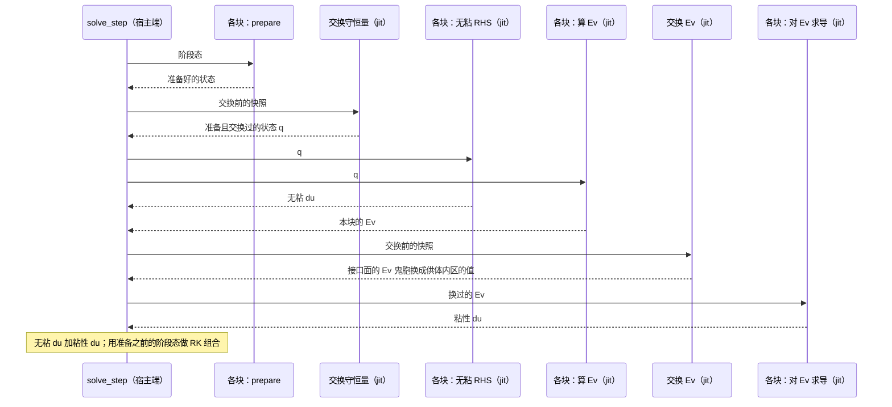

# 第七步 多块粘性通量交换 - Plan

## 实施进度（2026-11-27）

本步已落地（提交 `ce9bf94`）。下面计划里的 R11（粘性导数不是 CD8 时报错）、R15（CD6 不放行）和 Key Decisions 里的“放行 plate 加 CD8”，自 2026-11-27 起被补尾巴 C1 取代（`docs/plans/2026-11-26-001-tails-before-step9-plan.md`）：多块运行粘性打开时，粘性导数的阶数 CD6、CD8 都放行。两层验收、四种故意注错的测试对两种阶数各验了一遍，比较分全域、接口邻域、物理边界带、其余四层。计划正文保留为当时的设计记录。

## Goal Capsule

- 目标：多块运行打开粘性项以后，各阶段的右端项和末态与等价单块一致，切块不改变结果。
- 依据：`11-16 我建议先对齐的.md` 里“第 7 步”的定义；jisen 在 2026-11-24 到 25 日的 grilling 里定的九条决定（见 Key Decisions）。
- 约束：只单进程；单块路径的结果逐位不变；第六步的无粘多块结果不变；原码树不动。
- 未决：没有阻塞实施的疑问。拆分后单块是否逐位相同、阈值取多少，在实施时实测（见 Outstanding Questions）。

---

## Product Contract

### Summary

第七步让多块运行可以打开粘性项。各块用交换过的守恒量算出自己的粘性通量，再把粘性通量换进邻居的鬼胞，然后求导。验收是五个验收网格和五个合成小网格都与等价单块一致。

### Problem Frame

粘性项分三段算：守恒量得到原始变量的一阶导数，再组装成粘性通量 `Ev`，最后对 `Ev` 再求一次导。CD8 每次求导用到左右各 4 个点。

第六步只交换守恒量，所以前两段在接口旁已经是对的。内区离接口最近的点算一阶导数，要读接口外的 4 层，交换来的守恒量刚好够；度量只用内区的。缺口在第三段：对 `Ev` 求导要读接口外的 `Ev`，而那一侧的 `Ev` 现在是各块用本地的无意义值算出来、又按物理边界的规则填过的，不是邻居内区的值。

原码的多块也是换 `Ev`。以下是读源码得到的，没有运行验证：原码的多块只是把一张全局结构网格按进程做笛卡尔切分，接口都是 1:1 的。每个 RK 阶段它先换 4 层原始变量，算无粘，然后对每个方向依次“算这个方向的 `Ev`、沿这个方向换 `Ev`、对 `Ev` 求导”。块边界附近没有专门处理，用的就是中心差分。棱和角上的鬼胞从不填充。JAX 换的是守恒量，三个方向的 `Ev` 算完后一次换完，这两处与原码等价，差在舍入。

路线图把“块角处坐标与单块一致”留到了这一步。按上面的做法它用不上：内区的粘性右端项只沿三个坐标方向取点，读接口外的值时读的是那个面的鬼胞带上、另外两个下标还在内区里的点。两个或三个下标同时出界的块角鬼胞，读不到。原码的交换同样只覆盖面内的长条。

### Key Decisions

- **验收只对照 JAX 单块。** 切块不改变结果。不与原码的多块结果对拍：这台机器没有 MPI 的编译器，原码的多进程跑不起来。
- **放行 plate 加 CD8。** CD6 只加一条小网格测试，不放行。其他算例的粘性也不放行。
- **接口处交换粘性通量，复用第六步的交换表。** 下标映射、T 形和阶梯的归属、周期接缝的取法都沿用第六步，不另建规则。
- **不等真实网格。** 用现有的五个验收网格和五个合成小网格做，真实网格来了再单独验。
- **块角处的坐标不做。** 改成一条测试：把各块块角鬼胞里的量全部换成垃圾值，内区的粘性右端项逐位不变。
- **验收分两层。** 第一层是五个验收网格各跑两个整步，对照等价单块。第二层是五个合成小网格上的线性场，只算粘性右端项。
- **接口两侧的 `Ev` 要一致。** 接口共有的内区点上，两块各自算出的 `Ev` 在容差内一致，放进验收。

### Requirements

**拆分与单块不变**

- R1. `viscous_rhs` 的函数体原样拆成两段：一段由状态算出粘性通量 `Ev`，一段对 `Ev` 求导并累加成右端项。`viscous_rhs` 的名字、参数、返回值都不变，它按原来的先后顺序调用这两段。单块路径的结果逐位不变。
- R2. “算 `Ev`”这一段接收的状态已经准备并交换过。它输出三个计算方向各四个分量的 `Ev`，物理面和块内周期面上的 `Ev` 鬼胞已经按单块的规则填好。接口面上的 `Ev` 鬼胞这一段不管。
- R3. “对 `Ev` 求导”这一段只依赖 `Ev`、度量、步长、边界带标志和导数的阶数。接口面和周期接缝面上不套单侧的边界带公式，与第六步对无粘项的处理相同。

**`Ev` 的交换与编排**

- R4. 每个 RK 阶段，各块算出 `Ev` 之后，全块同步交换一次 `Ev`：按第六步的交换表，把供体内区的 `Ev` 写进接收块的鬼胞。
- R5. 交换从交换前的快照读。表的先后不影响结果。
- R6. 每个 RK 阶段的顺序：各块从自己的阶段态做准备，交换守恒量，各块算无粘右端项和自己的 `Ev`，交换 `Ev`，各块对 `Ev` 求导并累加，最后用准备之前的阶段态做 RK 组合。整步结束后的准备和守恒量交换不变。
- R7. 交换写进接收槽的 `Ev` 与供体内区对应点的 `Ev` 逐位相同。交换不改动任何内区的值。
- R8. 内区的粘性右端项不读块角鬼胞里的任何量。
- R9. 普通切口共有的内区点上，各块自己算出的 `Ev` 在容差内一致。跨块的周期接缝没有共有的点，不比这一项。审计开关打开时，求解函数导出每个阶段的 `Ev`。

**放行**

- R10. 多块运行可以打开粘性项。打开时另外要求粘性导数是 CD8，其余放行条件与第六步相同。粘性关闭时，放行条件和运行结果都与第六步相同。
- R11. 多块下粘性导数不是 CD8 时，在读坐标之前报错，说明第七步只放行 CD8。生效的阶数读 `args.vis_order`，JSON 和命令行给的一样算。
- R12. 物性参数与单块用同一个函数组装。粘性打开时，启动信息里带上 Re、Ama、参考温度、Pr 和粘性导数的阶数；参考温度取缺省值时，提示与单块相同。

**验收**

- R13. 第一层：x2、y2、z2、xyz8、t3 五个验收网格，粘性打开，物性与第六步的验收相同，dt=0.0001，用第六步的验收初场，各跑两个整步。三个阶段的右端项、准备之前的 `q1`、`q2`、末态与等价单块按阈值一致。右端项既比总项，也比单独的粘性项。
- R14. 第二层：五个合成小网格（两块切口、周期接缝、T 形、阶梯、一格宽的条带），放上线性的速度场和温度场，只算粘性右端项，与各自等价的单块长方体按阈值一致。
- R15. CD6 不放行，但在两块切口的合成小网格上有一条测试：粘性导数取 CD6，多块的粘性右端项与等价单块一致。
- R16. 阈值：每个守恒量各定相对容差和绝对容差，规则与第六步相同，数值按粘性的实测确定。`Ev` 的 12 个量用同样的规则。
- R17. 验收有判别力：不交换 `Ev`、交换时取错层、接口面被套上单侧公式、RK 组合用错操作数，这四种故意引入的错误都能被发现。
- R18. 第六步的验收原样通过，阈值不变。单块的冻结测试和基线抽样逐位通过。

**文档**

- R19. `src/README.md` 写多块粘性的用法和放行清单；`Grid/CGNS多块网格说明.md` 第 7 节更新；路线图记下第七步的落地情况、“块角处坐标不需要”的结论和原码的事实。

### Key Flows

**一个 RK 阶段（粘性打开）**

1. 各块从自己的阶段态做物理准备。
2. 全块同步交换守恒量的鬼胞，得到准备且交换过的状态。
3. 各块用它算无粘右端项。
4. 各块用它算自己的 `Ev`。物理面和块内周期面上的 `Ev` 鬼胞在这里填好。
5. 全块同步交换 `Ev`。接口面上的 `Ev` 鬼胞换成供体内区的值。
6. 各块对 `Ev` 求导，累加到右端项上。
7. 用准备之前的阶段态做 RK 组合。

粘性关闭时没有第 4 到 6 步，其余与第六步相同。

**放行**

多块的入口在第六步的放行校验之后多查一项：粘性打开而粘性导数不是 CD8，在读坐标之前报错。

### Acceptance Examples

- AE1. x2 网格，粘性打开，跑两个整步。三个阶段的右端项（总项和粘性项）、`q1`、`q2`、末态与等价单块的差在阈值内。
- AE2. z2 和 xyz8 网格，周期方向跨块。同 AE1。
- AE3. t3 网格，左块的 `i+` 面分两段。同 AE1。
- AE4. 阶梯网格和一格宽条带的网格，放上三个方向都变化的线性速度场和温度场，一步粘性右端项与等价的单块长方体在阈值内一致。
- AE5. 把 `Ev` 交换关掉，AE1 到 AE4 里至少有一个远超阈值。
- AE6. 两块切口的合成小网格，粘性导数取 CD6，多块的粘性右端项与等价单块在阈值内一致。
- AE7. 五个合成小网格上，把各块块角鬼胞里的坐标、度量、守恒量、`Ev` 在各自被读到的时刻换成 NaN，内区的粘性右端项逐位不变。四处各有一个把 NaN 放在面内鬼胞上的对照，都出现 NaN。
- AE8. x2 第一步之后，接口共有的内区点上两块的 `Ev` 差在阈值内。
- AE9. 粘性打开的多块 plate 配置从命令行入口跑两步，每步每块存一个文件，文件名和 `_meta` 与无粘时相同。（2026-11-26 补记：第八步起每个保存步一个文件，`_meta` 多了粘性开关，这条的测试已按新格式改写：文件名相同，`_meta` 只差粘性开关一项。）
- AE10. 粘性打开而粘性导数是 CD6（JSON 或命令行给的）：启动时报一行“初始化错误”，退出码 2，消息里点出 `vis_order`。

### Scope Boundaries

不在第七步：

- 其他算例的粘性，CD6 的放行。
- 翻转和轴交换的连接、非匹配界面：第 10 步。
- 多 GPU：第 9 步。
- 每个保存步存一个文件：第 8 步。
- 和原码的多块结果对拍。需要先搭 MPI 环境。
- 滤波。JAX 里目前没有滤波，原码在滤波时另外交换滤波后的压力，这件事等滤波移植时再处理。
- 真实网格上的验证，以及它的参考尺度怎么取。

### Dependencies / Assumptions

- 第六步已经提交（`ddf4162`）。第七步直接用它的交换表、块的装配、求解函数和测试辅助模块。
- 鬼胞层数是 4，对 CD8 刚好够：一阶导数读 4 层守恒量，第二次求导读 4 层 `Ev`。
- 单块的粘性路径有基准。真实 plate 的一步、三个阶段的总右端项和末态与原码比过，签收范围是 plate、FP64、WENO7/CD8、固定一步，差在舍入量级，见 `experiment/step49_progress_2026-11-19.md`。第七步拿单块 JAX 当基准。
- 冻结测试 `experiment/test_step49_frozen.py` 用的配置开着粘性，它守住单块一步的末态。

### Outstanding Questions

**Resolve Before Planning**

没有。

**Deferred to Implementation**

- 拆分以后单块是否逐位相同。XLA 的编译结果可能随函数边界变化，由 U1 的基线抽样判定。
- 阈值的数值。U4 和 U6 实测后写定。
- 六个面全是远场的单块长方体能不能过单块的装配校验。U4 开工时先确认。
- 每个阶段多三次 jit 调用和一次 `Ev` 交换，验收慢多少。

### Sources / Research

**原码**（`OpenCFD-SCU-v3.0`，只读；行号对应当前工作区）

| 事实 | 位置 |
|---|---|
| 多块是按进程的笛卡尔切分，邻居只有 6 个面 | `src/OCFD_mpi.c:93-201` |
| 时间步里换原始变量，每个方向 4 层 | `src/OCFD_Stream.cu:291-295`、`492-496`；`head/config_parameters.h:15` |
| 粘性另外换 `Ev1` 到 `Ev4`；每个方向“算 `Ev`、换 `Ev`、求导” | `src/OCFD_Stream.cu:312-332`（STREAM=0） |
| 单侧的边界格式只在全域的物理边界启用 | `src/OCFD_bound_Scheme.cu:353-401` |
| 度量各块自己算，初始化时交换一次 | `src/OCFD_Comput_Jacobian3d.cu:134-136`、`181-193`、`228-237` |
| 交换只覆盖面内的长条，横向下标只取内区 | `src/OCFD_mpi.c:223-233`、`361-372` |

**一处曾经怀疑、核对后不成立的**

读原码的子代理报告过：`STREAM=1` 时外区的 x、y、z 三个方向求导似乎都用了 x 方向的 `Ev`。实现方对照源码后确认不成立。函数名 `du_vis_Jacobian3d_outer_x_y` 里，`x` 是外区条带的方向，末尾的 `y` 是求导的方向；它调用的是 `du_viscous_Jacobian3d_x_final`（`src/OCFD_Stream.cu:571-582`）。`du_vis_Jacobian3d_outer_x` 换完 x 方向的 `Ev` 以后，在 x 外区条带上依次完成 x、y、z 三个方向的求导（`src/OCFD_Stream.cu:643-655`），这三个方向在这条带子上都只缺 x 方向的 `Ev` 鬼层，次序是对的。`STREAM=0` 的逐方向顺序同样核对无误。

**环境**

这台机器只有 `mpiexec` 运行时，没有 `mpicc`，只有一块显卡。仓库里的运行日志全是单进程。

**决定**

jisen 在 grilling 里对九个问题的回答，2026-11-24 到 25 日。Q1 到 Q7 见 Key Decisions；Q8 是继续在 `feat/step2-boundary` 上做；Q9 是方案写好后交 Astra 审一轮再开工。

**修订记录**

2026-11-25，按 Astra 对这份方案的审查（只审一轮）修订。审查的结论是做法成立，要改的是实施和验收的条款：

1. 第六步有三条断言要求拒绝粘性，与 R10 冲突。U5 改成把这三条改写为拒绝 CD6。
2. “常数场的粘性右端项为零”不成立，单块的板状块上实测能量分量的最大值是 0.24。U4 改成只比多块与单块，零值断言放到全周期的常数场上。
3. `compile_blocks` 拿不到是否粘性和阶数。KTD4、KTD7、U2、U6 明确从 `args` 传进去，缓存键随之改。
4. 块角不读的测试原来在装配之后改坐标，那时坐标已经没人读。U3 改成四处分别注入，各配阳性对照。
5. 第六步的 `compare` 只比前 5 个分量。KTD8 给它加一个可选的分量个数，比 `Ev` 时传 12。
6. 撤回“原码 `STREAM=1` 疑似有缺陷”。对照源码后确认是函数名读反了，原码没有这个问题。
7. KTD5 里“物理面的写入和接口的交换在棱角上重叠”不对，两类写入不相交。
8. 订正第六步的方案和落地记录里“按区域分别报告没有做”的说法。

**实施时补的决定**

2026-11-25，U1、U2 施工时定下的。做法没有变，变的是落地的方式：

1. `compile_blocks` 只多收一个参数 `vis_order`：`None` 关闭粘性，6 和 8 是 CD6、CD8。KTD4 写的是“是否粘性”和“阶数”两项；合成一项以后，没有“粘性开着却没给阶数”这种组合。缓存键是（参考尺度，`vis_order`）。
2. `Ev` 的 jit 交换不另写函数。第六步的 `BlockKernels.swap` 最前面一根轴是整段切片，传 12 平面的数组就是 `Ev` 的交换（KTD3）。急切路径同样直接用 `exchange`。
3. 多了一份逐位基线 `experiment/step7_inviscid_samples.npz`。U2 要求“粘性关闭时求解函数的结果与第六步逐位相同”，第六步没有存过多块路径的抽样，证不了。所以在动 `src/multiblock.py` 之前先存：五个验收网格和 per3，从验收初场跑两步，取三个阶段的右端项、`q1`、`q2` 和两步的末态（per3 只取第一步的右端项、`q1` 和末态），各块含鬼胞的数组展平后每隔 379 个取一个，共 200 组、1.2 MB。改完逐位相同。
4. 求解函数的 trace 多两个字段：`viscous` 是三个阶段的粘性分项（KTD9 里多块的那一半），`flux` 是审计打开时三个阶段交换过的 `Ev`（R9）。粘性关闭时都是空元组。
5. `BlockKernels` 里两个新函数的名字是 `flux`（由状态算 `Ev`）和 `divergence`（对 `Ev` 求导），每个块各一个，与 `rhs` 的组织方式相同。
6. U3 的四个阳性对照，有两个的位置与方案写的不一样。方案写的是“四处都把 NaN 放在面内的鬼胞上”。度量在粘性项里是逐点用的，鬼胞上的度量没有人读；坐标的导数沿一条轴取，面内鬼胞的坐标只影响紧挨接口的内区度量。所以守恒量和 `Ev` 的对照放在接口面内的鬼胞上，度量和坐标的对照放在紧挨接口的内区层上（坐标那处弄坏的是接口面内第一层鬼胞的坐标，看内区的度量）。放在鬼胞上的度量不会被读到，那样的对照是空转。
7. U1 的块角掩码错过一处，U3 施工时发现并改正。`step7_support.outside` 给第三根轴写下标时少了一维，“i 出界”标成了“j 出界再加 j 的最后一个内区点”，块角掩码跟着错成“全部 j 向鬼胞加一部分真块角”。U1 那两条块角不读的测试因此没有测到“k 出界、i 出界、j 在内区”这一族块角，当时通过是因为那些算例的 j 面是物理面，4 层以内不读鬼胞。改正后掩码与定义逐点相同（`experiment/test_step7_split.py` 里有一条按定义直接对照的测试），U1 的两条和 U3 的块角不读都用改正后的掩码重跑通过。教训：掩码不能只靠“内区逐位不变”间接测。
8. `compare` 加 `count` 参数时多了一条断言：数组最前面一根轴的长度要等于 `count`。拿缺省的 5 去比 12 平面的 `Ev` 会直接报错，不会悄悄只比前 5 个平面。
9. U4 的 CD6 那一条用的是验收初场，不是线性场。方案要求“确认 CD6 和 CD8 的参考在这个场上确有可测的差别”；线性场上两种阶数的导数都精确，分不出阶数有没有传对。验收初场（三角函数）上，两块切口小网格的等价单块 CD6 与 CD8 的粘性右端项相差 3.1e-2（量级 0.23）；多块传阶数 6 的结果与单块 CD6 的参考差 1.4e-16。
10. 全周期常数场的零值断言分两档。第一步的粘性分项恰好是零。无粘项对常数场有 1.6e-12 的舍入，之后两个阶段的阶段态不再是逐位的常数，粘性分项是 6.6e-20、3.3e-20；这两步断言绝对值不超过 1e-18。
11. 第七步的阈值沿用第六步的数值（`step6_support.RTOL`、`ATOL`），不另定。R16 说数值按粘性的实测确定；U4 的实测见风险表，最紧处只用到第六步阈值的 0.02%，第一层验收最多用到 1.98%。
12. U6 的单块参考每个阶段的粘性分项，是先对这个阶段交给右端项函数的状态做一次物理准备，再用 `viscous_rhs` 算的（KTD9）。`formal_trace` 记下的三次入参就是准备之前的阶段态。
13. U6 里“只动要试的那一处”的做法。不换 `Ev` 和取错供体层两条，是把 `multiblock.exchange` 换成一个只对 12 平面数组动手的函数，并让求解函数走急切路径（给出表的顺序）；切口面套单侧公式那条，另编一套把切口一侧的边界带标志改成 1 的求解函数，只取其中粘性的两段。每条都核对第一步准备且交换过的状态与正确的运行逐位相同。
14. 收尾做代码简化时（一个只读的审查子代理指出）改正两处。一是 `viscous_rhs` 不给 `dx` 时的报错：拆分以后它自己不查了，异常从 `viscous_fluxes` 抛出，文字从 `viscous_rhs requires dx` 变成了 `viscous_fluxes requires dx`。这是单块路径的一处行为变化，已经把原来那两行检查加回去，并加了一条测试。二是阶数表的名字：`src/multiblock.py` 里新加的表原来叫 `VIS_ORDERS`，与 `runtime_config.VIS_ORDERS`（允许的名字）同名不同义，改叫 `CD_ORDER`；`experiment/step7_support.py` 里自己抄的那份删掉，改用这一份。

**Astra 第 24 轮审查后改的**

2026-11-25，第七步实现的第一轮代码审查。结论是多块粘性的交换、求导和 RK 编排没有问题，问题在单块 `viscous_rhs` 拆分后的两处兼容性回归和测试上的几处。每条实现方都用 git 里的原码或按定义写的对照核实过：

15. **累加精度**。原函数按 `cons.dtype` 建 `du`，累加也在这个精度里做，最后乘 `Ajac` 才升到较高的精度。拆分后 `viscous_divergence` 看不到守恒量，写成了 `fluxes.dtype`。全是 FP64 时两者相同，原来的 18 种基线看不出；状态是 FP32 而度量是 FP64 时就不同（实现方用原码对照：33915 个值里有 5148 个不同，最大差 2.1e-9）。现在 `viscous_divergence` 多收一个 `dtype`，`viscous_rhs` 传 `cons.dtype`；多块里守恒量和 `Ev` 同为 FP64，取缺省。基线加了这种情形（`cube_mixed_cd8`），抽样用原码算。
16. **`axes` 的旧行为**。原函数只遍历一次 `axes`，给迭代器也一样；`axes` 为空时返回零。拆分后两段各遍历一次，迭代器到第二段已经空了，结果悄悄少掉一些方向；空元组在 `concatenate` 上报错。产品路径里 `axes` 都是非空元组（`CaseSpec` 校验过非空），实际没出过错，但这是公开函数。现在三个函数的入口都把 `axes` 固定成元组，`viscous_fluxes` 在没有方向时返回一个空的堆叠数组。两条直接查的测试在 `experiment/test_step7_split.py`。
17. **测试上的四处**。(a) `test_step7_split.py` 里“对 `Ev` 求导不读块角”那条，比较内区时把三个空间切片直接套在了四维数组上，第一个切片落在分量轴上，比到的只是其中一个分量。这是同类下标错的第三次，实现方把第七步所有“取内区”的写法二十多处逐个核对了一遍，错的只有这一处。现在用 `grid.inner()` 取内区，并断言取出来的形状。(b) `_band` 先写低侧再写高侧，轴长 7、低侧取 4 层时只选到 3 层；当时的对照恰好都取在高侧。现在两侧各写各的，并有一条按定义对照的测试。(c) `windows` 原来只查每个坐标值在单块的轴线上找得到，现在按算出的窗口逐点比。(d) U3 里“把准备过的阶段态当操作数”的对照原来比的是下一阶段的粘性分项，而准备会重写边界点，粘性分项在内区不变，差别只在鬼胞。现在比 `q1`。方案里“四条都必须是粘性分项超差”的说法相应订正：前三条是粘性分项，RK 组合那条是 `q1`。
18. **`faces=None` 且混合出口非空的分支**，基线和现有测试都没有覆盖，代码是原样搬过去的。这条分支只有特殊边界的执行器才会用到，而那种执行器的 `faces` 一定非空，正式路径走的是 `faces` 那一支。实现方做了一次性对照（没有留在仓库里）：手工造一个混合出口非空的执行器，原码和新码在这个分支上都被调用 1 次，走不走这条分支原码的结果不同，新码与原码逐位相同。没有加进持久基线。

**代码简化和效率审查后改的**

2026-11-25。另请的三个只读审查子代理（复用、质量、效率）和 Astra 第 24 轮都指出测试耗时和测试辅助代码里的重复。运行路径上没有可提的浪费（效率审查实测）：plate 上正式入口的整步 jit，新旧交替各三轮，编译 3.71 秒对 3.67 秒，每步 260 毫秒对 263 毫秒，在噪声内，新旧输出逐位相同。改动如下：

19. **`BlockKernels` 的构造拆成三样**（`src/multiblock.py`）。`flux_kernel(block, order)` 和 `divergence_kernel(block, order)` 是模块级的函数，各给一块编粘性的一段；`_plain_kernels` 编与粘性无关的那部分（物理准备、无粘右端项、RK 组合、守恒量交换）。`BlockKernels` 自己只剩把它们装在一起。两个粘性函数里的 `axes` 改用 `block.axes`，与无粘的写法一致（值恒为 `(0, 1, 2)`）。
20. **`compile_blocks` 在同一组参考尺度下复用与粘性无关的函数**。缓存键还是（参考尺度，阶数），三种模式的 `flux`、`divergence` 互不相同；`prepare`、`rhs`、`q1` 到 `q3`、`swap` 是同一批 jit 函数对象。正式运行只按一种阶数编译，走的是原来的路径。依据是效率审查的实测：per3 先按无粘编过、再按 CD8 编时，第一步 37.3 秒，其中 26.2 秒是重编这六样。这一条省的就是这 26.2 秒；改完以后没有单独再测这一个数。
21. **测试辅助合并进 `experiment/step7_support.py`**。合成小网格的清单原来在三个地方各有一份，现在只有 `SYNTHETIC`；U2、U3 的合成网格改用它装配好的块，求解函数跨测试共用，不再每个测试重写网格、重装、重编。`preset(name)` 把一个验收网格（或 per3）的块、参考尺度、起点放在一起，原来 per3 的特例散在两个文件里。“故意不换 `Ev`”的交换函数（`exchange_without_ev`）、接收槽的掩码（`received`）、`face_ghost` 的高侧也收了进来。删掉了照抄第六步 `_shared` 的 `shared_cut_layers`，改用第六步的那个。五个测试文件里支持模块的别名统一成 `step7`（原来叫 `viscous`，读起来像源码模块）。
22. **测试里只为改度量或改边界带时，只重编粘性的两段**（U3 的度量和块角两处、U6 的“切口面套单侧公式”），不再编一整套。粘性关闭的基线里 per3 只存了第一步的量，就只跑一步。CD6 的测试复用 CD8 的装配（装配不读阶数）。
23. **没有采纳的三条**，都是效率审查提的：让 `test_step7_config.py` 里的 `main.run` 用缓存好的装配（省 15 到 20 秒，但入口就不再真的走那一次装配，U5 要的正是入口全程）；改第六步 `compare` 不给掩码时的取点（省约 2 秒，动的是第六步的代码）；正式运行不收集粘性分项（要加开关，大网格上才看得出）。还有“接口旁四层鬼胞上的 `Ev` 算出来就被交换覆盖”（占各块 `Ev` 计算量的 5% 到 40%）：要省得按接口侧裁出子盒，牵动 `grid` 和 `faces` 的下标，没有保持行为的简单改法。

**Astra 第 25 轮（确认轮）**

2026-11-25。结论是功能上没有问题，可以作为第七步提交，必须修为零。审查方自己用 git 里的原码对照了 72 组构造的输入（numpy 和 jax 数组、混合精度、填充和清零鬼胞、部分方向和空方向），又把 20 种基线输入在 jit 下与原码对照，整数组都逐位相同。`faces=None` 的混合出口分支也与原码一致，第 18 条那次一次性对照够用，不必补进持久基线。`BlockKernels` 的拆分和 `compile_blocks` 的复用，它与独立新建的核比较过，三个阶段和末态逐位相同。它提了两条不拦提交的意见，都已处理：

24. **合并测试辅助代码时丢了一个组合**。U2、U3 的合成网格都换成了带全局顶点数的装配，第七步就没有了“不带全局顶点数、短块、粘性打开”这个情形（没有旁记的网格就是这样装配的）。补了一条测试 `test_blocks_assembled_without_the_global_sizes_give_the_same_step`（`experiment/test_step7_step.py`）：阶梯网格按两种方式装配，先确认每块的坐标鬼层确实不同、内区的坐标相同，再比一个整步的右端项、`q1`、`q2`、末态和粘性分项，逐位相同。物理面旁的度量和导数用单侧公式，只读内区，坐标鬼层怎么补不要紧。
25. `_with_metrics` 的注释有一句写错（说度量不进无粘右端项），已改成：无粘的那几个函数读的还是原来的度量，所以用它的几条测试只看粘性分项。

---

## Planning Contract

Product Contract 保留说明：这份方案没有上游的需求文档，Product Contract 直接来自 grilling 的九条决定。

### Key Technical Decisions

- **KTD1. 拆分靠“原样剪开”，不重写。** `src/viscous.py` 的 `viscous_rhs` 函数体剪成两个函数，中间多传一个堆叠数组。`viscous_rhs` 顺序调用它们，签名不变。单块的 `main.build_rhs` 仍然在一次 jit 里调用 `viscous_rhs`，所以逐位不变有望成立；由 U1 的基线抽样判定，不成立时用风险表里的退路。`src/compare.py` 也调用 `viscous_rhs`，不用改。剪的时候保住四样东西：第二段按传入的 `axes` 顺序、按原来的分量顺序逐次累加；输出的数据类型不变；不求解的方向照旧跳过；曲线坐标时最后乘 `Ajac` 的位置不变。`faces=None` 的旧逐轴路径、混合出口的分支、清鬼胞的分支都原样保留。`src/compare.py` 调用时省略了 `dif_bound` 和 `boundary_execution`，这个调用组合也要进基线。
- **KTD2. `Ev` 在一个块里是一个 12 平面的数组。** 三个计算方向各四个分量（三个动量分量和一个能量分量），沿最前面的轴堆叠。两个拆出来的函数之间传它，交换也搬它。交换表的下标是空间下标，最前面加一个整段切片就能用，与守恒量的交换写法相同。
- **KTD3. 交换复用第六步的表和函数，不新建规则。** 急切路径的 `exchange` 只按下标表搬数组，直接拿来搬 `Ev`。jit 路径在 `BlockKernels` 里加一个函数，结构与现有的守恒量交换相同：读交换前的快照，槽和源是静态下标。映射（普通切口 `n−1−r` 和 `r`，周期接缝 `n−r` 和 `r−1`）、T 形和阶梯的归属都已经在表里。
- **KTD4. 每块多两个 jit 函数，求解函数多三步。** `BlockKernels` 为每块编“由状态算 `Ev`”和“由 `Ev` 算粘性右端项”。第一段的实参与 `main.build_rhs` 调用 `viscous_rhs` 时逐项对应：

  | `viscous_rhs` 的形参 | 多块里传什么 |
  |---|---|
  | `cons` | 准备且交换过的状态 |
  | `grid` | 块的网格 |
  | `params` | `block.execution.phys` |
  | `bcs` | `block.execution.bcs`（占位值） |
  | `axes` | `(0, 1, 2)` |
  | `dx` | `(1, 1, 1)` |
  | `order` | 生效的阶数：CD8 是 8，CD6 是 6 |
  | `metrics` | 块的度量 |
  | `dif_bound` | `block.execution.band` |
  | `dif_axis_map` | `(0, 1, 2)` |
  | `boundary_execution` | `block.execution` |
  | `farfield` | `block.execution.farfield` |
  | `faces` | 块的物理面和块内周期面；没有面时是空元组，不传 `None` |
  | `zero_state_ghosts`、`fill_state_halos` | 都是假 |

  第二段接收交换过的 `Ev`，沿用表里同样的 `grid`、`axes`、`dx`、`order`、`metrics`、`dif_bound`、`dif_axis_map`。这张表写进 `BlockKernels` 的说明，与无粘的那张表并列。
  `compile_blocks` 现在只收参考尺度，拿不到是否打开粘性和阶数。第七步让它多收这两项，由 `multiblock.run` 从 `args` 传进来；缓存的键从参考尺度改成（参考尺度、是否粘性、阶数），三种模式的核互不串用。粘性关闭的运行不编这两个函数，求解函数与第六步相同。
- **KTD5. 先填物理面，后交换。** “算 `Ev`”那一段按块自己的 `faces` 填物理面和块内周期面上的 `Ev` 鬼胞，这一步写的是整片鬼胞。交换只写接口面上、两个切向下标都在内区里的那部分。物理面的写入要求那个物理轴出界，接口的交换要求两个切向下标在内区，两类写入的区域不相交，次序其实无关；仍然固定为先填后交换。
- **KTD6. 放行只加一个条件。** `_check_release` 里去掉“粘性项是开的”那条拒绝，改成：粘性打开时 `vis_order` 必须是 `CD8`。生效的粘性与单块同一个算法：`args.viscous`，或算例声明强制粘性。plate 不强制，所以多块下就是 `args.viscous`。
- **KTD7. 粘性导数的阶数从配置来，不为 CD6 加分支。** 两个 jit 函数的阶数由 `compile_blocks` 的调用方从 `args.vis_order` 查出：`{"CD6": 6, "CD8": 8}`，与 `main.build_rhs` 同一张表。CD6 的测试在调 `compile_blocks` 时直接传阶数 6，不走入口。
- **KTD8. 验收辅助分两处。** 能复用的从 `experiment/step6_support.py` 拿：验收网格、验收初场、拼回、单块参考的分阶段追踪。第七步新增 `experiment/step7_support.py`，放粘性专有的部分：打开粘性的单块参考、合成小网格的等价单块、线性场、阈值。单块参考要新建：用打开粘性的配置走 `init.prepare`，不原地修改第六步缓存参考的 `args`，那份参考的右端项按 state 缓存着，改 `args` 会复用已经编好的无粘右端项。第六步的 `compare` 只对前 5 个分量算误差；给它加一个可选参数给出分量的个数，缺省是 5，第六步的行为不变；比 `Ev` 时传 12。
- **KTD9. 单块的粘性右端项在验收里单独取。** 单块参考每个阶段的粘性项，用 `viscous_rhs` 在同一阶段的准备态上算；多块的取求解函数 trace 里的粘性部分。两边都不用“总项减无粘项”，避免相减放大舍入。

### 触及清单

| 文件 | 改动 | 护栏 |
|---|---|---|
| `src/viscous.py` | 函数体原样拆成两段；`viscous_rhs` 顺序调用 | U1 的基线抽样；`experiment/test_step49_frozen.py`；现有粘性测试 |
| `src/multiblock.py` | `BlockKernels` 加三个 jit 函数；`compile_blocks` 多收是否粘性和阶数；`solve_step` 加粘性分支和 `Ev` 审计；放行加 CD8 的条件；启动信息 | 第六步的测试通过（`experiment/test_step6_config.py` 有三条断言按 U5 改写）；`experiment/test_step6_acceptance.py` 的数值不变 |
| `experiment/step6_support.py` | `compare` 加一个可选参数：分量的个数，缺省 5 | 缺省行为不变；第六步的测试通过 |
| `experiment/test_step6_config.py` | 三条拒绝粘性的断言改成拒绝 CD6 | 该文件其余断言不变 |
| `experiment/step7_support.py` | 新建 | — |
| `experiment/test_step7_*.py` | 新建七个 | — |
| `src/README.md`、`Grid/CGNS多块网格说明.md`、`11-16 我建议先对齐的.md` | 文档 | — |

不动的文件：`src/boundary.py`、`src/main.py`、`src/solver.py`、`src/cases.py`。

### High-Level Technical Design



接口旁一个内区点算粘性右端项，要读什么：

| 读的量 | 读到哪里 | 值从哪里来 |
|---|---|---|
| 守恒量 | 本点沿三个方向各加减 4 个点 | 内区是本块的；接口外 4 层来自守恒量交换 |
| 度量 | 只读本点 | 本块的内区度量 |
| `Ev` | 本点沿三个方向各加减 4 个点 | 内区是本块算的；接口外 4 层来自 `Ev` 交换 |

所以守恒量和 `Ev` 都只需要 4 层鬼胞，块角的鬼胞读不到。

### Assumptions

**需要 jisen 知道的默认处理**

1. 接口面上的 `Ev` 鬼胞有两个来源。“算 `Ev`”那一段会先用本地的无意义守恒量把它算出来，交换随后覆盖。这些中间值不参与任何判定。物理面的写入和接口的交换写到的区域不相交（KTD5）。
2. `Ev` 交换写的槽与守恒量交换写的槽是同一批。T 形共线处让给别人的槽，`Ev` 也不写。
3. 合成小网格的等价单块是长方体。下表是 U4 的起点，开工时先核对拼回的坐标与单块逐位相同：

   | 合成小网格 | 等价单块 | 外表面 |
   |---|---|---|
   | 两块切口 | 15×7×7 | `i−` 入口，`i+` 出口，`j−` 壁面，`j+` 远场，`k±` 块内周期 |
   | 周期接缝 | 15×7×7 | `i±` 是一对块内周期面，其余同上 |
   | T 形 | 15×13×7 | 同两块切口 |
   | 阶梯 | 13×13×13 | 六面全是远场 |
   | 一格宽的条带 | 15×19×7 | 六面全是远场 |

4. 第一层验收的配置与第六步的验收只差一处：粘性打开。物性是 Re=1000、Ama=0.1、参考温度 288.15、Pr=0.7，粘性导数是 CD8。
5. 参考温度取缺省值时，多块也打印单块那句提示。
6. 第七步继续在 `feat/step2-boundary` 上做。
7. plate 的物理面上，入口、出口、壁面、远场的 `Ev` 鬼胞清零，块内周期面复制对端。这是块装配里现成的规则，与单块相同。
8. 六个面全是接口的块（第六步 per3 的中心块）没有 `faces`，传空元组，`fill_ev_faces` 原样返回；状态准备跳过，`Ev` 的鬼胞全靠交换。
9. 同一个块的同一个轴上，一侧是块内周期面、另一侧是接口面：第六步的拓扑规则已经排除（周期的两个面必须成对），不用处理。

**对需求的澄清**（不改变范围）

- “右端项与等价单块一致”指三个阶段各自的值，不含整步末尾那次准备的值。
- `Ev` 的一致性只在普通切口共有的内区点上比，不比鬼胞，也不比跨块的周期接缝：鬼胞的值是逐位复制来的（R7），周期接缝的两个端点没有共有的点。
- 两份 `Ev` 副本的差不要求逐位相同。两块的编译形状不同，差在舍入量级，与第六步两份守恒量副本的情形相同。
- 常数来流下粘性右端项在内区不为零。物理面的状态鬼胞是清零或镜像的，紧挨物理面的内区点读到的导数不为零；单块 15×7×7 的板状块上实测，能量分量的最大值是 0.24。所以常数场只用来比多块与单块，不用来断言零。

### Risks & Dependencies

| 风险 | 应对 |
|---|---|
| 拆分以后 XLA 的编译结果变了，单块不再逐位相同 | U1 先存基线再动代码。退路：单块保留原来的函数体，多块用拆出来的两段，两处并存并注明原因。**实测没有走退路**：17 种调用方式的输出在抽样点上逐位相同（`experiment/test_step7_baseline.py`，含 `src/compare.py` 那种省略 `dif_bound` 和 `boundary_execution` 的调用），冻结测试和第六步的基线抽样也逐位通过。这台机器上 JAX 跑在 CPU 上。**基线之外另有两处行为变了，Astra 第 24 轮找到，已改回**（见“实施时补的决定”15、16）：累加的精度、`axes` 给迭代器或空元组时的行为。基线现在是 20 种调用方式 |
| 只看“内区逐位不变”的测试，会因为掩码或下标写错而空转 | 施工和审查里出了三次：块角掩码的第三轴少一维；比较内区时四维数组套了三个切片；`_band` 低侧少一层。三次都是“断言照样通过、实际没比到该比的东西”。现在的做法：掩码和取内区的辅助函数各有按定义直接对照的测试，取内区的辅助函数断言形状，每个“换成 NaN 以后不变”的断言都配一个“换到会被读到的位置就变”的对照 |
| 每个阶段多三次 jit 调用和一次 `Ev` 交换，验收变慢 | 验收只跑两个整步。明显变慢再和 jisen 商量 |
| 12 平面的 `Ev` 让每块多占一块内存 | 一块 59×48×48 的块约 13 MB。先不优化 |
| 合成小网格有的轴只有 7 个顶点，粘性的单侧带要求内区至少 7 个点 | 刚好够。两个等价单块也够。U4 实测：五个合成小网格（含两个等价单块）都算得通 |
| 六个面全是远场的长方体过不了单块的装配校验 | U4 开工时先确认。不行就把阶梯和条带两个网格的 `k−` 面改写成入口，多块和单块一起改。**实测能过**：13×13×13 和 15×19×7 两个六面全远场的单块都正常装配，没有改网格 |
| 第二层验收的差有多大 | U4 实测（一步的粘性右端项，各块内区拼回后对照等价单块）：线性场上五个合成小网格最大绝对差 3.9e-16（相对 1.9e-15），常数来流 8.3e-17；阶梯和条带上接口邻域与其余部分是同一个量级。最紧处用到第六步阈值的 0.019%，所以阈值沿用第六步的数值 |
| 第一层验收的差有多大 | U6 实测（五个验收网格各两个整步，验收初场，CD8，拼回后的全域最大差）：三个阶段的总项 1.5e-10（第六步阈值的 0.22%），粘性分项 1.15e-12（0.60%；接口邻域按邻域内的量级算容差，最多用到 1.98%），`q1`、`q2` 1.4e-13，末态 2.0e-13。从入口跑两步再读回的末态差 1.1e-13 |
| 故意引入的错误抓不抓得到 | U6 实测（x2，第一步的粘性分项）：不换 `Ev` 差 5.4e-2，容差 2.4e-12；取错供体层差 2.5e-4，容差 3.1e-12；切口面套单侧公式差 1.8e-3，容差 1.9e-10。用准备过的状态做 RK 组合，`q1` 超差。四条都超差，前三条只动在粘性上 |
| 全量测试变慢 | U3 在五个验收网格和 per3 上编了带粘性的求解函数，U4、U6 又各把它们跑一遍。第七步刚写完时全量是 9 分 34 秒（717 passed、2 skipped、1 xfailed），第六步是 4 分 36 秒。按效率审查的意见合并重复编译和测试辅助以后（见“实施时补的决定”19 到 25）是 6 分 58 秒，727 passed、2 skipped、1 xfailed：条数比刚写完时多了 10 条，没有减覆盖，只把一条重复的接缝检查并进了相邻的测试。剩下的大头是必要的一次性编译和 U5 里真实走入口的运行 |
| `Ev` 两份副本的差落在阈值边缘 | 阈值按实测，留足余量；出现时如实记录。U3 实测（验收初场，CD8）：五个验收网格切口共有的内区点上，两块各自算出的 `Ev` 最大绝对差 2.3e-17（t3），x2 和 z2 逐位相同；占第六步阈值最多 3.24%。t3 共线处拥有者与被让掉的候选差 6.3e-18，占 2.13% |
| 周期接缝上的 `Ev` 依赖第六步的周期映射 | 映射已被 z2、xyz8 和全周期小网格验收过；U3 单独核对 `Ev` 在接缝两侧的取法。U3 实测：合成小网格上，接缝两侧的 `Ev` 鬼胞与对侧内区按周期映射（低侧取 `n-r`、高侧取 `r-1`）取出的值逐位相同 |
| 六个面全是接口的块，`Ev` 的鬼胞全靠交换 | U3 实测（per3，中心块 `faces` 是空元组、`prepare` 跳过、边界带全 0）：跑一步对照等价的 25×25×25 全周期单块，三个阶段的粘性分项最大绝对差 2.2e-15、总项 1.8e-13，末态 5.7e-14；占第六步阈值都在 0.3% 以内 |
| U2 改了 `solve_step`，粘性关闭的结果跟着变 | 第六步没有存过多块路径的逐位抽样，证不了“不变”。动 `src/multiblock.py` 之前先存一份（`experiment/step7_inviscid_samples.npz`，见下面的实施记录），改完逐位相同 |
| 只有一块、没有接口的多块打开粘性，与正式路径差多少 | 实测（FP64，验收初场，CD8，一步）最大绝对差：三个阶段的粘性分项 3.3e-13、3.6e-13、8.4e-13（量级 19）；总项 1.1e-13、5.5e-11、1.2e-10（量级 1.06e4）；`q1`、`q2` 2.8e-14；末态 1.4e-13。相对量级都在 1e-14 以内，与第六步无粘时同一个机制：jit 的边界不同，`q1` 先差 2.8e-14，被右端项放大。测试的上限取 1e-9 |

### Future Considerations

- 多 GPU 时，守恒量和 `Ev` 的两次交换都换成设备间的通信（第 9 步）。
- 滤波移植时，原码在滤波时另外交换 `pf_lap` 和 `pP`（原码的 `src/OCFD_filtering.cu:98-131`）。
- 真实网格到了以后单独验；参考尺度的取法一并定。
- 和原码的多块结果对拍，需要先搭 MPI 环境，并且用 `STREAM=0`。

---

## Implementation Units

### U1. 拆分 viscous_rhs，单块逐位不变

**Goal:** 把 `viscous_rhs` 拆成“算 `Ev`”和“对 `Ev` 求导”两段，单块结果逐位不变。

**Requirements:** R1、R2、R3、R18。

**Dependencies:** 无。

**Files:**
- 修改 `src/viscous.py`
- 新建 `experiment/step7_viscous_samples.npz`
- 新建 `experiment/test_step7_baseline.py`
- 新建 `experiment/test_step7_split.py`

**Approach:**
- 改动之前先存基线。对 `viscous_rhs` 的输出抽样，存成 `experiment/step7_viscous_samples.npz`。覆盖四种调用方式的组合：直角度量（`metrics=None`）与曲线度量；带 `faces` 的 plate CGNS 装配与旧的逐轴 `bcs` 路径；CD6 与 CD8；`fill_state_halos` 真与假。输入用沿三个方向变化的非均匀场。抽样点与第六步的基线取法相同：每条轴取离两端 9 层以内的全部，加中间一个。
- 拆分。第一段从读守恒量开始，到组装各方向的 `Ev`、按 `faces` 填物理面的 `Ev` 鬼胞为止。第二段是各方向对 `Ev` 求导、累加，曲线坐标时乘 `Ajac`。两段之间传 KTD2 的 12 平面数组。
- 三个方向的 `Ev` 先全部组装并填好，再统一求导。单块原来是一个方向组装完就求导，再下一个方向。各方向的计算互不依赖，累加的先后不变。

**Execution note:** 先存基线，看到基线测试在改动前通过，再动 `src/viscous.py`。

**Patterns to follow:** `experiment/test_step6_baseline.py` 存抽样和逐位比较的写法；`experiment/step6_support.py` 里 `same_bits`。

**Test scenarios:**
- 基线：各调用方式的组合下，`viscous_rhs` 的输出与改动前存的抽样逐位相同，其中包含 `src/compare.py` 那种省略 `dif_bound` 和 `boundary_execution` 的调用。比较有判别力：结果副本里翻转一个位，比较失败。这是独立的对照。
- 两段顺序组合的结果与 `viscous_rhs` 逐位相同，直角和曲线两种度量各试一次。这条只能查接线，代替不了上一条。
- 第一段输出的 `Ev` 是 12 平面的数组；`axes` 只含部分方向时（二维算例的写法），`viscous_rhs` 的结果与基线相同。
- `fill_state_halos=True` 的旧接口、`faces=None` 的旧逐轴路径、混合出口的分支，结果都与基线相同。

**Verification:** 测试通过；`experiment/test_step49_frozen.py`、`experiment/test_step6_baseline.py` 通过；现有调用 `viscous_rhs` 的测试（`experiment/test_step2_boundary.py`、`experiment/test_step49_plate.py`、`experiment/test_metrics_goldstandard.py`）不变。

### U2. Ev 的交换

**Goal:** 用第六步的交换表交换 `Ev`，并把“算 `Ev`、换 `Ev`、求导”接进求解函数。

**Requirements:** R4、R5、R6、R7。

**Dependencies:** U1。

**Files:**
- 修改 `src/multiblock.py`
- 新建 `experiment/step7_support.py`
- 新建 `experiment/test_step7_exchange.py`

**Approach:**
- 急切路径直接用第六步的 `exchange` 搬 `Ev`。jit 路径在 `BlockKernels` 里加一个交换 `Ev` 的函数，结构与守恒量的交换相同。
- `BlockKernels` 每块多两个 jit 函数（KTD4）。实参的对应关系写成一张表，放进 `BlockKernels` 的说明。
- `compile_blocks` 多收“是否粘性”和“阶数”，缓存键相应改变（KTD4）。`multiblock.run` 负责传。
- 求解函数在粘性打开时每阶段多出三步（R6）。审计开关打开时，trace 里带每阶段的 `Ev`。急切路径的遍历顺序参数对 `Ev` 的交换同样生效。

**Execution note:** 测试用的 `Ev` 场要让 12 个平面、沿 `i`、`j`、`k` 都各不相同，才能分辨取错平面、取错层、取错供体。

**Patterns to follow:** `experiment/test_step6_exchange.py` 的编码场和四种取法的逐层核对；`BlockKernels.swap` 的写法。

**Test scenarios:**
- 用编码场逐层核对四种取法，做法同第六步的守恒量交换测试：普通切口接低侧供体、接高侧供体，周期接缝接低侧供体、接高侧供体。12 个平面各核对一遍。每个接收槽的值等于按映射手算出的供体下标上的值。
- Covers R5. 把表的先后打乱，`Ev` 的交换结果逐位相同。
- jit 的交换和急切的交换结果逐位相同，并且都对得上手算的下标。只拿 `Ev` 和守恒量互相比不够，那只能说明两种数组落到了同一批槽上。
- Covers R7. 交换写进接收槽的值与供体内区对应点逐位相同；交换不改动内区。
- 同一套块、同一参考尺度下，关闭、CD6、CD8 三种编译结果互不串用：CD8 和 CD6 算出的粘性右端项不同，关闭的编译结果里没有粘性函数。
- 只有一块、没有接口的多块，粘性右端项与正式路径在阈值内一致；实测的差记进风险表。
- 粘性关闭时求解函数的结果与第六步逐位相同。

**Verification:** 测试通过；`experiment/test_step6_exchange.py`、`experiment/test_step6_run.py` 通过。

### U3. 多块粘性的一步，块角不读，Ev 一致

**Goal:** 证明多块的粘性右端项每一步都来自正确的量，块角的鬼胞不参与，接口两侧的 `Ev` 一致。

**Requirements:** R6、R8、R9。

**Dependencies:** U2。

**Files:**
- 修改 `src/multiblock.py`
- 修改 `experiment/step7_support.py`
- 新建 `experiment/test_step7_step.py`

**Approach:**
- 块角不读分四处注入，各查各的。装配完再改 `block.coords` 没有用，那时坐标已经没人读了：
  1. 坐标。取装配好的各块坐标，把块角鬼胞的坐标换成 NaN，用全中心的逐侧标志重算度量。内区的度量逐位不变，并且有限。
  2. 度量。编核之前把各块块角鬼胞的度量换成 NaN。内区的粘性分项逐位不变。
  3. 守恒量。状态交换之后、算 `Ev` 之前，把块角鬼胞换成 NaN。
  4. `Ev`。`Ev` 交换之后、求导之前，把块角鬼胞换成 NaN。
  后两处在测试里给各块的 jit 函数包一层，每次算完把块角换成 NaN。每一处看的都是内区的粘性分项，不看总项。
- 四处各配一个阳性对照，阶段相同，只是把 NaN 放在面内的鬼胞上。守恒量那一处，放一个接口面上切向下标在内区的一层鬼胞，相邻内区点的粘性分项要出现 NaN。`Ev` 那一处，放同一个接口面的法向所对应的那个方向的四个分量，相邻内区点要出现 NaN。对照里不出现 NaN，说明注入没有生效，这条测试作废。
- `Ev` 的一致性用审计开关导出的 `Ev` 来比。普通切口共有的内区点按第六步的旁记取，T 形共线处的三个候选用第六步的审计导出。

**Execution note:** 先写四个阳性对照，看到它们都出现 NaN，再写块角不读的断言。

**Patterns to follow:** `experiment/test_step6_acceptance.py` 里副本对照和共线审计的写法；`experiment/test_step6_run.py` 里全周期中心块的那条测试；`Grid/inner()` 与 `LAP` 的下标约定。

**Test scenarios:**
- Covers AE7. 五个合成小网格上，四处分别注入块角 NaN：内区三个阶段的粘性分项逐位不变，第 1 处的内区度量逐位不变。四个阳性对照都出现 NaN。
- Covers AE8. 普通切口共有的内区点上，两块各自算出的 `Ev` 差在阈值内；T 形共线处拥有者的 `Ev` 与被让掉的候选差在阈值内。
- trace 里每个阶段的粘性右端项，等于“同一阶段准备且交换过的状态 → 算 `Ev` → 交换 `Ev` → 求导”重算一遍的结果，逐位相同。这条只查编排。
- 整步后的末态只做准备和守恒量交换：它等于对第三阶段的组合结果做准备、再交换守恒量得到的结果，重算一遍逐位相同。
- Covers R6. 两个阶段的 `du` 各自从所有块同一阶段的准备态出发；`q1`、`q2` 是准备之前的值。做法与 `experiment/test_step6_run.py` 里同名的一条相同，多出 `Ev` 的那一层。
- 周期接缝两侧的 `Ev` 鬼胞等于对侧内区按周期映射取出的值。
- 六个面全是接口的块（第六步 per3 的中心块）：`faces` 是空元组，状态准备跳过，`Ev` 的鬼胞全靠交换。跑一步与等价单块在阈值内一致。

**Verification:** 测试通过；U2 通过。

### U4. 合成小网格的线性场

**Goal:** 第二层验收：五个合成小网格上的线性速度场和温度场，多块的粘性右端项与等价单块一致。

**Requirements:** R14、R15、R16（阈值的测定）。

**Dependencies:** U3。

**Files:**
- 修改 `experiment/step7_support.py`
- 新建 `experiment/test_step7_linear.py`

**Approach:**
- 等价单块按 Assumptions 里的表构造。单块和多块的初场是同一个按全局坐标取值的函数：速度和温度是线性的，三个方向都变；守恒量由它换算。块在接口外的坐标鬼胞来自第六步的补层和交换，线性函数在这些坐标上的值与单块相同。
- 先核对拼回的坐标与单块逐位相同，再比右端项。
- 阈值在本单元实测：五个网格上一步粘性右端项的差，按 R16 的规则定相对容差和绝对容差，写进 `experiment/step7_support.py`，U6 沿用或收紧。

**Execution note:** 开工时先确认六个面全是远场的长方体能过单块的装配校验（风险表）。

**Patterns to follow:** `experiment/test_step6_exchange.py` 里的线性场测试；`experiment/step6_support.py` 里的 `acceptance_state` 和 `reassemble`。

**Test scenarios:**
- Covers AE4. 五个合成小网格，一步粘性右端项与等价单块在阈值内一致。
- 常数来流：多块与等价单块在阈值内一致，不断言为零（原因见 Assumptions）。零值断言放在全周期的常数场上：第六步的 per3，内区的粘性右端项是零。
- Covers AE6. CD6：两块切口的小网格，编译时传阶数 6，多块与等价单块在阈值内一致。同时确认 CD6 和 CD8 的参考在这个场上确有可测的差别，否则这条测试分不出阶数传错。
- 阶梯和条带两个网格上，离接口 4 层以内的点和其余的点分开报出差值，都在阈值内。
- 判别力：把 `Ev` 交换换成恒等（`monkeypatch`），阶梯网格上的差远超阈值。

**Verification:** 测试通过。

### U5. 放行与启动信息

**Goal:** 粘性打开的多块配置能走通入口；不放行的配置在读坐标之前被拦住。

**Requirements:** R10、R11、R12。

**Dependencies:** U2。

**Files:**
- 修改 `src/multiblock.py`
- 修改 `experiment/test_step6_config.py`
- 修改 `experiment/step7_support.py`
- 新建 `experiment/test_step7_config.py`

**Approach:**
- `_check_release` 按 KTD6 改。报错写法与第六步同类消息一致。
- `multiblock.run` 的启动信息按 R12 加一行。
- 第六步有三条断言要求拒绝粘性：JSON 里 `numerics.viscous: true`、命令行 `--viscous`、子进程用打开粘性的 JSON。第七步放行粘性，这三条改成要求拒绝 CD6，另加一条“粘性关闭而粘性导数是 CD6，仍然放行”。

**Patterns to follow:** `experiment/test_step6_config.py` 的配置构造、命令行解析和子进程检查。

**Test scenarios:**
- Covers AE9. 粘性打开的多块 plate 配置通过入口；从 `main.run` 跑两步，保存时机、文件名、`_meta` 与无粘时相同；读回的末态与打开粘性的单块参考（KTD8）在阈值内一致。文件名和 `_meta` 相同证明不了粘性生效，所以要有后半句。
- Covers AE10. 粘性导数是 CD6，JSON 给的和命令行给的各试一次：在读坐标之前报错，消息里点出 `vis_order`。
- 第六步配置测试里三条拒绝粘性的断言改成拒绝 CD6（JSON 一条、命令行一条、子进程一条）；粘性关闭而粘性导数是 CD6 时仍然放行。该文件其余断言不变。
- 粘性打开时不放行的其他配置仍被拦住：FP32、UP7、带特殊边界脚本、参考尺度按某一块填。
- 启动信息带 Re、Ama、参考温度、Pr 和 CD8；参考温度取缺省值时有提示。
- 命令行入口：不放行的运行只输出一行“初始化错误”，退出码 2，没有 traceback。

**Verification:** 测试通过。

### U6. 验收与阈值

**Goal:** 第一层验收，定阈值，核对判别力。

**Requirements:** R13、R16、R17、R18。

**Dependencies:** U3、U4。

**Files:**
- 修改 `experiment/step7_support.py`
- 新建 `experiment/test_step7_acceptance.py`

**Approach:**
- 单块参考新建（KTD8）：打开粘性的配置走 `init.prepare`，从验收初场出发，用正式路径的分阶段追踪。多块用求解函数的 trace。
- 比较项：三个阶段的右端项（总项和粘性项，KTD9）、`q1`、`q2`、末态。拼回以后比，接口共有的点两份副本先互相比。比 `Ev` 时给 `compare` 传 12 个分量。
- 阈值在本单元按实测定；粘性项的阈值不窄于 U4 的。
- 四种故意引入的错误各有一条测试（R17）。每一条都只动要试的那一处，其余保持正确，免得别的错误先报出来、把要试的掩盖掉。

**Patterns to follow:** `experiment/test_step6_acceptance.py` 的结构；`experiment/step6_support.py` 的 `compare`。

**Test scenarios:**
- Covers AE1、AE2、AE3. 五个验收网格各两个整步，比较项全部在阈值内。
- 比较器有判别力：把 `Ev` 的第 12 个平面改掉一个可辨的量，比较必须失败。
- Covers AE5. 不交换 `Ev`：只把实际执行的那次 `Ev` 交换关掉，无粘和守恒量的交换不动。x2 的粘性分项远超阈值。
- 交换时取错层：只把 `Ev` 的供体层偏移一层，下标仍在内区。粘性分项远超阈值。
- 接口面被套上单侧公式：只改粘性用的切口一侧的标志，无粘的不动。粘性分项远超阈值。
- RK 组合用了准备过的状态：用准备过的状态组合 `q1`，直接比准备之前的 `q1`。远超阈值。
- 以上四条都以独立的单块参考为准。前三条超差的是粘性分项。RK 组合那一条超差的是 `q1`：下一阶段还会再做一次准备，粘性分项在内区与正确的逐位相同，这个错误在粘性分项上看不出来。
- 存盘读回：拼回后与单块末态在阈值内一致。
- Covers R18. 第六步的验收（无粘）原样通过，阈值不变。

**Verification:** 测试通过；全量测试通过。

### U7. 文档

**Goal:** 文档与代码一致，决定和原码的事实有记录。

**Requirements:** R19。

**Dependencies:** U1 到 U6。

**Files:**
- 修改 `src/README.md`
- 修改 `Grid/CGNS多块网格说明.md`
- 修改 `11-16 我建议先对齐的.md`

**Approach:**
- README 的 7.1.2 加一小节：多块粘性的做法、放行清单、CD8 的限制。
- CGNS 说明第 7 节注明粘性项复用同一张交换表。
- 路线图第 7 步写落地情况：“坐标 halo 交换、每块度量计算”第六步已做；“块角处坐标与单块一致”经论证不需要，有测试。第六步方案和落地记录里“按区域分别报告没有做”的说法一并订正。

**Test expectation: none -- 纯文档。**

**Verification:** 文档里的每句话都能在代码或测试里找到对应。

---

## Verification Contract

测试从工作区根目录（仓库的上一级）运行，解释器在仓库旁的 `.venv` 里：

```bash
.venv/Scripts/python.exe -m pytest opencfd_jax/tests/ opencfd_jax/experiment/ -q -p no:cacheprovider
```

| 门槛 | 通过标准 |
|---|---|
| 全量测试 | 没有失败。基线是 600 passed、2 skipped、1 xfailed；passed 只增 |
| 单块逐位不变 | `experiment/test_step49_frozen.py`、`experiment/test_step6_baseline.py`、`experiment/test_step7_baseline.py` 通过。U1 收尾时必跑；U2 到 U6 没有改共用模块 |
| 第六步不变 | `experiment/test_step6_*.py` 全部通过，其中 `experiment/test_step6_config.py` 有三条断言按 U5 改写；`experiment/test_step6_acceptance.py` 的阈值不变 |
| 新增测试 | `experiment/test_step7_*.py` 全部通过 |
| 验收 | 五个验收网格各两步、五个合成小网格的线性场，比较项全部在阈值内 |

`opencfd_jax/tests/` 不入库，只在本地存在。

---

## Definition of Done

**全局**

- 七个单元全部完成，Verification Contract 的五条门槛都满足。
- 单块路径的结果不变，由冻结测试和第七步的基线抽样自动检查。
- 第六步的无粘多块结果和验收不变。
- 没有留下试验性的代码、注释掉的分支或一次性脚本。
- 没有引入任何哈希值。
- 文档与代码一致；实施时定下的阈值、拆分是否逐位相同、合成小网格等价单块的实际尺寸，都记进这份方案的风险表。

**逐单元**

- U1：基线抽样有判别力，并且在改动之前已经通过。
- U2：`Ev` 的交换换序不变；写进槽的值与供体逐位相同；三种模式的核互不串用。
- U3：块角不读的测试分四处注入，四个阳性对照都出现 NaN；`Ev` 的一致性在阈值内。
- U4：五个合成小网格的拼回坐标与等价单块逐位相同。
- U5：CD6 在读坐标之前被拦住，JSON 和命令行各一种；第六步的三条旧断言已改写。
- U6：四种故意引入的错误都被发现：前三条超差的是粘性分项，RK 组合那一条超差的是 `q1`。
- U7：文档记下了“块角处坐标不需要”的依据；第六步记录里两处不准确的说法已订正。
