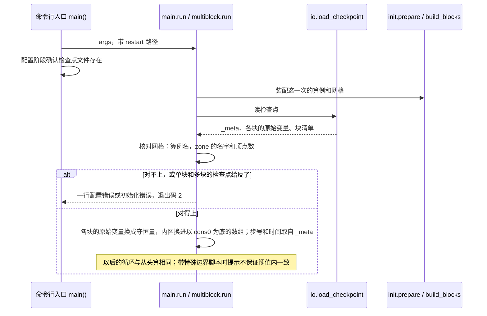

# 第八步 检查点格式与续算 - Plan

## Goal Capsule

- 目标：检查点里存原始变量 ρ、u、v、w、T，单块和多块是同一种布局；多块运行每个保存步只写一个检查点文件，里面是所有块；检查点的 `_meta` 能分辨一次运行；能从检查点续算，float64 的运行结果与不中断的运行在验收的阈值内一致。
- 依据：`11-16 我建议先对齐的.md` 里“第 8 步”的定义；jisen 在 2026-11-25 的 grilling 里对十八个问题的回答，和 2026-11-26 审过 Astra 第 27 轮以后定的三条（见 Key Decisions 和 Sources）。
- 约束：单块的数值结果不变；第六步、第七步的验收不变；原码树不动。
- 未决：没有阻塞实施的疑问。续算在阈值内一致这件事在还没测过的算例上是否成立，由 U3、U4 的测试判定；带特殊边界脚本、脚本把历史留在鬼胞里的运行不保证阈值内一致（jisen 的决定）。读 `cons_0` 到 `cons_4` 的几个脚本怎么处理，jisen 已经确认（见 Key Decisions）。

---

## Product Contract

### Summary

第八步做两件事。一是定下检查点的格式：里面存原始变量 ρ、u、v、w、T，单块和多块是同一种布局；多块运行每个保存步一个 NPZ，里面是各块自己的数组，带一份块清单。二是续算：从一张检查点接着算，步号和时间接着编号，float64 的运行结果与不中断的运行在阈值内一致。顺带把 `_meta` 补全，把输出间隔的校验补齐。

### Problem Frame

现在多块运行每一步每块各存一个 NPZ，文件名带块名。要看一个时刻的全场，得先把几个文件对上号；块名进文件名，还要防两块的 slug 撞车。jisen 在第六步就定了：这是过渡，第八步换成每个保存步一个文件。

检查点里现在存的是守恒量。jisen 定了改成原始变量 ρ、u、v、w、T：打开文件看到的就是物理量，原码的快照里存的也是原始变量。单块和多块用同一种布局，每块一个数组。

检查点的 `_meta` 记了时间、步号、步长、算例、格式和物性，没有记粘性开关、精度和网格。第七步做完以后，打开粘性和关闭粘性的两次运行，文件从 `_meta` 上看不出区别。

JAX 不能续算。原码能：从快照文件头读回步号和时间，接着往下算。长算例换机器、中途停了再来，都要这一条。

另外有一处小洞：单块运行从命令行给 `--kstep-save 0`，会先跑完第一步、打印完诊断，再崩出 `ZeroDivisionError` 的 traceback。JSON 和多块两条路都在启动时报错，只有这一条没拦。

### Key Decisions

- **滚动可视文件不放进第八步。** 路线图里单列一步。
- **不压缩。** 实测真实的 plate 检查点用 zlib 能省 45%，写盘从 5 毫秒变成 114 毫秒；jisen 的选择是保持现状。
- **检查点存原始变量。** 每块一个数组，键是 `b` 加块号，里面是 ρ、u、v、w、T，只有内区。单块和多块是同一种布局（jisen 在 Astra 第 27 轮以后定）。
- **多块每个保存步一个 NPZ。** 各块自己的数组放进同一个文件，另带一份块清单。块清单就是多块标记。
- **不带坐标。** 与单块一致。
- **第六步那种按块各存一个的布局直接替换。** 磁盘上没有一张旧布局的文件。
- **续算并进第八步。** 由 `--restart` 显式给出检查点；启动时只核对网格，其余配置以这一次为准；步号和时间接着编号；这一步之前写的检查点也能续。
- **续算的验收是阈值内一致，不是逐位相同。** 阈值用第六步、第七步验收的那两个数。检查点存了原始变量，读回来要换成守恒量，换算有舍入（jisen 在 Astra 第 27 轮以后定）。验收只做 float64 的运行；float32 的运行只要求能续，浮点数的优化是以后的事（jisen 在 Astra 第 28 轮之后定）。
- **带特殊边界脚本的运行允许续算，不保证阈值内一致。** 启动时提示一句。脚本留在鬼胞里的历史存不下来（Astra 第 26 轮审查后，jisen 的决定）。
- **读 `cons_0` 到 `cons_4` 的脚本分三类处理。** 带测试的和 `outputest/snapshot_to_plt.py` 跟着改；四个为旧归档写的对照脚本不动，它们读新文件会报错（jisen 确认，2026-11-26）。清单见 Assumptions 第 13 条。
- **不做单块和多块之间的互转。**
- **`_meta` 补全。**
- **输出间隔必须是正整数。**

### Requirements

**检查点**

- R1. 多块运行每个保存步只写一个 NPZ，文件名 `<前缀>-istep-<步号>.npz`，与单块同一规则。保存时机不变：保存间隔的整数倍，或到达终止时间。
- R2. 文件里每块一个数组，键是 `b` 加块号：`b0`、`b1`……块号是块在网格文件里的序号，单块只有 `b0`。数组是原始变量，形状 (5, nk, nj, ni)：第一根轴依次是 ρ、u、v、w、T，空间轴按 (k, j, i) 排，i 最快。只有内区，各块用自己的形状，不补齐。存盘时每个数组的值，等于对那一块内区同一时刻的守恒量做同一份换算（KTD13）的结果。
- R3. 文件带一份块清单（键 `_blocks`，JSON，编码与 `_meta` 相同）：等价单块的全局顶点数，以及每块的 zone 名、形状、在等价单块里的起止下标。全局顶点数和起止下标只在网格旁记里有的时候给。块清单是多块标记。
- R4. 不带坐标，不压缩。
- R5. 单块检查点的文件名和保存时机不变，文件里是 `b0` 和 `_meta`。这一步之前写的单块检查点（键是 `cons_0` 到 `cons_4`）读得出来，也能续算。

**`_meta` 与读回**

- R6. `_meta` 补四个字段（KTD4）：粘性开关（生效值）、粘性导数的阶数、精度、网格。网格一项含格式、文件的路径、zone 的名字和尺寸。原有的项不变。多块文件里网格一项只有格式和路径，各块的尺寸在块清单里，`_meta` 不写 `N`。
- R7. `src/io.py` 提供统一的读回：单块和多块的检查点都能读，拿到公共的 `_meta`、各块的原始变量数组和块清单；多块的能按块清单拼回全局场。原始变量换成守恒量也走 `src/io.py`。这一步之前的单块检查点读回来也是原始变量。`io.load_npz` 的行为不变。

**输出参数**

- R8. `--kstep-show` 和 `--kstep-save` 必须是正整数。单块运行在启动时报一行配置错误，退出码 2，报法与多块和 JSON 一致。

**续算**

- R9. 续算由 `--restart 路径`（JSON 的 `time.restart`）显式给出检查点；不给就从初始场算起。单块的所有算例和多块都开放。相对路径按 JSON 所在目录解析，与 `mesh.file` 相同。
- R10. 续算的起点以初场 `cons0` 为底，只把内区换成检查点的原始变量换算出的守恒量；鬼胞留初场的，再由物理准备和交换按规则填。多块的每块用自己的 `cons0`。步号和时间从 `_meta` 读回，接着编号；终止时间、终止步数、保存间隔、显示间隔都按累计的步号算。
- R11. 启动时只核对网格：算例名，以及每个 zone 的名字和顶点数（内置网格比 ni、nj、nk）。对不上报一行配置错误。其余配置以这一次为准，不核对。
- R12. 检查点里记了的项就比，没记的跳过并提示一句。
- R13. 多块运行只从多块检查点续算，单块运行只从单块检查点续算。给反了报错。
- R14. 检查点读不了、不是检查点、缺 `_meta`、缺步号或时间：启动时报一行初始化错误，退出码 2，没有 traceback。数组的形状与这一次网格的内区不同也报这样的错。
- R15. 启动信息里指出从哪个文件、哪一步、什么时间续算。带特殊边界脚本的运行续算时，另外提示一句：不保证与不中断的运行在阈值内一致。

**验收**

- R16. 不带特殊边界脚本的运行，续算的结果与不中断的运行在阈值内一致，阈值和比法见 KTD10。前提是两边走过的步长序列相同。单块比整个内区；多块比各块内区的三个阶段的右端项、粘性分项、准备态、q1、q2、末态。带特殊边界脚本的运行：脚本不依赖历史的，阈值内一致；脚本把历史留在鬼胞里的，只要求能续，不比。验收只做 float64 的运行（jisen 的决定）：float32 的运行只要求能续，不比阈值；单精度下来回换算的舍入是 1e-7 的相对量级，到不了这个阈值（Sources 里的实测），浮点数的优化是以后的事。
- R17. 从正式入口走一遍“跑两步”和“跑一步再续一步”，用终止步数在保存步切开：两边的文件一一对应，`b` 开头的数组在阈值内一致，`_meta` 的 `step` 和 `t` 相同。
- R18. 网格对不上、单块和多块的检查点给反了、检查点坏了，各被拦住，各有一条测试。
- R19. 单块的数值结果不变；第六步、第七步的验收不变。存盘相关的断言按 R1 到 R5 改写，阈值不变。

**文档**

- R20. `src/README.md` 写检查点的格式（存什么、键名、轴的顺序）、`_meta` 的字段、续算的用法和只核对网格的规则；路线图记第八步的落地情况、不压缩的依据、滚动可视文件单列一步；第六步的方案里加一句“第八步已替换”。

### Key Flows

**存盘**

到达保存步，把各块内区的守恒量换成原始变量，每块写一个数组 `b{块号}`，放进同一个 NPZ，附上公共的 `_meta`。多块另带块清单，清单里的位置取自网格旁边的旁记。

**续算的启动**

1. 命令行或 JSON 给出检查点。配置阶段确认文件存在。
2. 装配这一次的算例和网格，与从头算相同。
3. 读检查点，核对网格。对不上就报错退出。
4. 把检查点里各块的原始变量换成守恒量，内区换进以 `cons0` 为底的数组。步号和时间取自 `_meta`。
5. 以后的运行循环与从头算相同。

### Acceptance Examples

- AE1. x2 跑两步，输出目录里是 `x2-istep-00000001.npz` 和 `x2-istep-00000002.npz`。读回：`b0` 的形状是 (5, 40, 40, 51)，`b1` 是 (5, 40, 40, 50)；块清单里两块的名字、形状、位置；换成守恒量、拼回的末态与等价单块在阈值内一致。
- AE2. t3 的检查点读回，三块的数组与对同一时刻各块内区做同一份换算的结果逐位相同。没有旁记的网格，块清单里没有全局顶点数和起止下标，读回照常。
- AE3. 粘性打开和关闭的两次运行，检查点的 `_meta` 只差粘性开关一项（阶数相同时），文件名相同。
- AE4. 这一步之前写的单块检查点（`cons_0` 到 `cons_4`）：`io.load_npz` 照旧读得出来；统一的读回给出原始变量；能续算。
- AE5. 单块给 `--kstep-save 0`：启动时报一行“配置错误”，退出码 2，没有输出文件。
- AE6. plate 跑一步存盘，用 `--restart` 从这张检查点续一步。与一口气跑两步相比，第二张检查点的 `b0` 在阈值内一致，`_meta.step` 是 2，`_meta.t` 相同。
- AE7. 多块 x2 同 AE6，比的是 `b0` 和 `b1`。
- AE8. 网格不同的检查点拿来续算：启动时报配置错误，消息里点出哪里对不上。
- AE9. 把多块检查点给了单块运行，或者反过来：报错。
- AE10. 这一步之前写的检查点（只记了算例名和 `N`）拿来续算：能续，启动时提示哪些项没有核对。
- AE11. 带特殊边界脚本的运行从检查点续算：能续，启动信息里有一句不保证阈值内一致的提示。脚本不依赖历史时（固定赋值的那种），续算的结果与不中断的运行在阈值内一致。

### Scope Boundaries

不在第八步：

- 滚动可视文件。路线图里单列一步。
- 压缩。
- 单块检查点与多块检查点之间的互转。
- 按原码的 `OCFD%08d.dat` 格式输出，时间平均场。对拍工具需要的输出另议。
- `src/compare.py` 写的 `cons_{标签}_step*.npz`：对照工具自己的文件，不是检查点，格式不动。
- 多 GPU 下按进程分文件的写法（第 9 步）。

### Dependencies / Assumptions

- 第七步已经提交（`ce9bf94`）。第八步直接用它的求解函数、测试辅助模块和验收。
- 磁盘上没有一张按块存的多块检查点，旧布局不需要兼容。单块的旧检查点（`cons_0` 到 `cons_4`）在归档里有，要能读、能续。
- 读检查点的脚本读的是 `cons_0` 到 `cons_4` 加 `_meta`。单块改成新格式以后，它们读不了新写的文件。处理办法见 Assumptions 第 13 条。

### Outstanding Questions

**Resolve Before Planning**

没有。读 `cons_0` 到 `cons_4` 的脚本怎么处理，jisen 在 2026-11-26 确认按 Key Decisions 里的做法，清单见 Assumptions 第 13 条。

**Deferred to Implementation**

- 续算在阈值内一致这件事，在还没测过的配置上是否成立。已实测在阈值内的有：plate（CGNS 源网格，粘性 CD8）、多块的 x2、t3、per3（粘性 CD8）。其余算例由 U3、U4 的测试判定。
- 读回函数和核对函数的确切名字和参数。

### Sources / Research

**原码**（`OpenCFD-SCU-v3.0`，仓库的同级目录，只读；行号对应当前工作区）

| 事实 | 位置 |
|---|---|
| 快照是全局一份的 `OCFD%08d.dat`，里面是原始变量；`Istep % Kstep_save == 0` 时写 | `src/OCFD_IO.c:174-214`、`src/OCFD_NS_Solver.cu:157-170` |
| 续算：`INIT_STAT != 0` 时读 `Opencfd.msg` 指定的那张快照，没有这个文件就读 `opencfd.dat`；步号和时间取自文件头 | `src/OCFD_IO.c:37-85`、`src/OCFD_init.cu:78-98` |

原码没有“只留最新一份”的滚动文件，常规主循环里没有 Tecplot 输出。这两条是一个只读的子代理读源码得出的，实现方没有逐行核对。

**JAX**（实现方读过）

- `src/io.py`：`checkpoint_name`、`time_to_save`、`inner_fields`、`checkpoint_meta`、`save_npz`、`load_npz`。
- `src/boundary.py` 的 `primitive`（守恒量→原始变量，对应原码的 `cons_to_pri_kernel`）和 `src/cases.py` 的 `cons_from_state`（原始变量→守恒量）是现成的两份换算。
- `src/main.py` 的 `run`：起点是 `state.cons0`，`t` 和 `step` 从零起；`main` 负责创建输出目录，把 `ConfigError` 和 `SetupError` 报成一行。
- `src/multiblock.py` 的 `run`：起点是各块的 `cons0`，存盘用 `block_slugs` 给每块拼文件名；`_global_sizes` 读旁记里的全局顶点数。
- `src/runtime_config.py`：`_SCHEMA` 的 `time` 组有 `dt`、`end_time`、`end_step`；`path` 类型把相对路径按 JSON 所在目录解析，并要求文件存在。
- `src/mesh_cgns.py` 的 `zone_metadata` 只读 zone 的名字和顶点数，不读坐标。

**实测**（一次性脚本，没有留在仓库里）

- 压缩：plate 的检查点 6.40 MB，zlib 后 3.52 MB；写 5 毫秒对 114 毫秒，读 12 毫秒对 35 毫秒，读回的值逐位相同。
- `--kstep-save 0`：跑完第一步、打印诊断之后 `ZeroDivisionError`，退出码 1。
- 守恒量和原始变量来回换算：存盘时把内区的守恒量换成原始变量，读回时再换回去，用的是代码里现成的两份换算（KTD13），结果不逐位相同。两份数据上各量了一次，差的最大值和相对量级相同，不逐位相同的值的个数随数据不同：
  - 进程里按正式入口的装配算出的 plate（CGNS 源网格，粘性 CD8）第 1 步：ρ 和 ρu 逐位相同，ρE 有 44272/160000 个值不同，差最大 5.68e-14，相对该分量的最大值 3.17e-16。
  - 归档的 plate 检查点（第 4.9 步的默认口径，文件在 `experiment/step49_eps_scaled_20261122/` 下，不入库）：ρ 逐位相同，ρu 有 40 个值不同（相对 1.08e-16），ρE 有 37497 个值不同，差最大 5.68e-14，相对 3.17e-16。
- float32 下的来回换算：同一份归档的 plate 检查点转成 float32，ρu 有 40 个值不同，差最大 5.96e-8（相对 5.8e-8）；ρE 有 6560 个值不同，差最大 3.05e-5（相对 1.7e-7）。都超出第六步的阈值。所以验收只做 float64 的运行。
- 续算，检查点存原始变量、读回再续一步：以 `cons0` 为底、只换内区。单块（plate，粘性 CD8）第 2 步的内区与不中断的运行比，五个分量都有不逐位相同的值（ρ 4790 个、ρu 6952 个、ρv 150472 个、ρw 150480 个、ρE 35792 个，各 160000 个）。差最大的是 ρE 的 1.42e-13（相对 7.9e-16）。余量最小的一处是 ρv：差 3.8e-16，容差 1.79e-11，约四万倍。多块（x2、t3、per3，粘性 CD8）各块的内区同样在阈值内。四个算例都通过第六步的 `compare`。复现的做法：单块用 `experiment/step6_support.py` 的 `formal_step`，多块用 `src/multiblock.py` 的 `solve_step` 和 `experiment/step7_support.py` 的 `preset`；把第一步末态的内区换算后放进以 `cons0` 为底的数组再走一步，与不中断的比。
- 续算的机理，不经换算的那次实测（检查点里直接是守恒量）：以 `cons0` 为底、只换内区，单块（plate，粘性 CD8）第 2 步的末态与不中断的运行逐位相同；多块（x2、t3，粘性 CD8）第 2 步各块内区的三个阶段右端项、粘性分项、准备态、q1、q2、末态逐位相同。所以存原始变量以后的差只来自换算的舍入。多块连鬼胞一起比时不相同：准备态和末态不同的只有两条以上的轴同时出界的块角鬼胞；准备之前的 q1、q2 在面内的鬼胞上也有不同。都比内区，不影响 R16。
- 续算，鬼胞从零开始是错的（Astra 第 26 轮找到，实现方复现）：sod（64×4×4，dt 0.0001）的初场把左状态的密度 1.0 写进入口侧的鬼胞、右状态的 0.125 写进出口侧的鬼胞，出口的规则是保持原值，内区会读它们。清零续算，WENO7 第 2 步有 768 个内区值不同，最大差 9.451e-3；UP7 有 1152 个，最大差 4.056e-3。以 `cons0` 为底以后两种格式都逐位相同。tg（32×16×8）、内置的 poiseuille（32×16×4，带体积力）、`Grid/fixtures/poiseuille_box.cgns`（六面周期加壁面，没有出口）两种做法都逐位相同。
- 续算，依赖历史的回调：在 plate 上加一个特殊边界回调，它把历史留在出口的鬼胞里，再用鬼胞改最外面一层内区。只存内区，续算第 2 步有 109716 个内区值不同，最大差 0.26，以 `cons0` 为底也一样。只动鬼胞、不动内区的回调，内区不受影响。仓库的 `src/special_boundaries/` 里现在没有脚本。
- 步长：两条主循环都按剩余时间截短末步（`src/main.py` 的 `run`、`src/multiblock.py` 的 `run`）。前一段因终止时间停在半步处时，续算与不中断的运行走过的步长不同。
- 多块的尺寸：x2 两块的内区是 51×40×40 和 50×40×40。
- 两个 plate 网格（`Grid/testcgnstest.cgns`、`Grid/testcgnstest_ystr.cgns`）的 zone 都是 `blk-1`、100×40×40，按 R11 的规则算同一个网格。它们的 y 坐标最大相差约 0.494，这个数是 Astra 读出来的，实现方没有复核。

**决定**

jisen 在 2026-11-25 的 grilling 里对十八个问题的回答，记录见 Key Decisions。其中第二轮 Q3 的回答是 jisen 自己给的，没有选给出的选项：步长、终止时间、终止步数、输出设置、格式、粘性开关、粘性导数的阶数、精度可以改，网格不许改；第三轮确认物性和边界条件也可以改，不核对。

审过方案以后又定了一条（2026-11-26，Astra 第 26 轮之后）：带特殊边界脚本的运行允许续算，不保证阈值内一致，启动时提示。

审过 Astra 第 27 轮以后，jisen 又定了三条（2026-11-26）：检查点存原始变量 ρ、u、v、w、T，不存守恒量；续算的验收改成阈值内一致，阈值用第六步、第七步验收的那两个数，因为换了变量以后做不到逐位相同；多块文件每块一个键 `b{块号}`，数组形状 (5, nk, nj, ni)，各块自己的形状，不补齐。第三条是 jisen 提的布局。实现方据此让单块也用 `b0`，单块和多块成了同一种布局。

实现方按这三条改方案时提了两个做法，jisen 在 2026-11-26 确认照做：读 `cons_0` 到 `cons_4` 的脚本按三类处理（见 Key Decisions）；原来的 U1 和 U2 合成一个单元，格式的事一次改完。

实现方量出来的一条（2026-11-26，Astra 第 28 轮指出，实现方复现）：float32 的运行做不到阈值内一致，单精度下来回换算的舍入是 1e-7 的相对量级。jisen 随后定了（2026-11-26）：验收只做 float64，float32 的运行自然可用、只要求能续，浮点数的优化是以后的事。

同一天 jisen 还定了一条工作规则：Astra 的审查费钱，文档每改一次不要都送审；送审之前先让 jisen 确认，jisen 没让送的时候实现方自己检查。

**修订记录**

2026-11-26，按 Astra 第 28 轮对方案的审查修订。必须改三条，都已落实：

1. float32 的运行不比阈值，只要求能续（R16、KTD10、Assumptions 第 14 条、风险表、Verification Contract、DoD）。单精度下来回换算的舍入是 1e-7 的相对量级，实现方复现了。jisen 随后定：验收只做 float64，float32 的运行不专门测（U1、U3 里两条 FP32 的测试场景已删）。
2. 三个脚本的改法写具体（Assumptions 第 13 条、U1）：`run_step0.py` 的统计怎么取数，`check_step0.py` 和脚本换算旧文件用的物性取自文件自己的 `_meta`，测试放进 `experiment/test_check_step0.py`。
3. 四个对照脚本的边界写准（Assumptions 第 13 条）：它们缺省读归档，目录是命令行给的，指到新文件会报 KeyError；按 jisen 的决定不改代码。

采纳的建议两条：KTD13 写明 `primitive` 返回的三样怎么拼成 (5, nk, nj, ni)、读回时怎么交给 `cons_from_state`；Sources 写明两次量测各自的数据和复现的做法，并补了 float32 下的量测。

第 28 轮的三条落实以后没有再送确认轮：jisen 定了 Astra 的审查费钱，文档每改一次不都送审，实现方准备充足以后再送（Assumptions 第 10 条）。

采纳的建议两条：KTD13 写明 `primitive` 返回的三样怎么拼成 (5, nk, nj, ni)、读回时怎么交给 `cons_from_state`；Sources 写明两次量测各自的数据和复现的做法。
2026-11-26，按 jisen 在 Astra 第 27 轮以后定的三条修订。做法变了的三处：

1. 检查点里存原始变量 ρ、u、v、w、T，不存守恒量（R2、R5、R7、R10、KTD3、KTD6、KTD13）。单块和多块是同一种布局，每块一个数组 `b{块号}`，形状 (5, nk, nj, ni)。
2. 续算的验收从“逐位相同”改成“阈值内一致”（R16、R17、KTD10）。换算有舍入，做不到逐位相同；实测见 Sources。
3. 原来的 U1 和 U2 合成一个单元，格式的事一次改完（jisen 确认）。后面的单元顺次前移一号：U2 是输出间隔的校验，U3 是单块续算，U4 是多块续算，U5 是文档。

跟着改的：读 `cons_0` 到 `cons_4` 的测试和脚本列了清单，分三类处理，jisen 确认，记在 Assumptions 第 13 条；`inner_fields` 没有调用方了，删除；冻结测试改成比换算以后的原始量。

2026-11-26，按 Astra 第 26 轮对方案的审查修订。这一条里的单元编号是合并以前的（U4 是单块续算，U5 是多块续算，现在是 U3、U4），“逐位相同”是当时的验收，上一条第 2 点已经改成阈值内一致。做法变了的三处：

1. 续算的起点从“鬼胞从零开始”改成“以 `cons0` 为底、只换内区”（R10）。
2. “逐位相同”补上两个前提：不带特殊边界脚本，步长序列相同（R16、KTD10）。带特殊边界脚本的运行允许续算，不保证逐位相同（R15）。
3. 块清单里的位置写入之前，先核对旁记的块名和每块的大小（KTD2）。

采纳的建议四条：读回时核对场的形状（R14、KTD8）；U5 的验收写成“拦得住块数、名字、尺寸的变化”；续算的测试里，不中断的一边用带鬼胞的末态，续算的一边真的走读盘，用终止步数切开，起步的步号不是保存间隔的整数倍（KTD10、U4）；`_meta` 的新字段写明它能分辨什么（KTD4）。

订正的笔误和说法：x2 两块的尺寸（是 51 和 50，不是两个 51）；`tg` 的名字；KTD2 里“旁记的合法性已由 `_global_sizes` 校验过”不对，它只校验全局顶点数；Sources 里“不同的只有块角”只对准备态和末态成立。

没有采纳的一条：Astra 把“带出口的 CGNS Poiseuille”列为漏测的分支。仓库里现成的那份网格六面周期加壁面，没有出口；带出口的网格等真实网格来了再验。

---

## Planning Contract

Product Contract 保留说明：这份方案没有上游的需求文档，Product Contract 直接来自 grilling 的回答。

### Key Technical Decisions

- **KTD1. 块清单沿用旁记的结构。** 旁记（`Grid/split_cgns.py` 写在网格旁边的 JSON）记着 `global_vertices` 和每个块的 `name`、`start`、`stop`。块清单照这个结构写，另加每块的 `size`。三元组都按 (i, j, k) 排。好处是拼回的算法只有一份：把它从 `experiment/step6_support.py` 搬进 `src/io.py`，测试辅助改为调用它。
- **KTD2. 块清单里的位置从旁记来，核对以后才写。** `multiblock.run` 再读一次旁记，取各块的 `name`、`start`、`stop`。写进去之前核对两件事：块名按顺序与网格的 zone 一致；每一块 `stop − start` 等于该块的尺寸。核对不过，或者旁记里没有这些项，就不记全局顶点数和起止下标；旁记在、块名却对不上的那种情况打印一句提示。`_global_sizes` 只校验 `global_vertices`，不校验块的这一部分。
- **KTD3. 数组的布局。** B 是块数。文件里的键是 `b0` 到 `b{B-1}`，块号是 zone 在网格文件里的序号；单块只有 `b0`。每个数组是 (5, nk, nj, ni)：第一根轴的五项依次是 ρ、u、v、w、T；空间轴按 (k, j, i) 排，与数组在内存里的顺序相同，i 最快。各块用自己的形状，不补齐。多块的形状另外记在块清单的 `size` 里，读回时逐项核对。
- **KTD4. `_meta` 的新字段。**

  | 字段 | 取值 | 从哪里来 |
  |---|---|---|
  | `viscous` | `true` 或 `false` | 生效的粘性：`args.viscous`，或算例声明强制粘性。多块只放行 plate，它不强制粘性，生效的就是 `args.viscous` |
  | `vis_order` | `"CD6"` 或 `"CD8"` | `args.vis_order` |
  | `precision` | `"float64"` 或 `"float32"` | 与启动信息里的 `precision=` 同一个来源 |
  | `mesh` | `format`（`builtin` 或 `cgns`）、`file`（路径，内置网格为空）、`zone`（zone 名，内置网格为空）、`size`（[ni, nj, nk]） | 单块见 KTD5。多块只有 `format` 和 `file` |

  单块的 `N` 照旧写。多块的 `_meta` 不写 `N`。这四个字段说明的是这一步新增的设置。同一网格改了参考尺度或出口条件，`_meta` 是一样的；它不是整份配置的快照。
- **KTD5. 单块的 zone 名和尺寸在存盘时取。** CGNS 网格用 `mesh_cgns.zone_metadata` 取所选的那个 zone，只读元数据。内置网格的 zone 名记空，尺寸取网格。
- **KTD6. 读回函数的形状。** `load_checkpoint(path)` 返回三样：`meta`（公共的 `_meta`）、`blocks`（块清单，单块为空）、`fields`（按块的序号排的列表，每项是那一块的 (5, nk, nj, ni) 原始变量数组；单块的列表只有一项）。新格式的单块和多块检查点、旧格式的单块检查点读回来是同一个样子。`reassemble(blocks, pieces)` 把各块的场拼回全局，第一根轴是什么分量它不管。`load_npz` 和 `save_npz` 不动。
- **KTD7. 续算的接线。** 单块在 `main.run` 里 `init.prepare` 之后替换起点、步号和时间；多块在 `multiblock.run` 里做同样的事。两个运行循环不动。
- **KTD8. 核对网格的函数放在 `src/io.py`。** 输入是检查点和这一次的算例名、zone 列表（每项是名字和顶点数）；输出是对不上的项和没核对到的项。调用方决定怎么报错、怎么提示。读回时另外逐项核对每个数组的形状：第一根轴是 5，后面三根与这一块的内区相同；不同就按 R14 报错。旧检查点只核对了 ni，这一条兜住另外两维；形状不同时不做广播。
- **KTD9. 精度以这一次为准。** 检查点的场转成与这一次的 `cons0` 相同的类型。这是“精度可以改”的后果：FP32 的运行从 FP64 的检查点续算，值会变。启动信息里提示一句。
- **KTD10. 阈值和验收里的“不中断的运行”。** 阈值用 `experiment/step6_support.py` 里 `compare` 的两个数：相对 1e-11 乘该分量在参考场里的最大值，加上绝对 1e-13 乘五个分量的最大值；参考场是不中断的运行。比守恒量的阶段（右端项、准备态、q1、q2、末态）和比原始变量的检查点文件用同一个公式，五个分量换成 ρ、u、v、w、T；粘性分项按 12 个分量比，公式相同。“不中断的运行”：单块用正式入口的装配连跑两步，多块用求解函数连跑两步；第二步直接接在第一步含鬼胞的末态后面。续算的一边把第一步末态的内区按新格式写成检查点，走实际的读盘和恢复再续第二步。两边用同一个求解函数，判别力在第二步的起点：一边是带鬼胞的末态，一边是按 R10 恢复出来的。两段都用终止步数切开，不用终止时间，保证步长序列相同（R16）。从正式入口比的测试，两边各用一个输出目录，并断言续算那一边新写了第二步的文件；起步的步号选一个不是保存间隔整数倍的，才看得出保存和显示是按累计步号触发的。阈值内一致的依据是 Sources 里的实测。验收只做 float64 的运行；float32 的运行只要求能续，不在验收范围内（R16）。
- **KTD11. 旧检查点。** 这一步之前写的单块检查点，键是 `cons_0` 到 `cons_4`，值是内区的守恒量。读回时用 KTD13 的换算转成原始变量，以后与新文件走同一条路。换算要用的物性由调用方给：续算时给这一次的；脚本独立运行时，用文件自己 `_meta` 里的 `gamma` 和 `Ama` 现搭一个，只用得到 `Cv`。它的 `_meta` 只有算例名和 `N` 能用来核对网格。续算时比这两项，其余没记的提示一句。
- **KTD12. `block_slugs` 删除。** 一个保存步一个文件以后，块名不再进文件名，这个函数和它的两条测试没有用处了。
- **KTD13. 换算用现成的两份。** 守恒量→原始变量用 `src/boundary.py` 的 `primitive`，原始变量→守恒量用 `src/cases.py` 的 `cons_from_state`，不另写算式。`primitive` 返回 `(rho, u, T)` 三样，`u` 是 (3, nk, nj, ni)。存盘时拼成 `[rho, u[0], u[1], u[2], T]`；读回时按 `{"rho": b[0], "u": b[1], "v": b[2], "w": b[3], "T": b[4]}` 交给 `cons_from_state`。两个函数都在 jit 之外调用。`primitive` 在 ρ 不大于零的点上用 1 代替 ρ 再除；正常的运行里内区的 ρ 是正的，这里不处理 ρ 非正的运行。sod 算例的初值约定与 `T = E_int/Cv` 不同（`src/cases.py` 的 `_build_sod` 注释里写着），检查点里的 T 按 `primitive` 的约定算，换回守恒量时用同一个约定，续算不受影响。

### 触及清单

| 文件 | 改动 | 护栏 |
|---|---|---|
| `src/io.py` | `checkpoint_meta` 补字段；存一块的原始变量；多块的存盘和读回；`reassemble`；核对网格的函数；删 `inner_fields` | `experiment/test_step49_frozen.py`（按新格式改写） |
| `src/main.py` | 存盘改成存原始变量；`--restart`；续算的接线；启动信息；输出间隔的校验 | 配置测试、第三步的测试 |
| `src/multiblock.py` | 存盘改成存原始变量、一个保存步一个文件；读旁记取各块的位置；续算的接线；删 `block_slugs` | 第六步、第七步的测试（存盘的断言按 U1 改写） |
| `src/runtime_config.py` | `time.restart` | `experiment/test_step3_config.py` |
| `experiment/step6_support.py` | `reassemble` 改为调用 `src/io.py` 的 | 第六步、第七步的验收 |
| `experiment/test_step49_frozen.py`、`experiment/test_step6_run.py`、`experiment/test_step6_acceptance.py`、`experiment/test_step7_config.py` | 存盘的断言按新格式改写 | 各文件其余断言不变 |
| `experiment/run_step0.py`、`experiment/check_step0.py`、`outputest/snapshot_to_plt.py` | 认新格式，旧格式照旧认（Assumptions 第 13 条） | `experiment/test_check_step0.py`（补“基准旧、候选新”的用例）、`experiment/test_step8_format.py` |
| `experiment/test_step8_*.py` | 新建三个 | — |
| `src/README.md`、`11-16 我建议先对齐的.md`、`docs/plans/2026-11-23-001-feat-step6-multiblock-serial-plan.md`、`docs/plans/2026-11-25-001-feat-step7-multiblock-viscous-plan.md` | 文档 | — |

不动的文件：`src/viscous.py`、`src/solver.py`、`src/boundary.py`、`src/cases.py`（只调用它们的换算）、`src/compare.py`。

### High-Level Technical Design



检查点里有什么。单块（以 plate 的 CGNS 源网格为例，内区 100×40×40）：

| 键 | 内容 |
|---|---|
| `b0` | 原始变量，形状 (5, nk, nj, ni) = (5, 40, 40, 100)；第一根轴依次是 ρ、u、v、w、T |
| `_meta` | 时间、步号、步长、算例、格式、物性，加上 KTD4 的四项 |

多块（以 x2 为例，两块的内区分别是 51×40×40 和 50×40×40）：

| 键 | 内容 |
|---|---|
| `b0` | 第 0 块的原始变量，形状 (5, nk, nj, ni) = (5, 40, 40, 51) |
| `b1` | 第 1 块的原始变量，形状 (5, 40, 40, 50) |
| `_meta` | 与单块的相同；没有 `N`，网格一项只有格式和路径 |
| `_blocks` | `global_vertices`：[100, 40, 40]；`blocks`：两项，各有 `name`、`size`、`start`、`stop` |

网格对不上时，检查点里记了的项就比，没记的提示：

| 检查点 | 比什么 | 提示什么 |
|---|---|---|
| 第八步写的单块检查点 | 算例名；网格格式；CGNS 的 zone 名；尺寸 [ni, nj, nk] | 不提示 |
| 第八步写的多块检查点 | 算例名；每一块的 zone 名和形状 | 不提示 |
| 这一步之前的检查点 | 算例名；`N` 对 ni | zone 的名字和另外两维的尺寸没有记，没核对 |

### Assumptions

**需要 jisen 知道的默认处理**

1. 块的序号是 zone 在网格文件里的顺序。
2. 网格核对的是结构，不是坐标。zone 的名字和顶点数都相同的两个网格算同一个；内置 plate 的 `plate_x0`、`plate_x1`、`plate_h` 改了，不会被拦。
3. 续算后的保存间隔按累计步号算：从第 1000 步续、间隔 500，下一张是第 1500 步。单独到达步数上限不保存，与从头算相同。
4. 检查点的场转成这一次的精度（KTD9），启动信息里提示。
5. 续算给的检查点就在输出目录里时，它不会被覆盖：以后的文件步号更大。
6. `--restart` 给的文件在配置阶段就确认存在，与 `mesh.file` 相同。
7. 续算做完一步也没跑（检查点的步号或时间已经到了终止条件）时，照常打印结束那一行，不存盘。
8. 旁记的块名与网格的 zone 顺序对不上时，块清单不记位置，打印一句提示（KTD2）。
9. `block_slugs` 和它的两条测试删除（KTD12）。
10. 继续在 `feat/step2-boundary` 上做。Astra 的审查费钱：送审之前先让 jisen 确认；jisen 没让送的时候，实现方自己检查（jisen，2026-11-26）。
11. 带特殊边界脚本的运行允许续算，不保证阈值内一致。只动鬼胞的回调不影响内区；把历史留在“保持原值”的鬼胞里、再用它改内区的回调，续算就超出阈值（Sources 里的实测）。脚本自己记在 Python 变量里的状态（闭包、全局变量），检查点存不了。
12. 检查点里存原始变量 ρ、u、v、w、T（jisen 的决定）。守恒量换成原始变量再换回来有舍入，续算做不到逐位相同，验收是阈值内一致。
13. 读 `cons_0` 到 `cons_4` 的入库文件分三类（清单是实现方用 `git grep` 找的，jisen 确认，2026-11-26）。（1）跟着改：`experiment/test_step49_frozen.py`；`experiment/run_step0.py`（清单的统计：旧文件照旧，新文件按 `b0`、`b1`……各记一项，密度范围取 `b0` 的第 0 个分量）；`experiment/check_step0.py`（基准是旧格式、候选是新格式时，把基准的守恒量用同一份换算转成原始量再比；缺省的容差是零，也就是逐位比）；`outputest/snapshot_to_plt.py`（新旧两种格式都认，转出的一律是原始量）。脚本换算旧文件用的物性，取自那个文件自己 `_meta` 里的 `gamma` 和 `Ama`：脚本独立运行，没有这一次的配置可取。（2）不动。它们是为以前的归档写的，缺省的路径指向归档；目录是命令行给的，指到新写的检查点会因为没有 `cons_*` 报 KeyError。要拿它们读新文件时再改：`experiment/compare_outlet_ghost.py`、`experiment/compare_supersonic_bl.py`、`experiment/compare_supersonic_bl_stations.py`、`experiment/baseline/ocfd_plate/compare.py`。（3）不受影响：`experiment/test_check_step0.py`（只拿 `cons_0` 当键名用）、`experiment/test_step49_plate.py`、`experiment/compare_ocfd_jax.py`、`experiment/baseline/ocfd_plate/to_npz.py`（读的是原码的输出和基准 npz）、`experiment/source_record_20261117/`（源码归档）。
14. 验收只做 float64 的运行；float32 的运行只要求能续，不比阈值，也不专门测，浮点数的优化是以后的事（jisen 的决定，2026-11-26）。单精度下来回换算的舍入是 1e-7 的相对量级，验收用的阈值是 1e-11。

**对需求的澄清**（不改变范围）

- “续算的结果与不中断的运行在阈值内一致”只比内区，并且只对两边都是 float64 的运行、不带特殊边界脚本或者脚本不依赖历史的运行、两边步长序列相同的情形成立（R16）。多块的块角鬼胞在两种运行里不同：不中断的运行里留着上一轮交换的旧值，续算里是初场的值。块角没有人读（第七步的 R8）。
- `_meta` 里原有的 `dt` 在末步是截短后的值，这一点不变。

### Risks & Dependencies

| 风险 | 应对 |
|---|---|
| 续算在阈值内一致的机理在还没测过的算例上不成立：那种边界的物理准备读了上一步留下的鬼胞 | U3、U4 对每个算例各验一次。出现超出阈值的算例如实报告，再和 jisen 商量 |
| 带特殊边界脚本、脚本把历史留在鬼胞里的运行，续算后超出阈值 | jisen 的决定：允许续算，启动时提示，不比（R15、R16）。脚本不依赖历史时阈值内一致，有一条测试 |
| 守恒量和原始变量来回换算的舍入，一次次续算累积起来 | 每次换算的差在 1e-16 的相对量级（Sources），离相对阈值差约五个数量级。没有做连续多次续算的测试 |
| 检查点的精度与这一次不同，续出来的值跟着变 | 这是 jisen 允许的。启动信息里提示（KTD9）。float32 不在验收范围内，不专门测 |
| float32 的运行续算超出阈值 | 单精度下来回换算的舍入是 1e-7 的相对量级（Sources 的实测）。验收只做 float64 的运行（R16、KTD10、Assumptions 第 14 条） |
| 网格的结构相同、坐标不同，核对不出来 | 如实记在 Assumptions 第 2 条。要比坐标得另存网格的标识，这一步不做 |
| 旧格式的测试改写量大：`experiment/test_step49_frozen.py` 两条，`experiment/test_step6_run.py` 四条，`experiment/test_step6_acceptance.py`、`experiment/test_step7_config.py` 各一条，脚本三个，文档四处 | 都在 U1 改完。多块的断言改写后比原来的严：原来只查文件名和 `_meta.zone`，现在还查每个数组的值 |
| 读 `cons_0` 到 `cons_4` 的脚本读不了新写的检查点 | 清单和做法在 Assumptions 第 13 条。U1 一起改带测试的和 `snapshot_to_plt.py`；四个对照脚本不动，读新文件会报错 |
| `experiment/test_step7_config.py` 断言粘性与无粘两次运行的全部 `_meta` 相等 | R6 以后 `_meta` 多了粘性开关，这条断言改成“除粘性开关外相等”，文件名照旧相同 |
| 续算读进来的场形状与这一次的网格不同 | 网格核对先拦住。核对不到的（旧检查点只比了 ni）由形状核对兜住：读回时逐项比形状，不同就报初始化错误，不做广播（KTD8） |
| 旁记的块名与网格对不上时只提示、不报错 | 这是新增的读取路径。写进块清单之前先核对块名的顺序和每块的大小（KTD2），对不上就不记位置并提示。真要对不上，拼回的结果就是错的，所以拼回的函数在块清单没有位置时报错 |
| 命令行多了一个选项 `--restart` | 缺省是不给，不给就是从头算。第三步的 `test_defaults_unchanged` 只核对几项缺省值，不逐项枚举，不受影响；U3 加一条断言 `restart` 的缺省是空 |

### Future Considerations

- 滚动可视文件：每保存一步写一个固定名字的文件，先写临时文件再原子替换；多块时一个文件多个 ZONE。仓库里已有纯 Python 的二进制 `.plt` 写出器，但没有在 Tecplot 本体里打开过。
- 压缩：做成可选项。实测数字见 Sources。
- 单块检查点与多块检查点的互转。
- 多 GPU：按进程分文件的写法，到第 9 步定。

---

## Implementation Units

### U1. 检查点存原始变量、`_meta` 补全与读回

**Goal:** 检查点里存原始变量 ρ、u、v、w、T，单块和多块是同一种布局；多块运行每个保存步只写一个文件；检查点的 `_meta` 记下分辨一次运行要用的项；`src/io.py` 能读新旧的检查点，能拼回。

**Requirements:** R1、R2、R3、R4、R5、R6、R7、R19。

**Dependencies:** 无。

**Files:**
- 修改 `src/io.py`、`src/main.py`、`src/multiblock.py`
- 修改 `experiment/step6_support.py`
- 修改 `experiment/test_step49_frozen.py`、`experiment/test_step6_run.py`、`experiment/test_step6_acceptance.py`、`experiment/test_step7_config.py`
- 修改 `experiment/run_step0.py`、`experiment/check_step0.py`、`outputest/snapshot_to_plt.py`
- 修改 `experiment/test_check_step0.py`（第 0 步两个脚本的测试）
- 新建 `experiment/test_step8_format.py`

**Approach:**
- 存盘：单块和多块的两处存盘都改成写原始变量。各块内区的守恒量经 `boundary.primitive` 换成 ρ、u、v、w、T，按 KTD3 写成 `b{块号}`。多块的各块放进同一个文件，文件名用 `checkpoint_name(prefix, step)`，块清单按 KTD1 和 KTD2。`inner_fields` 没有调用方了，删掉。
- `checkpoint_meta` 按 KTD4 多收几项。单块和多块的两个调用点把值传进来。
- `load_checkpoint` 按 KTD6。旧格式的单块检查点按 KTD11 转成原始变量。
- `reassemble` 从 `experiment/step6_support.py` 搬进 `src/io.py`，那个辅助函数改为转调。
- 删 `block_slugs` 和它的两条测试。
- 锁旧格式的断言和读旧格式的脚本按触及清单改写。脚本换算旧文件用的物性，取自那个文件自己的 `_meta`（`gamma`、`Ama`）：脚本独立运行，没有这一次的配置可取。

**Execution note:** 先写新格式的测试，看到它在旧代码上挂，再改存盘。搬 `reassemble` 之前，先用第六步的存几组输出，搬完逐位对照。

**Patterns to follow:** `src/io.py` 里 `_meta` 的编码（JSON 的 UTF-8 字节存成 uint8 数组）；`experiment/test_step6_run.py` 里 `test_saving_follows_the_single_block_rule` 的结构和比较函数的测试写法；`experiment/test_step7_config.py` 的读回验收。

**Test scenarios:**
- Covers AE1. x2 跑两步：目录里恰好两个文件，名字如 AE1。`_meta` 没有 `N` 和 `zone`。`b0` 的形状是 (5, 40, 40, 51)，`b1` 是 (5, 40, 40, 50)。块清单的两块名字、形状与装配的一致，起止下标与旁记的相同。换成守恒量、拼回的末态与等价单块在阈值内一致。
- 各块的值：对 t3、阶梯、一格宽的条带各试一次（块的形状各不相同），`b{块号}` 与对那一块同一时刻内区的守恒量做同一份换算的结果逐位相同。
- 单块 plate 跑一步：文件里恰好 `b0` 和 `_meta`，`b0` 的形状是 (5, nk, nj, ni)。冻结文件的守恒量用同一份换算转成原始变量，与新写的 `b0` 逐位相同（改写 `experiment/test_step49_frozen.py`，翻转一个位以后比较必须失败的那条保留）。
- Covers AE2. t3 的检查点读回，三块的数组与各自的换算结果逐位相同。没有旁记的合成网格：块清单里没有全局顶点数和起止下标；读回照常。
- 旁记的块名与网格对不上（测试里造一份旁记）：块清单不记位置，打印的提示里点出这件事，其余照常。
- 保存时机不变（改写 `test_saving_follows_the_single_block_rule`）：保存间隔 2、终止时间 0.00045、dt 0.0001 时，第 2、4、5 步各一个文件；末步 `_meta.dt` 是截短后的值。终止步数先到时只在第 2、4 步。
- `test_main_run_chooses_the_path_by_zone_count`：x2 跑一步，目录里恰好一个文件，名字是 `x2-istep-00000001.npz`。
- `experiment/test_step6_acceptance.py` 和 `experiment/test_step7_config.py` 的读回验收改用 `load_checkpoint`；后者把“全部 `_meta` 相等”改成“除 `viscous` 外相等”。
- plate（CGNS 源网格）粘性打开跑一步：`_meta` 多出 KTD4 的四项，值与启动信息一致；原有的项不变。
- Covers AE3. 同一网格粘性关闭再跑一次：两次的 `_meta` 只差 `viscous`。
- 内置网格（sod）：`mesh.zone` 是空，`mesh.size` 是 ni、nj、nk。强制粘性的算例（poiseuille）：`viscous` 是 `true`。
- `load_checkpoint` 读单块的检查点：`meta` 与 `load_npz` 给的相同；`fields` 只有一项，就是文件里的 `b0`；`blocks` 为空。
- Covers AE4. 在测试里按这一步之前的格式写一份检查点（`cons_0` 到 `cons_4`，`_meta` 只有原来的项）：`load_npz` 照旧读得出来；`load_checkpoint` 给出原始变量，与对同一份守恒量做同一份换算的结果逐位相同。
- 读回时核对每个数组的形状：第一根轴是 5，后面三根与这一块的内区相同；不同就报错，不做广播。
- `reassemble`：t3 的旁记加各块的内区，与搬之前的结果逐位相同。
- `reassemble` 在块清单没有位置时报错。
- 脚本（测试放进 `experiment/test_check_step0.py`）：`run_step0.py` 的清单对旧文件和新文件各记一次，密度范围都取得到；`check_step0.py` 对“基准是旧格式、候选是新格式”的一对文件判 PASS，值差一点判 FAIL；`outputest/snapshot_to_plt.py` 对新旧两种文件都读得出来，转出的文件里是原始量（这一条的测试放进 `experiment/test_step8_format.py`）。

**Verification:** 测试通过；`experiment/test_step49_frozen.py` 通过（按新格式改写）；`experiment/test_step3_config.py` 通过；第六步、第七步的验收通过，阈值不变。

### U2. 输出间隔的校验

**Goal:** 输出间隔不是正整数时，在启动时报一行配置错误，不跑。

**Requirements:** R8。

**Dependencies:** 无。

**Files:**
- 修改 `src/main.py`
- 新建 `experiment/test_step8_config.py`

**Approach:**
- 校验放在 `main.run` 的单块分支开头，报 `ConfigError`。命令行入口把它报成一行“配置错误”，退出码 2。直接调用 `main.run` 的测试也拿得到这个异常。
- 多块分支和 JSON 已经有校验，不动。

**Execution note:** 先写子进程的测试，看到 traceback，再改。

**Patterns to follow:** `experiment/test_step6_config.py` 里 `test_unreleased_run_from_the_command_line_reports_one_line` 的做法。

**Test scenarios:**
- Covers AE5. `--kstep-save 0`：只输出一行“配置错误”，退出码 2，没有 traceback，输出目录里没有文件。
- `--kstep-show 0`、`--kstep-save -1` 同理。
- 正常值照常运行，存盘的文件名不变。
- JSON 里给 0 的报错行为与原来相同。

**Verification:** 测试通过；`experiment/test_step3_config.py`、`experiment/test_step6_config.py` 通过。

### U3. 单块续算

**Goal:** 从一张单块检查点接着算，float64 的运行结果与不中断的运行在阈值内一致；网格对不上、文件坏了，都在启动时拦住。

**Requirements:** R9、R10、R11、R12、R13、R14、R15、R16、R17、R18。

**Dependencies:** U1。

**Files:**
- 修改 `src/io.py`（核对网格的函数）、`src/main.py`、`src/runtime_config.py`
- 新建 `experiment/test_step8_restart.py`

**Approach:**
- `runtime_config` 的 `time` 组多一个 `restart`，用 `path` 类型。命令行加 `--restart`，缺省是不给。
- `main.run` 在 `init.prepare` 之后按 KTD7 接线。核对用 KTD8 的函数，提示和报错在 `main.run` 里打印。
- 续算的起点按 R10：以 `cons0` 为底，把检查点的原始变量换成守恒量，只换内区。
- 启动信息里加一行：续算的文件、步号、时间；有没核对的项、或精度变了，跟在后面。带特殊边界脚本的运行，再加一句不保证阈值内一致的提示。

**Execution note:** 先写“续一步与不中断在阈值内一致”的测试，再接线。每个算例各写一条；哪一条超出阈值，先查清原因，不要改阈值。旧的检查点在测试里按旧格式写，不依赖不入库的归档文件。

**Patterns to follow:** `experiment/step6_support.py` 的 `formal_step` 和 `formal_trace`；`experiment/test_specificboundary.py` 里挂特殊边界脚本的做法。

**Test scenarios:**
- Covers AE6. plate（CGNS 源网格，粘性 CD8）保存间隔 1，从正式入口跑两步，两张检查点在 A 目录。再用 `--restart` 从第 1 步的检查点续一步，保存间隔和显示间隔都改成 2，终止步数 2，输出到 B 目录。B 目录里新写了第 2 步的检查点，`b0` 与 A 的第 2 步在阈值内一致，`_meta.step` 是 2、`_meta.t` 相同；启动信息里有第 2 步的诊断行。
- Covers R16. 续算那一步三个阶段的右端项、q1、q2、末态，与不中断的第二步在阈值内一致（用 `formal_trace`）。不中断的一边第二步直接接在第一步含鬼胞的末态后面；续算的一边走读盘和恢复。
- 每个算例各一条“续一步与不中断在阈值内一致”：sod、`tg`、poiseuille（内置网格）、plate（内置小网格）。
- Covers AE11. 带特殊边界脚本的运行两种各一条：脚本不依赖历史（固定赋值，`experiment/test_specificboundary.py` 的做法）时，续算的结果与不中断的运行在阈值内一致；脚本把历史留在鬼胞里、再用它改内区时，续算能跑完、结果超出阈值，启动信息里有不保证阈值内一致的提示。
- 累计的终止条件：从第 2 步的检查点续、终止步数 3，只跑一步。到达终止时间的那一步存盘；单独到达步数上限的那一步不存。
- Covers AE8. 网格对不上各一次：算例名不同、zone 名不同、顶点数不同。启动时报一行配置错误，消息点出对不上的项，没有输出文件。
- Covers AE10. 这一步之前的检查点（在测试里按旧格式写，`_meta` 只有算例名和 `N` 等原来的项）：能续，启动信息里提示 zone 的名字和另外两维的尺寸没有核对。
- Covers AE9. 多块的检查点给单块运行：报错。
- 坏文件各一次：不是 NPZ、缺 `_meta`、`_meta` 不是 JSON、缺步号、缺时间。启动时报一行初始化错误，退出码 2，没有 traceback。
- 旧检查点的场放不进这一次的内区（ni 相同、nj 不同）：报初始化错误。
- JSON 给相对路径，按 JSON 所在目录解析；文件不存在在配置阶段报错。命令行给的文件不存在同理。
- Covers R15. 启动信息里有续算的文件、步号、时间。

**Verification:** 测试通过；`experiment/test_step3_config.py` 通过。

### U4. 多块续算

**Goal:** 从一张多块检查点接着算，float64 的运行里各块内区的结果与不中断的运行在阈值内一致。

**Requirements:** R9、R10、R11、R12、R13、R14、R15、R16、R17、R18，在多块上。

**Dependencies:** U2、U3。

**Files:**
- 修改 `src/multiblock.py`
- 修改 `experiment/test_step8_restart.py`

**Approach:**
- `multiblock.run` 按 KTD7 接线。核对用 KTD8 的函数：算例名，以及每一块的 zone 名和形状对块清单。
- 启动信息与单块的相同。

**Execution note:** 先写“续一步与不中断在阈值内一致”的测试，再接线。

**Patterns to follow:** `experiment/test_step7_step.py` 里取各块内区的做法；`experiment/test_step7_config.py` 的入口验收。

**Test scenarios:**
- Covers AE7. x2 从正式入口跑一步，续一步。与一口气跑两步相比，第二张检查点里各块的数组在阈值内一致，`_meta.step` 和 `_meta.t` 相同。
- Covers R16（多块）. t3、per3：续算那一步各块内区的三个阶段右端项、粘性分项、准备态、q1、q2、末态，与不中断的第二步在阈值内一致（用 `solve_step` 的 trace）。只比内区。
- 粘性关闭的运行各试一次（x2）。
- Covers R11、R18. 网格对不上各一次：块数不同、某块的 zone 名不同、某块的形状不同。报一行配置错误。拦住的是块数、名字、尺寸的改变；坐标不同而结构相同的网格拦不住（Assumptions 第 2 条）。
- 块清单没有位置的检查点（没有旁记的合成网格）：照常能续。
- Covers AE9. 单块的检查点给多块运行：报错。
- 坏文件、缺步号：与单块的报法相同。
- 显式给出 `--restart` 的多块运行通过放行校验（放行清单拦的是“显式给出了不该给的参数”，`--restart` 不在其中）。

**Verification:** 测试通过；第六步、第七步的验收通过。

### U5. 文档

**Goal:** 文档与代码一致，决定和实测有记录。

**Requirements:** R20。

**Dependencies:** U1 到 U4。

**Files:**
- 修改 `src/README.md`
- 修改 `11-16 我建议先对齐的.md`
- 修改 `docs/plans/2026-11-23-001-feat-step6-multiblock-serial-plan.md`
- 修改 `docs/plans/2026-11-25-001-feat-step7-multiblock-viscous-plan.md`

**Approach:**
- README 的输出一节：检查点存什么（原始变量 ρ、u、v、w、T，每块一个数组 `b{块号}`，形状 (5, nk, nj, ni)，轴的顺序），`_meta` 的字段表，续算的用法和例子，只核对网格的规则，旧检查点的提示，带特殊边界脚本时不保证阈值内一致。选项表加 `--restart`。
- README 的 7.1.2：多块的存盘改成“每个保存步一个 NPZ”，写块清单的格式和读回、拼回的函数。多块 plate 的例子里，产物名相应改掉。
- 路线图第 8 步：落地情况；不压缩的实测数字；滚动可视文件单列一步，排在第 8 步之后，没有排期。
- 第六步方案的 KTD10 旁边加一句：第八步已按这份方案替换，块清单是多块标记。
- 第七步的方案里 AE9 还写着“每步每块存一个文件”，加一句历史说明：第八步已替换。

**Test expectation: none -- 纯文档。**

**Verification:** 文档里的每句话都能在代码或测试里找到对应。

---

## Verification Contract

测试从工作区根目录（仓库的上一级）运行，解释器在仓库旁的 `.venv` 里：

```bash
.venv/Scripts/python.exe -m pytest opencfd_jax/tests/ opencfd_jax/experiment/ -q -p no:cacheprovider
```

| 门槛 | 通过标准 |
|---|---|
| 全量测试 | 没有失败。基线是 727 passed、2 skipped、1 xfailed；passed 只增 |
| 单块不变 | `experiment/test_step49_frozen.py`（按 U1 改写，比的是换算以后的原始量）、`experiment/test_step6_baseline.py`、`experiment/test_step7_baseline.py` 通过 |
| 第六步、第七步不变 | `experiment/test_step6_*.py`、`experiment/test_step7_*.py` 全部通过，其中存盘的断言按 U1 改写；验收的阈值不变 |
| 新增测试 | `experiment/test_step8_*.py` 全部通过 |
| 续算 | float64 的运行：单块每个算例、多块 x2、t3、per3，续算的结果与不中断的运行在内区、在 KTD10 的阈值内一致；带特殊边界脚本、脚本不依赖历史的运行同样在阈值内一致；脚本把历史留在鬼胞里的运行能续，有提示，不比。float32 的运行不在验收范围内 |

`opencfd_jax/tests/` 不入库，只在本地存在。

---

## Definition of Done

**全局**

- 五个单元全部完成，Verification Contract 的五条门槛都满足。
- 单块路径的数值结果不变，由冻结测试自动检查。
- 第六步、第七步的无粘和粘性多块结果和验收不变。
- 没有留下试验性的代码、注释掉的分支或一次性脚本。
- 没有引入任何哈希值。
- 文档与代码一致；实施时定下的决定记进这份方案。

**逐单元**

- U1：检查点里是原始变量 ρ、u、v、w、T，每块一个数组，单块和多块同一种布局；多块每个保存步一个文件；每个数组的值与那一块内区的换算结果逐位相同；保存时机不变；`_meta` 的新字段与启动信息一致；这一步之前的检查点读得出来。
- U2：输出间隔不是正整数时，启动时一行配置错误，没有 traceback。
- U3：float64 的运行里，不带特殊边界脚本的算例，续算都与不中断的运行在阈值内一致；带特殊边界脚本的运行能续、有提示，脚本不依赖历史时阈值内一致；网格对不上、坏文件、检查点给反了，都被拦住。float32 的运行不在验收范围内。
- U4：float64 的运行里，多块的续算与不中断的运行在阈值内一致；块清单的核对拦得住块数、名字、尺寸的改变。
- U5：文档记下了不压缩的依据和滚动可视文件的去向。
